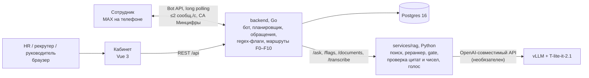

# Корсик. ИИ-помощник адаптации сотрудников ПОЛИПЛАСТИК в мессенджере MAX

Решение кейса ПОЛИПЛАСТИК на хакатоне «Открой#Моспром» 2026. Состав решения:
бот в MAX, который ведёт сотрудника от D−3 до D+90 (дни считаются от даты
выхода), сервис ответов по регламентам с проверкой цитат и чисел, разметка
свободных ответов по категориям риска и тону и веб-кабинет для HR, рекрутеров и
руководителей подразделений. Сценарий адаптации HR собирает в конструкторе или
загружает из Excel-ТЗ заказчика. Конструктор описывает это ТЗ целиком, со всеми
ветками, опросами и различиями по площадкам.

Этот README содержит полное описание решения и не требует других документов.
Тизер и презентация подаются через личный кабинет хакатона. Материалы заказчика
(Excel-ТЗ, ПВТР, три презентации) конфиденциальны и в репозиторий не входят:
импорт ТЗ и RAG проверены на них локально, а в репозитории лежит синтетика.

Центральное утверждение решения: **ИИ формулирует, код решает. Бот не отдаёт
сотруднику цитату или число, которых нет в пункте регламента; если пункта нет,
он отказывает и передаёт вопрос HR; куда уйдёт жалоба, решает таблица в коде, и
руководитель подразделения не видит ни текстов сотрудников, ни их обращений.**
Это измерено на документах заказчика: 100 % отказов на вопросах-ловушках и
попытках взлома, цитата дословно есть в пункте в 100 % ответов. Цена такой
строгости тоже измерена: на новых разговорных вопросах бот находит пункт в 13–14
случаях из 22, остальные уходят человеку.

## Запуск

Всё в Docker одной командой: Postgres, API и бот, RAG, кабинет и демо-данные.
Нужны Docker с Compose v2 и 8 ГБ памяти для Docker, около 10 ГБ на диске, `make`.
Go, Node и Python не нужны.

```bash
git clone https://github.com/kunak-agency/polyplastic-bot && cd polyplastic-bot
make rag-models   # один раз: веса bge-m3 и реранкера в services/rag/.cache (~6 ГБ)
make demo         # сборка и старт, ждёт готовности всех сервисов
# кабинет: http://localhost:18080, демо-чат сотрудника: http://localhost:18080/dev/chat
make demo-down    # остановить; make demo-clean — ещё и удалить демо-базу
```

Без `make`: `docker compose -f docker-compose.demo.yml up -d --build --wait`.
`.env` создаётся из `.env.example` сам. Без `make rag-models` RAG стартует на BM25
без реранкера: ответы с цитатой работают, перефразы распознаются хуже. Без модели
(`LLM_BASE_URL` пустой) бот отвечает дословной цитатой пункта, сценарии и
обращения работают так же.

Прод: `https://lk.plexet.ru`, вход по ролям. Логины: `hr` (руководитель HR),
`recruiter1` и `recruiter2` (рекрутеры), `manager` (руководитель подразделения).
Пароли выдаются жюри отдельно. Данные на проде синтетические.

Проверка, что стек живой:

```bash
curl http://localhost:18081/api/health      # локально: status ok, db ok, rag ok
curl https://lk.plexet.ru/api/health        # прод
```

Свой бот MAX: в `.env` вписать `MAX_BOT_TOKEN` и `MAX_BOT_USERNAME` и снова
выполнить `make demo`. Бот перейдёт с подделки MAX на живой, корневой сертификат
Минцифры (`deploy/certs/`) подключится сам. Своя модель: `LLM_BASE_URL`
(OpenAI-совместимый адрес с `/v1`), `LLM_API_KEY`, `LLM_MODEL`. Локальный запуск
без Docker описан в `make help` и в `services/rag/README.md`.

## Архитектура и стек

Проприетарное ПО не используется. Модели открытые и развёрнуты командой, внешних
ИИ-сервисов продукт не вызывает.

| Часть | Что это | Зависимости |
|---|---|---|
| `backend/` | Go: бот MAX (официальный SDK в `externalApi/max`), планировщик шагов, обращения, правила эскалации, REST кабинета, импорт и экспорт Excel | Fiber, GORM, Postgres 16 |
| `services/rag/` | Python: поиск по регламентам, проверка цитат и чисел, разметка флагов и тона (`/flags`), загрузка документов, распознавание голоса, `eval/` с наборами вопросов | bge-m3, bge-reranker-v2-m3, BM25 + pymorphy3, Tesseract, T-one через sherpa-onnx; модель T-lite-it-2.1 через OpenAI-совместимый API, необязательна |
| `frontend/` | Vue 3: кабинет по ролям и демо-чат сотрудника | Vite, pnpm |
| `deploy/` | Terraform для ВМ (`deploy/terraform/`: Postgres, API, Caddy с HTTPS), сертификат Минцифры, инициализация Postgres | Terraform, Docker |
| `data/` | `taxonomy.yaml`: категории F0–F10, маршруты, видимость; синтетические персоны | — |



Контракт между частями. Кабинет говорит с бэкендом только через REST `/api`.
Бэкенд говорит с RAG через `/ask`, `/flags`, `/documents`, `/transcribe`, закрытые
общим ключом `RAG_API_KEY`. RAG говорит с моделью по OpenAI-совместимому API, и
адрес модели задаётся одной переменной `LLM_BASE_URL`. Кабинет и MAX напрямую
не связаны, всё идёт через бэкенд.

Команды:

| Команда | Назначение |
|---|---|
| `make demo`, `make demo-down`, `make demo-clean`, `make demo-logs`, `make demo-ps` | весь стек в Docker |
| `make up`, `make env`, `make run` | Postgres и RAG в Docker, API и бот из исходников на `:8081` |
| `make seed`, `make seed-reset` | демо-сценарии «Завод GTP» и «Офис GrPP», 3 сотрудника |
| `cmd/seed -users` | демо-аккаунты кабинета, закрепление сотрудников за рекрутерами |
| `cmd/seed -people` | перенос руководителей и наставников из карточек в справочник людей |
| `cmd/seed-demo` | поток из 150 синтетических сотрудников для обзора и дайджеста |
| `cmd/tone-backfill` | проставить тон старым ответам без вызова модели |
| `make test`, `make check` | go vet и go test; перед пушем ещё gofmt и поиск секретов |
| `make rag-models` | скачать веса моделей RAG |

Тесты: 313 тестовых функций Go (интеграционные идут на Postgres), 280 тестов
pytest в `services/rag`, 127 тестов кабинета. Тесты кабинета и сбор pytest
проверены 24.10, все тесты кабинета зелёные.

## Описание решения

Раздел самодостаточен: решение можно понять и оценить, не открывая код.

### Постановка и главный вывод

У ПОЛИПЛАСТИК работает бот адаптации в Telegram. Его нужно перенести в MAX и
добавить ИИ: ответы на вопросы по непубличной базе знаний, разбор свободных
ответов и эмоций, передачу человеку, управление процессом для рекрутеров. В
группе больше 8 000 человек и 33 завода. У рабочего в цеху часто нет ПК, но
есть телефон, поэтому мессенджер для него и есть рабочее место.

Кейс называет две главные боли. Первая: в Telegram нет корпоративного контура и
нет ИИ-слоя для свободного текста. Вторая: любое изменение сценария требует
программиста. Отсюда два решения, на которых держится проект:

1. Исполняем сценарий заказчика, а не свой. Excel-ТЗ импортируется в конструктор:
   21 блок, 57 шагов, 29 веток, 5 опросов на 30 вопросов. Выгрузка обратно в
   Excel и повторный импорт дают 0 расхождений.
2. Модели не доверяем ничего, что можно решить кодом. Модель пишет текст ответа,
   переформулирует вопрос, размечает категорию и тон. Код решает, отдать ли
   ответ, куда уйдёт обращение, что скрыть от руководителя и когда отправить
   шаг. Без модели продукт работает, просто отвечает цитатой.

### Путь сотрудника от D−3 до D+90

Рекрутер заводит сотрудника в кабинете и отправляет ему персональную ссылку или
QR (QR в оффере требует само ТЗ). Сотрудник открывает ссылку в MAX и нажимает
«Начать». Без ссылки бот его не привяжет и сам никому не пишет. Дальше
знакомство: «ты» или «вы», согласие на обработку данных до первого диалога.

За три дня до выхода бот присылает пакет D−3: что взять с собой, как добраться,
три факта о компании. Каждый шаг уходит в рабочее время площадки, по поясу
площадки или сотрудника, пн–пт 8–18, с учётом праздников РФ. Шаг, выпавший на
выходной, переносится. Перенос даты выхода пересчитывает неотправленные шаги без
дублей.

Блок сообщений сотрудник листает кнопкой «Дальше →». Подряд без его участия
уходит не больше двух сообщений, нажатая кнопка правится в итог. Вопрос с
кнопками держит поток не дольше 48 часов. По ходу адаптации, в первые дни,
через две недели и позже, бот задаёт пульс-опросы со шкалами и ветками по
вариантам. Ответ «своими
словами» размечается по категориям риска и тону. Если оценка низкая и причина
неясна, бот задаёт один уточняющий вопрос с кнопкой «Не хочу отвечать».

В любой момент сотрудник может спросить своими словами, текстом или голосом. Бот
отвечает по регламенту реплаем на его сообщение и указывает пункт-источник,
«Подробнее» показывает дословную цитату. Если пункта нет, бот так и говорит и
предлагает передать вопрос HR. HR отвечает из кабинета, сотрудник получает ответ
в MAX с подписью исполнителя и закрывает вопрос сам. После решения приходит «По
вашему сигналу: что сделано».

Если сотрудник молчит, бот напоминает через 4 и 24 часа в рабочее время, не
чаще раза в день, затем помечает «не отвечает» и ставит задачу рекрутеру.
Молчащий сотрудник не тормозит рассылку остальным. Если приглашение приняли
поздно, обязательные вопросы приходят по одному блоку в день, опросы старше 7
дней пропускаются. Руководителю подразделения плановые поводы для встречи
приходят на D+14, D+30 и D+87. На D+87 он выбирает «Оставить / Продлить /
Обсудить с HR», и решение по испытательному сроку сохраняется.

### Роли и экраны

Вход по логину и паролю, сессия 12 часов. Меню строится по роли: каждый видит
только свои разделы, по прямой ссылке чужой экран тоже не откроется.

| Роль | Стартовый экран | Что видит и делает |
|---|---|---|
| Рекрутер | «Сегодня» | только закреплённые за ним сотрудники; 7 типов строк, 6 плиток-фильтров, строка «бот сам: N»; «Связаться / Напомнить / Взять», «Отметить: связался»; утренняя сводка в MAX. Разделы «Обращения», «Новые сотрудники», «Аналитика», «Обзор площадок», «Сценарии», «База знаний», «Медиатека» |
| Руководитель HR | «Сегодня» | 4 типа строк, 6 плиток, карточка дайджеста. Страница «Команда»: нагрузка рекрутеров без рейтингов и вкладка руководителей подразделений, оттуда открывается вид руководителя. Массовое переназначение сотрудников, пользователи в «Настройках». Экран «Показатели» за 30 дней, 90 дней или квартал: подключение до выхода, отклик на пульс, доля вопросов, закрытых ботом, первый ответ HR, воронка от приглашения до решения по ИС, площадки относительно среднего по компании, темы с динамикой. Исходы, для которых данных ещё нет (ИС, ранний уход), подписаны «появится» |
| Руководитель подразделения | «Мои сотрудники» | только свои подчинённые: этап, пульс значком, повод для встречи, решение по ИС. Тексты ответов, обращения и тон сервер ему не отдаёт |

Руководители и наставники заведены как люди в справочнике (`/api/people`), а не
строкой в карточке: карточка сотрудника ссылается на них, и руководитель видит
своих подчинённых по ссылке, а не по совпадению ФИО. Исполнитель обращения,
кнопка «Это я», подпись ответа в MAX и авторы заметок берутся из входа, а не
вводятся руками.

Карточка сотрудника: траектория шагов с временем по поясу сотрудника, «Машина
времени» (прокрутить 90 дней за минуту и посмотреть, что ушло в MAX), история
напоминаний, «догоняет N из M», пять последних значков тона с подписью
«подсказка, не оценка», загрузка личного адаптационного плана. Карточка
обращения: сводка модели, цитата, значок тона, полный текст по клику, срок
реакции, «Решить» с полем «что сделано».

### Требования кейса и как они отражены

Метки проверки: «живой MAX» — пройдено на телефоне в настоящем MAX; «кабинет» —
проверено в браузере на настоящем сервере или тестами; «подделка MAX» — бот
прошёл путь целиком, но вместо MAX работала наша имитация (демо-чат, тесты).

| Требование кейса (пересказ) | Как отражено в решении | Где проверено |
|---|---|---|
| Роль 01. Сотрудник в первый день спрашивает своими словами и получает инструкцию | вопрос → поиск по регламентам → ответ с пунктом и цитатой; нет пункта — отказ и передача HR. Инструкции по корпоративному порталу среди полученных документов нет, поэтому такой вопрос бот честно передаст HR. Кнопки «Открыть документ» со ссылкой на файл нет | живой MAX на синтетике, замеры на документах заказчика |
| Роль 02. HR видит, кто на каком этапе и где трудно, и подключается только в нестандартных случаях | «Сегодня» рекрутера, «Обзор площадок» с этапами, зонами риска, тепловой картой и тоном за неделю, обращения со сроком реакции | кабинет, синтетика |
| Роль 03. Руководитель подразделения видит статус своего сотрудника и получает напоминания о встрече 1:1 | вход под ролью, только свои подчинённые без текстов и обращений; плановые поводы D+14, D+30, D+87 в MAX, решение по ИС | кабинет; push в MAX — подделка MAX |
| Роль 04. Руководитель подбора получает еженедельный дайджест: темы и зоны риска | дайджест по понедельникам в 9:00 и в разделе «Аналитика»: темы, зоны риска, площадки, динамика, тон, «Сделано по темам». Числа и темы считает код, модель пишет связный текст, код сверяет в нём каждое число. Группы меньше 5 человек скрыты | кабинет; отправка в MAX — подделка MAX |
| Бот в MAX вместо Telegram с учётом ограничений платформы | официальный Go-клиент MAX, long polling, не больше 2 сообщений в секунду на диалог, обработка 429, сертификат Минцифры, реплаи | живой MAX |
| Проактивные рассылки по таймлайну D−3…D+90 | планировщик в днях от даты выхода, рабочие часы и пояс площадки, праздники РФ | живой MAX до D−1, кабинет, подделка MAX до D+92 |
| Персонализация по площадкам | у шага, варианта опроса и файла медиатеки свои площадки (GrPP, Luzhniki, GTP). Поиск по регламентам площадку не учитывает | кабинет, подделка MAX |
| Ответы на свободные вопросы по базе знаний (RAG) | гибридный поиск, реранкер, порог 0,2, словарь кадрового сленга, переформулировка вопроса с подтверждением | замеры на документах заказчика, живой MAX на синтетике |
| Строгий контроль выдумок | нет пункта выше порога — отказ; цитата и каждое число сверяются с пунктом; темы взысканий, коммерческой тайны и охраны — только дословной цитатой | ловушки и инъекции 100 % на обоих наборах |
| Анализ настроений, красные флаги HR | категории F0–F10 и тон у каждого текста, уточняющий вопрос, недельный агрегат при n ≥ 5, зоны риска с одной причиной словами | кабинет; путь «телефон → тон → агрегат» — подделка MAX |
| Бесшовная передача живому HR | отказ или кнопка → обращение со сроком реакции → HR отвечает из кабинета → ответ в MAX с подписью → «Вопрос закрыт» | живой MAX |
| Карточки, вложения, кнопки эскалации | кнопки эскалации везде; медиатека хранит свой файл на каждую площадку. Настоящих картинок и PDF в ТЗ нет, только имена; 16 картинок Корсика заказчик прислал отдельно | кабинет; вложения в живом MAX не проверены |
| Кнопочное меню и свободный диалог вместе | кнопки сценария и опросов, команды `/food`, `/hr`, `/help`, свободный вопрос в любой момент | живой MAX |
| Корпоративный стиль ответов | ответ строится только по пункту, форма «ты» или «вы» по выбору сотрудника, ответ в чужой форме код откатывает на цитату, длина до 700 символов | стилевого гида заказчика у нас нет, совпадение с ним не проверено |
| HR сам обновляет базу знаний без кода | «База знаний»: перетащить PDF (в том числе скан), PPTX, XLSX, проверочный вопрос, версии, «вопросы без ответа». Файл до 20 МБ | кабинет |
| Менять сценарии и добавлять площадки без программиста | конструктор, импорт и экспорт Excel, медиатека; площадки — данные, а не код | кабинет: 7 сложных конструкций ТЗ собраны только кликами |
| Старый Excel-сценарий заказчика | импорт находит колонки по словам, больше 50 предупреждений со ссылкой на строку ТЗ, экспорт обратно в формат ТЗ | кабинет, подделка MAX |
| Масштаб на всю группу | площадки — данные, сценарии копируются, модель меняется одной настройкой | нагрузочного теста нет |

### RAG и контроль галлюцинаций

Поиск гибридный: BM25 с морфологией и эмбеддинги bge-m3, затем реранкер выбирает
пункт, затем gate с порогом 0,2 решает, есть ли ответ вообще. Порог подобран на
реальном корпусе: худшая ловушка («компенсируют ли проезд») набирает 0,102 и
не проходит. Словарь кадрового сленга переводит
разговорные слова сотрудника на язык регламента.

Модель получает только найденный пункт и пишет по нему ответ. Код проверяет, что
цитата дословно есть в пункте и что каждое число из ответа есть в цитате. Не
прошло, или модель не ответила за `LLM_TIMEOUT`, — сотрудник получает дословный
пункт. Так же устроены остальные места с моделью: переформулированный вопрос
засчитывается, только если пункт нашли два разных запроса и модель ответила по
нему на исходный вопрос; вариант текстов на «вы» сверяется по числам, ссылкам и
подстановкам; текст дайджеста — по каждому числу из агрегатов.

Переформулировка без этих защит пропускала 20 % ловушек. С защитами ловушки
вернулись к 100 %.

Корпус заказчика: ПВТР (скан 23 страниц, OCR), антикоррупционная политика,
положение о коммерческой тайне, политика качества и экологии, всего 102
фрагмента. Основной набор — 60 вопросов (21 дословный, 26 разговорных, 10
ловушек, 3 инъекции). Отложенный — 34 вопроса, составлен до подбора словаря (22
новых перефраза, 10 ловушек, 2 инъекции). Корпус и наборы вне git.

| Метрика | Основной, до | Основной, после | Отложенный, после |
|---|---|---|---|
| Ответ с верным пунктом | 68 % | 91 % | около 60 % новых перефразов (13–14 из 22) |
| Разговорные перефразы | 42 % | 85 % | 59–64 % |
| Отказ на ловушках | 100 % | 100 % | 100 % |
| Инъекции отбиты | 100 % | 100 % | 100 % |
| Цитата дословно есть в пункте | 100 % | 100 % | 100 % |
| 95 % ответов быстрее | 4,6 с | 5,6 с | 5,9 с |

«До» — поиск с реранкером, «после» — плюс словарь и переформулировка. Честная
цифра для новых вопросов — отложенный набор: словарь писался после разбора
ошибок основного набора и на нём завышает результат. Без модели, только со
словарём, на основном наборе 89 % верных пунктов и 100 % отказов на ловушках.

Что уходит человеку: длинные пункты о запретах, вопросы на стыке двух
документов, ответы, где модель берёт число с соседнего слайда. Это ошибка в
безопасную сторону.

### Сигналы риска и эскалация

Свободный текст сначала проверяют регулярные выражения в Go на грубость и
харассмент (F5), намерение уйти (F7) и коррупцию или нарушения ТБ (F9): эти
случаи уходят по маршруту до модели.
Затем модель размечает текст по таксономии F0–F10 (`data/taxonomy.yaml`), ставит
тон (позитив, нейтрально, негатив), пишет сводку и цитату для обращения.

Маршрут задаёт таблица в коде, а не модель. F5 и F9 получают пометку
«конфиденциально»: текст сотрудника скрыт, обращение уходит в службу
безопасности, руководителю не показывается. F0, F4, F10 скрыты только от
руководителя. Тревожный вариант в опросе не заводит обращение сам: он ставит
сигнал в карточку, зону риска и дайджест, а обращение появляется по нажатию
сотрудника или его тексту. У «проблемного» сотрудника в сверке ТЗ стало 8
обращений на 8 его действий, было 12.

Зона риска появляется при первом сигнале (низкая оценка, тревожный вариант, флаг,
молчание после двух напоминаний), а не после увольнения. У сотрудника одна зона
и одна причина словами. Не считаются обращения, закрытые в срок, и опросы
младше 48 часов. На синтетическом потоке в зоне риска 21 % сотрудников вместо
58 % у первой версии правил.

Тон служит подсказкой HR. Индекса настроения человека нет, в
решениях по испытательному сроку тон не участвует, агрегат показывается только
от 5 человек за неделю.

### Конструктор сценариев и Excel

Сценарий — это блоки сообщений на день и время от даты выхода. В конструкторе
есть ветки кнопок (до двух реплик и действие), общая ветка на несколько кнопок,
опросы с веткой и флагом на каждый вариант, несколько ответов и «свой вариант»,
правила после опроса с «ЛИБО» и «+», разные тексты и варианты по площадкам, ввод
текста и фото от сотрудника, личный файл плана из карточки, шаг «по отмашке
рекрутера», команды сценария и правила напоминаний. Шаг открывается в широком
окне рядом с превью телефона, есть вид «Таймлайн», публикация версии показывает
сводку изменений.

Импорт Excel-ТЗ находит колонки по словам и пишет отчёт: блоки, шаги и
предупреждения со ссылкой на строку ТЗ, клик по строке открывает шаг.
Предупреждения ловят дыры самого ТЗ: нет маршрутов транспорта (строки r11–r13),
карт территории (r20–r21), PDF «где пообедать» (r26–r28), презентации (r32),
образца мини-резюме (r34), расписания спортзала (r37), фото (r45); два
приветствия подряд (r50/r51), упомянут опрос, которого нет (r58), смешаны «ты» и
«вы» (r23, r47). Логины и пароли (r18) бот не шлёт сознательно, письмо HR (r19)
становится задачей HR. Где материала нет, бот честно говорит об этом и даёт
кнопку «Спросить HR».

ТЗ написано на «ты». Кнопка в отчёте импорта просит модель сделать вариант на
«вы» в нейтральном роде, код проверяет числа, ссылки, подстановки, эмодзи, длину
и что «ты» не осталось. На файле заказчика: 83 правки, ни одного «ты». Не
прошло — текст остаётся прежним с бейджем «ИИ — проверьте».

Экспорт выгружает сценарий обратно в формат ТЗ плюс лист «Корсик — расширения».

### Ключевые результаты

| Показатель | Значение | Природа |
|---|---|---|
| Импорт Excel-ТЗ | 21 блок, 57 шагов, 29 веток, 5 опросов на 30 вопросов, 2 правила, 2 команды | измерено на файле заказчика |
| Excel → конструктор → Excel | 0 расхождений | измерено на синтетике и файле заказчика |
| Сверка ТЗ построчно | 70 строк, 3 площадки, 18 сотрудников, D−3…D+92 | измерено на подделке MAX (`TestTZConformance`) |
| Сообщений активному сотруднику | 55–62 за испытательный срок (GTP 55, GrPP 60, Luzhniki 62) | измерено на подделке MAX |
| Молчащий сотрудник | 33–35 сообщений и напоминания об опросах (до исправления 1 за 90 дней) | измерено на подделке MAX |
| Верный пункт, основной набор | 91 % (перефразы 42 → 85 %) | измерено на документах заказчика |
| Верный пункт, новые перефразы | около 60 % (13–14 из 22) | измерено, отложенный набор |
| Отказ на ловушках и инъекциях | 100 % (20 ловушек, 5 инъекций) | измерено, оба набора |
| Без модели | 89 % верных пунктов, ловушки 100 % | измерено, основной набор |
| 95 % ответов с моделью быстрее | 5,6 с | измерено на документах заказчика |
| Ответ в живом MAX | 2,3 с | измерено, синтетический регламент |
| Тон текста | accuracy 0,92, macro-F1 0,92 (±7 п. п.) | синтетика: 50 придуманных текстов, один разметчик |
| Флаги F0–F10 | критические F0/F5/F7/F9: точность 1,00, полнота 0,91; ложных флагов на чистых текстах 0 из 15 | синтетика: 60 придуманных текстов, один разметчик |
| Вариант текстов на «вы» | 83 правки, ни одного «ты» | измерено на файле заказчика |
| Зона риска | 21 % потока вместо 58 % | синтетика, 150 сотрудников; пороги экспертные |
| Голос | фраза 3,6 с распознаётся за 0,96 с | измерено на GPU-сервере, на телефоне не проверено |
| Эффект в год | ≈ 7–8 млн ₽ | допущение, раздел «Экономика» |

### Аналоги

Сравнили 12 решений: российские HCM (Поток Адаптация, Пульс, Websoft,
Mirapolis), VK WorkSpace AI, Yva.ai, заказной бот в MAX, конструкторы ботов для
MAX, западные платформы (Enboarder, Moveworks, Leena AI, Paradox). HCM-системы
живут в портале, а у рабочего в цеху портала нет. Конструкторы для MAX считают
паузы в минутах, а адаптация считается в днях от выхода. Ближе всех Leena AI,
но он работает в Teams и Slack, в России недоступен и Excel-сценарий HR не
принимает. Ни одно из решений не объединяет сценарий от даты выхода, ответы по
регламентам с проверкой цитаты, передачу сигнала нужной роли и работу в MAX.
Отметки поставлены только по открытым источникам.

● есть · ◐ частично или заявлено · ○ нет · ? нет данных

| Решение | Канал | Сценарий от даты выхода | Конструктор без кода | Ответы по регламентам | Сигналы риска и тон | Передача человеку | Кабинет по ролям | В MAX, в РФ |
|---|---|---|---|---|---|---|---|---|
| Поток Адаптация | своё приложение | ● | ◐ | ○ | ◐ | ○ | ● | ○ |
| Пульс (Сбер) | веб, моб. | ? | ? | ○ | ◐ | ○ | ● | ○ |
| Websoft HCM | портал | ◐ | ◐ | ◐ | ◐ | ? | ● | ○ |
| Mirapolis HCM | портал | ◐ | ? | ○ | ○ | ○ | ● | ○ |
| VK WorkSpace AI | свой мессенджер | ○ | ○ | ● | ○ | ○ | ○ | ○ |
| Yva.ai | опросы | ● | ○ | ○ | ● | ◐ | ● | ○ |
| Заказной бот «Жилсервис» | MAX | ◐ | ○ | ○ | ○ | ◐ | ○ | ● |
| Конструкторы MAX (Botman, Salebot, BotHelp) | MAX, TG, VK | ○ | ● | ◐ | ○ | ◐ | ◐ | ● |
| Enboarder | SMS, Slack, Teams | ● | ◐ | ◐ | ○ | ○ | ● | ○ |
| Moveworks | Teams, Slack | ◐ | ○ | ● | ○ | ◐ | ● | ○ |
| Leena AI | чат, голос | ● | ◐ | ● | ● | ● | ● | ○ |
| Paradox | SMS | ● | ○ | ◐ | ○ | ● | ● | ○ |
| **Корсик** | **MAX + кабинет** | **●** | **●** | **●** | **●** | **●** | **●** | **●** |

Та же таблица картинкой для слайда: `docs/competitors.png`.

## Воспроизводимость и проверка

```bash
make test                                   # из корня: go vet + go test бэкенда на Postgres
cd frontend && pnpm test                    # 127 тестов кабинета
cd services/rag && .venv/bin/python -m pytest -q   # 280 тестов поиска
```

| Команда | Что сверяет |
|---|---|
| `make test` | правила планировщика (рабочие часы, пояса, праздники, перенос без дублей), маршруты эскалации и видимость по ролям, импорт и экспорт Excel по кругу, зоны риска, дайджест, тон |
| `pnpm test`, `pnpm lint`, `pnpm type-check`, `pnpm build` в `frontend/` | видимость разделов по ролям, форматирование, сборку кабинета |
| `./run.sh eval --configs bm25,final -v` в `services/rag/` | RAG на синтетическом регламенте из репозитория: верный пункт, ловушки, инъекции, дословность цитаты |
| `./run.sh eval --real --configs final+llm,final+llm+syn+rw -v` | то же на документах заказчика; нужны `corpus-real/`, `eval/golden-real.csv` и `LLM_BASE_URL` |
| `./run.sh eval --real --golden eval/golden-real-holdout.csv --configs final+llm+syn+rw` | отложенный набор |
| `.venv/bin/python -m eval.sentiment`, `.venv/bin/python -m eval.flags_eval` | тон и флаги на придуманных текстах против живого `/flags` |
| `TZ_XLSX=… CONFORM_DATABASE_URL=… TZ_JOURNAL=<каталог вне репо> go test ./services -run TestTZConformance -timeout 60m` в `backend/` | сверка бота с Excel-ТЗ: импорт, публикация, 18 сотрудников, машина времени до D+92, итог по каждой строке |

Синтетические наборы и синтетический регламент лежат в репозитории, так что
прогон eval на синтетике воспроизводится на машине проверяющего. Прогоны на
документах заказчика и сверка ТЗ требуют его файлов: без `TZ_XLSX` тест
пропускается. Журнал сверки пишется вне репозитория, потому что в нём тексты ТЗ.

Ответы модели при temperature 0.1 немного меняются от прогона к прогону. Отсюда
разброс 59–64 % на отложенном наборе.

## Ограничения и допущения

| Допущение | Значение | Направление ошибки |
|---|---|---|
| Рутина HR на одного сотрудника | 4 ч (диапазон 2–8) | главное допущение экономики, может завышать эффект; цифру кейсодержатель не дал |
| Новых сотрудников в год | ≈ 2 200 = 8 500 × 26 % | по найму в обрабатывающих производствах, не по данным компании |
| Доля вопросов, которые снимает бот | 70 % — цель заказчика | наши 91 % и около 60 % — доля верных пунктов на наборах вопросов, а не на журнале реальных вопросов сотрудников |
| Точность тона | 0,92 на 50 придуманных текстах | реальные ответы сотрудников разнообразнее, точность на них, скорее всего, ниже |
| Пороги зон риска | экспертные | не откалиброваны на реальном потоке |
| Рабочие дни и месяцы ТЗ | рабочий день = календарный, месяц = 30 дней | шаги могут прийти на день раньше, чем по производственному календарю |
| Конец испытательного срока | D+89 по ТЗ, а не из карточки | если D+89 выпал на выходной, сообщение уходит уже после срока |

Проверено только на подделке MAX, в настоящем MAX не прогонялось:

- импортированный сценарий из Excel-ТЗ (в живом MAX пройден базовый путь на
  синтетическом сценарии: ссылка, «вы», согласие, шаги до D−1, ответ с пунктом,
  отказ, обращение, ответ HR с подписью, «Вопрос закрыт»);
- дайджест руководителю подбора и утренняя сводка рекрутеру;
- push руководителю на D+14, D+30, D+87 и D+1;
- напоминания 4 ч и 24 ч, поздний вход, уточняющий вопрос (на проде выключены до
  прогона на телефоне, потому что включение пишет живым людям);
- «По вашему сигналу: что сделано»;
- голосовые (на записях работает, на телефоне не проверено), «печатает» и
  обработка 429.

На проде включены реплаи, вход и роли, пояса и окно 8–18, зоны риска v2.

Чего нет: входа через систему учётных записей заказчика и отдельной роли СБ;
карточек обращений в групповые чаты HR и СБ (код есть, нужны идентификаторы
чатов); учёта площадки в поиске по регламентам; группировки текстов, которые не
попали ни в одну категорию; интеграции с 1С ЗУП и нагрузочного теста. Уведомление
руководителю из обращений F1, F2, F6 пишется только в журнал сервера.

Сознательно не делаем: эмоции по голосу и лицу, идентификацию по голосу (это
биометрия), индекс настроения отдельного человека, автоматические решения о
сотруднике. Модель только подсвечивает, решает человек.

## Безопасность и ПДн

| Вопрос | Как сейчас |
|---|---|
| Что уходит в модель | текст вопроса и найденные пункты (`/ask`), текст свободного сообщения (`/flags`), тексты сценария для варианта на «вы», агрегаты недели без имён для дайджеста. ФИО, телефон и поля карточки не передаются. Маскирования имён внутри текста вопроса нет |
| Где модель | на хакатоне открытая модель развёрнута командой на арендованной GPU, поиск и голос — на втором арендованном GPU-сервере, бэкенд и база — на ВМ. При проверке на материалах заказчика фрагменты регламентов и тексты ТЗ обрабатывала эта модель. В пилоте модель ставится в контур заказчика или в российское облако одной переменной `LLM_BASE_URL` |
| Согласие | до первого диалога; текст вопросов сохраняется только при действующем согласии. Отдельный документ согласия должен дать работодатель |
| Видимость | F5 и F9 скрыты от всех, кроме HR-партнёра и СБ; F0, F4, F10 скрыты от руководителя. Под ролью руководителя подразделения сервер не отдаёт тексты, обращения и тон |
| Обезличивание | порог анонимности 5 в обзоре и дайджесте; «вопросы без ответа» маскируют имена, телефоны, почты и номера; у F10 (здоровье) цитаты нет |
| Логи | RAG пишет в лог только `trace_id`, решение, скор и номера пунктов, без текста вопросов |
| Открытые вопросы | телефон сотрудника хранится открытым текстом; текст в открытом обращении хранится всегда, у F10 это сведения о здоровье. Согласовать с юристом до пилота |
| Данные в репозитории | только синтетика: регламент, сценарии, сотрудники с пометкой «(синтетика)» в ФИО и телефонами `+7 000 …`. Материалы заказчика в `.gitignore` и `.dockerignore` |

## Экономика

Все цифры — допущения, пока кейсодержатель не дал своих.

| Параметр | Значение | Откуда |
|---|---|---|
| Новых сотрудников в год | ≈ 2 200 | 8 500 × 26 % (коэффициент найма в обрабатывающих производствах по Росстату) |
| Рутина HR на сотрудника | 4 ч (2–8) | главное допущение |
| Доля вопросов, которые снимает бот | 70 % | цель заказчика |
| Экономия HR-времени | ≈ 6 160 ч ≈ 5,9 млн ₽ в год | ставка ≈ 950 ₽/ч |
| Эффект удержания | 1–2 млн ₽ в год | 18 % уходят из-за плохой адаптации (KORUS, 2022), замена от 100 тыс. ₽ |
| Затраты | своя GPU ≈ 1 млн ₽ или облачный API 15–180 тыс. ₽ в год; пилот 8 недель 1,2–2 млн ₽ | оценка |

Облачные API дешевле своей GPU. Довод за свой контур — риск: штраф за утечку
ПДн (от 3 млн ₽) больше трёхлетней стоимости своей карты. Контур выбирает ИБ
заказчика.

План пилота на одном заводе, 8 недель: недели 1–2 — корпоративный бот MAX, чаты
HR и СБ, материалы медиатеки, модель в контуре; 3–4 — остальные регламенты,
замер на журнале вопросов текущего бота, вход через систему заказчика, роль СБ;
5–6 — реальный поток сотрудников, калибровка тона, флагов и зон риска; 7–8 —
голосовые, нагрузочный тест, замер KPI (доля вопросов без HR, время первого
ответа HR, доля прошедших D+30 и D+90).

## Использованные ИИ-инструменты

Раскрытие по Положению, пп. 4.3.3 и 4.3.4.

| Инструмент | Где | Для чего |
|---|---|---|
| T-lite-it-2.1 (Т-Банк, Apache-2.0), FP8 на vLLM | в продукте | ответ по найденному пункту, переформулировка вопроса, флаги и тон, вариант текста на «вы», текст дайджеста. Код проверяет каждый её ответ |
| BAAI/bge-m3 (MIT) | в продукте | эмбеддинги для поиска по регламентам |
| BAAI/bge-reranker-v2-m3 (Apache-2.0) | в продукте | выбор пункта регламента из кандидатов |
| T-one (Т-Банк) через sherpa-onnx | в продукте | распознавание голосовых на своём сервере |
| Tesseract OCR (Apache-2.0) | в продукте | чтение сканов без текстового слоя |
| ИИ-ассистенты для программирования | разработка | код, тесты и документация под контролем команды |
| Внешний ИИ-ресерч | аналитика | анализ рынка, аналогов, права, UX ролей; факты для питча перепроверены по первоисточникам |

Код интеграции с ИИ лежит в репозитории: `services/rag/llm.py`, `flags.py`,
`rewrite.py`, `asr.py`, `backend/externalApi/`.

Что делали люди. Архитектуру, стек, правила маршрутизации жалоб, видимость по
ролям и приоритеты задавала команда. Люди принимали каждую волну изменений:
проверяли путь сотрудника на телефоне в живом MAX, проходили кабинет по ролям,
сверяли числа в README с прогонами и решали открытые вопросы по данным
заказчика.

Создано с помощью ИИ под контролем команды: код всех частей; синтетические
данные (регламент, персоны, наборы вопросов, демо-сотрудники, тексты для оценки
тона); тексты демо-сценариев, продуктовые промпты и документация, включая этот
README. В продукте модель генерирует вариант текстов на «вы» и текст дайджеста,
код их проверяет. Картинки Корсика предоставлены заказчиком, ИИ их не создавал.

## Самооценка по критериям

Оценка команды по критериям Положения, п. 6.4: от 0 до 3 баллов по каждому из
семи критериев, без весов.

| Критерий | Максимум | Самооценка | Обоснование |
|---|---|---|---|
| Прототип | 3 | **2** | у каждой функции указано, где она проверена; базовый путь пройден в живом MAX; ТЗ сверено по 70 строкам; но сценарий ТЗ и почти вся итерация 24.10 проверены только на подделке MAX |
| Решение основной проблемы | 3 | **3** | бот в MAX, сценарий заказчика целиком, ответы по его регламентам с проверкой кодом, категории риска и тон, передача человеку, управление по ролям |
| Разработка и внедрение | 3 | **2** | `make demo` одной командой, прод через Terraform, новые функции за флагами, одна GPU на 24 ГБ; экономика держится на допущениях |
| Новаторские идеи | 3 | **2** | проверка цитат и чисел кодом, переформулировка с подтверждением, Excel без потерь, плановые поводы всем руководителям; связку «ответ по базе + оператор» уже показывали другие команды |
| UI/UX | 3 | **3** | реплаи, «Дальше →», кнопка правится в итог, уточнение с отказом; меню и экраны по ролям, превью телефона в конструкторе |
| Второстепенные проблемы | 3 | **3** | согласие, жалобы мимо руководителя, порог анонимности, пояса и праздники, напоминания без спама, поздний вход, молчун не тормозит остальных, работа без модели |
| Аналитика | 3 | **2** | роли и аудитория, данные об адаптации на заводах, 12 аналогов, построчный разбор ТЗ; данных о текущем боте заказчика нет |

Итого: **17 из 21**. Реалистичный потолок — 19: «Прототип» до 3 после прогона
новых функций на телефоне, «Аналитика» до 3 при данных о текущем боте заказчика.

### Обоснование оценок по пунктам

Для каждого критерия: что требует формулировка, на что опирается оценка и где
это проверить в репозитории или на проде.

#### Прототип (2 из 3)

Требование критерия. Соответствие работающего прототипа заявленному: оценка
снижается, если обещано больше, чем работает.

Основание оценки. В живом MAX на телефоне пройден путь от ссылки-приглашения до
ответа HR с подписью, включая ответ по пункту регламента за 2,3 с и отказ на
ловушке. Сценарий заказчика сверен построчно по 70 строкам на 18 сотрудниках и
трёх площадках. Прод работает на `https://lk.plexet.ru` с включёнными реплаями,
ролями, поясами и зонами риска v2. Балл снижен, потому что
импортированный сценарий, дайджест, push руководителю, напоминания, поздний вход
и голос проверены только на подделке MAX. Полный список приведён в разделе «Ограничения и допущения».

Где проверить. Прод по ролям; `backend/services/tz_conformance_test.go`;
`backend/externalApi/max/`; раздел «Ограничения и допущения».

#### Решение основной проблемы (3 из 3)

Требование критерия. Закрыта ли главная проблема кейса: бот в MAX и ИИ для
свободного текста и эмоций.

Основание оценки. Бот работает в MAX и исполняет сценарий заказчика из его же
Excel. ИИ отвечает только по регламентам заказчика, и на них измерено: 91 %
верных пунктов на основном наборе, около 60 % на новых перефразах, 100 % отказов
на ловушках. Свободные ответы размечаются по 11 категориям и тону, после низкой
оценки бот задаёт уточняющий вопрос, сигнал уходит нужной роли. Слабое место:
тон измерен на 50 придуманных текстах одним разметчиком (±7 п. п.).

Где проверить. `services/rag/` (`pipeline.py`, `verify.py`, `flags.py`);
`backend/services/bot_flags.go`, `clarify.go`, `overview_tone.go`; прод: «Обзор
площадок», карточка обращения.

#### Разработка и внедрение (2 из 3)

Требование критерия. Оправдывает ли эффект затраты на разработку и внедрение.

Основание оценки. Стек поднимается одной командой `make demo`. Прод развёрнут
через Terraform со сборкой из чистого дерева и копией базы перед каждым
выкатом. Новые функции включаются флагами `FEATURE_*` по одной, откат —
выключить флаг. Модель меняется одной переменной, без неё продукт работает.
Расчёт эффекта ≈ 7–8 млн ₽ в год против пилота 1,2–2 млн ₽ и своей GPU ≈ 1 млн ₽.
Балл не максимальный: эффект держится на допущениях (4 ч рутины HR на
сотрудника, 2 200 новых сотрудников в год), своих цифр кейсодержатель не дал.

Где проверить. `Makefile`, `docker-compose.demo.yml`, `deploy/terraform/`;
раздел «Экономика».

#### Новаторские идеи (2 из 3)

Требование критерия. Собственные идеи, а не копия существующего.

Основание оценки. Код проверяет каждую цитату и каждое число в ответе модели и
при провале отдаёт дословный пункт. Вопрос переформулируется, но пункт отдаётся
только после подтверждения двумя запросами и моделью. Вариант на «вы» пишет ИИ,
проверяет код. Шаги считаются в рабочих днях от даты выхода с поясом площадки,
а не в минутах воронки. Excel и конструктор переводятся друг в друга без потерь.
Плановые поводы для встречи приходят всем руководителям, чтобы по молчанию бота
нельзя было угадать жалобу. Балл не максимальный: сама связка «ответ по базе
знаний и передача оператору» на хакатонах уже встречалась.

Где проверить. `services/rag/verify.py`, `rewrite.py`;
`backend/services/scenario_xlsx_export.go`, `manager_rules.go`.

#### UI/UX (3 из 3)

Требование критерия. Проработанность пользовательского интерфейса.

Основание оценки. В боте: ответы реплаем на сообщение сотрудника, блок
листается «Дальше →», нажатая кнопка правится в итог, один уточняющий вопрос с
«Не хочу отвечать», «Что вы пропустили» при позднем входе. В кабинете: меню по
ролям, экран «Сегодня» под рекрутера и руководителя HR с плитками-фильтрами,
«Команда» для руководителя HR, «Мои сотрудники» для руководителя подразделения,
карточка обращения со сводкой и цитатой, время по поясу сотрудника, конструктор
с превью телефона, отчёт импорта со ссылкой на шаг. Оговорка: экраны проверены
на синтетических данных.

Где проверить. Прод тремя логинами в трёх окнах браузера с одним сотрудником;
`frontend/src/lib/roles.ts`, `frontend/src/pages/`.

#### Второстепенные проблемы (3 из 3)

Требование критерия. Решение второстепенных проблем из кейса и найденных
командой.

Основание оценки. Закрыты второстепенные проблемы кейса: нет ранних сигналов
(зона риска по первому сигналу), масштабирование требует программиста
(конструктор, Excel, база знаний, медиатека), HR тратит время на разбор
текстов (разметка и дайджест). Найдены и закрыты свои: согласие до первого
диалога, жалобы F5 и F9 мимо руководителя, руководитель не видит текстов и тона,
порог анонимности 5, пояса и праздники РФ, напоминания не чаще раза в день,
поздний вход без потери обязательного, молчун не тормозит остальных (было 1
сообщение за 90 дней, стало 33–35), обращение по действию сотрудника, а не по
каждому варианту, логины и пароли бот не шлёт, без модели бот работает. Слабое
место: телефон сотрудника хранится открытым текстом.

Где проверить. `data/taxonomy.yaml`, `backend/services/scheduler_tz.go`,
`scheduler_nudges.go`, `scheduler_catchup.go`, `backend/handlers/auth.go`;
раздел «Безопасность и ПДн».

#### Аналитика (2 из 3)

Требование критерия. Исследование аудитории, проблем UX и аналогов.

Основание оценки. Описаны пять ролей и их задачи. Собраны данные об адаптации
на заводах: в опросе 102 заводов только 24 % говорят, что почти все новые
сотрудники остаются дольше года, у 60 % наставникам не хватает времени; 18 %
уходят из-за плохой адаптации. Сравнены 12 аналогов. Excel-ТЗ разобран построчно,
найдены дыры самого ТЗ: два приветствия подряд, опрос, которого нет, смешанные
«ты» и «вы», картинки только по именам. Балл не максимальный: данных о текущем
Telegram-боте заказчика (сколько вопросов, где ломается) у нас нет, доля рабочих
без ПК — допущение.

Где проверить. Разделы «Аналоги», «Конструктор сценариев и Excel»;
предупреждения импорта в `backend/services/scenario_xlsx_tz.go`.
