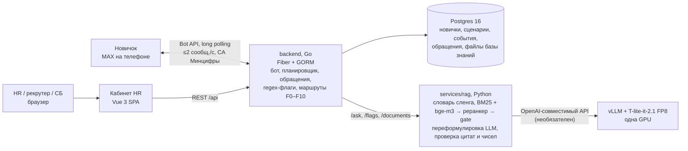

# Корсик: ИИ-помощник адаптации новичков в MAX

Хакатон «Открой#Моспром» 2026, кейс ПОЛИПЛАСТИК.

## TL;DR

- **Что это.** Бот в мессенджере MAX ведёт новичка по маршруту адаптации от D−3 до D+90, считая дни от даты выхода. На вопросы он отвечает по регламентам и в каждом ответе указывает пункт-источник. Если пункта нет или тема чувствительная, бот создаёт обращение к HR. Маршрут адаптации HR собирает сам в веб-кабинете или загружает Excel-ТЗ заказчика: конструктор описывает это ТЗ целиком, со всеми ветками, опросами и различиями по площадкам.
- **Для кого.** Новички на заводах (у рабочего часто нет ПК, но есть телефон), HR и рекрутеры, руководитель подразделения, руководитель подбора, HR-партнёр и служба безопасности.
- **Цифры.** Excel-ТЗ заказчика (строки r1–r70) сверено построчно на трёх площадках: 18 новичков прошли D−3…D+92 на подделке MAX. RAG на настоящих регламентах ПОЛИПЛАСТИК (ПВТР-скан и 3 презентации): верный пункт на разговорных перефразах 85 %, на отложенном наборе 59–68 %, на вопросах-ловушках и инъекциях 100 % отказов. Базовый путь новичка пройден в настоящем MAX на телефоне.

> Материалы заказчика (Excel-ТЗ, ПВТР, три презентации) получены 24.10. Они конфиденциальны и в репозиторий не входят: импорт ТЗ и RAG проверены на них локально. Демо-данные в репозитории синтетические: регламент из 15 пунктов, два сценария, новички, ответы на опросы.

## Критерии жюри (Положение, п. 6.4)

| Критерий | Где смотреть | Что сделано |
|---|---|---|
| Прототип | разделы [Что работает](#что-работает-и-на-чём-проверено) и [Ограничения](#ограничения-и-план-пилота) | У каждой функции указано, на чём она проверена: живой MAX, подделка MAX, API или синтетика. Сверка Excel-ТЗ построчно (r1–r70) с итогом по каждой строке: совпадает, исправлено или нет контента в самом ТЗ. Отдельно перечислено, что не сделано |
| Решение основной проблемы | [Сценарии для проверяющего](#сценарии-для-проверяющего), `backend/`, `services/rag/` | Сценарий заказчика импортируется из его Excel-ТЗ и исполняется ботом целиком. Кабинет HR и рекрутера. Ответы ИИ по настоящим регламентам с цитатой пункта, передача вопроса человеку. Дайджест для руководителя подбора и уведомления руководителю подразделения |
| Разработка и внедрение | [Экономика](#экономика), [Быстрый запуск](#быстрый-запуск), `agency/pitch/facts.md` §3 | `make demo` поднимает весь стек в Docker одной командой. Расчёт эффекта и TCO, допущения помечены. Одна GPU на 24 ГБ или любой OpenAI-совместимый адрес. План пилота на 8 недель |
| Новаторство | [Архитектура](#архитектура), [Качество](#качество) | Шаги считаются в рабочих днях от даты выхода с учётом часов площадки, а не в минутах воронки. Код проверяет цитату и каждое число в ответе модели, при провале отдаёт дословный пункт. Вариант текста на «вы» и нейтральный род готовит модель, а код проверяет числа, ссылки и подстановки. Разговорный вопрос модель переформулирует, но пункт отдаётся только после подтверждения. Жалобы уходят мимо руководителя |
| UX/UI | `frontend/`, сценарии 1–12 | В боте: блок сообщений листается кнопкой «Дальше →» как карточки, нажатая кнопка правится в итог, опросы с ветками по вариантам. В кабинете: редактор веток и опросов с превью телефона, вид «Таймлайн», отчёт импорта со ссылкой на шаг, медиатека по площадкам, реестр, траектория с машиной времени, обращения с SLA, обзор, дайджест, база знаний |
| Второстепенные проблемы | [Безопасность и ПДн](#безопасность-и-пдн) | Согласие до первого диалога, видимость категорий F0–F10, порог анонимности 5 в обзоре и дайджесте. Рабочие часы и перенос с выходных, перенос даты выхода без дублей. Новичок, который молчит, не останавливает рассылку остальным. Доступы к системам (r18) бот не шлёт. Без модели бот продолжает работать |
| Аналитика | `agency/pitch/facts.md` §1, §4; `agency/playbook/artifacts/research/`; `agency/playbook/steps/06-…`, `07-…` | Аудитория и роли, данные об адаптации на заводах, аналоги (Поток, Пульс, Websoft, конструкторы MAX, западные решения). Построчный разбор Excel-ТЗ заказчика: какие конструкции в нём есть и чего в нём не хватает |

## Что работает и на чём проверено

Метки: **✅ живой MAX** — проверено на телефоне в настоящем MAX; **✅ API** — проверено на настоящем API в браузере или тестами; **🟡 подделка MAX** — бот прогнан целиком, но вместо MAX стоит подделка (`externalApi/max/fake.go`, демо-чат); **🟡** — проверено частично (на синтетике или только тестами); **❌** — не сделано.

**Путь новичка в настоящем MAX** (прогон 24.10 01:08–01:15, синтетический сценарий):

| Функция | Статус | Чем подтверждено |
|---|---|---|
| Вход по персональной ссылке `https://max.ru/<бот>?start=inv_…`, выбор «ты/вы», согласие. QR и ссылку для оффера требует само ТЗ (r8, колонка «Форма/Макет») | ✅ живой MAX | `agency/LOG.md` |
| Шаги таймлайна D−3…D−1, кнопки правят сообщение в итог, подстановка дня выхода | ✅ живой MAX | там же: 6 шагов, без ошибок 429 |
| Вопрос → ответ с «📄 Источник» → «Подробнее» (дословная цитата) | ✅ живой MAX | «Когда выплачивают аванс?» → п. 6.1, 2,3 с при обычной нагрузке |
| Ловушка → отказ → «Передать HR» → обращение → ответ HR с подписью → «Вопрос закрыт» | ✅ живой MAX | «Положен ли ДМС?» → обращение #1009, ответ HR отправлен через API |

**Сценарий заказчика из Excel-ТЗ** (файл заказчика вне git, строки r1–r70):

| Функция | Статус | Чем подтверждено |
|---|---|---|
| Импорт Excel-ТЗ с отчётом: блоки, шаги, предупреждения по строкам, клик по строке отчёта открывает шаг. Импорт не теряет данных при сохранении черновика | ✅ API | настоящий файл через кабинет: 21 блок, 57 шагов, 29 веток, 5 опросов на 30 вопросов, 2 правила, 2 команды, 54 предупреждения. `TestImportedStepsRoundTrip` |
| Конструктор описывает ТЗ целиком: ветки кнопок (до двух реплик и действия), общая ветка на несколько кнопок, опросы с веткой и флагом на каждый вариант, несколько ответов, «свой вариант», правила после опроса («ЛИБО» и «+»), разные тексты и варианты опроса по площадкам, ввод текста и фото от новичка (r34), личный файл плана из карточки (r36), показ «по отмашке рекрутера», команды `/food` и `/hr`, правила сценария r69 (свободный вопрос без ответа) и r70 (напоминание об опросе через 24 и 48 ч) | ✅ API (редактор) / 🟡 подделка MAX (бот) | редактор: вкладки веток, «После опроса», «Команды и правила», вид «Таймлайн», превью телефона. Бот: прогон `TestTZConformance` |
| Сквозная сверка r1–r70 на трёх площадках: 18 новичков (GrPP, Luzhniki, GTP × «ты»/«вы» × активный, проблемный, молчун), машина времени D−3…D+92 | 🟡 подделка MAX | `backend/services/tz_conformance_test.go`; таблица по строкам — `agency/playbook/steps/07-tz-conformance.md`. Активный новичок получает 55–62 сообщения, молчун 33–35 и напоминания об опросах |
| Молчун не останавливает других: такт планировщика идёт по каждому новичку отдельно, блоки одного момента уходят по очереди | ✅ тестами / 🟡 подделка MAX | до исправления молчун получал 1 сообщение за 90 дней, а новички GTP вставали после D+2 |
| «Дальше →»: сообщения блока без вопроса новичок листает как карточки, подряд без его участия уходит не больше двух сообщений | 🟡 подделка MAX | демо-чат на импортированном ТЗ |
| Обращения от вариантов опроса заводятся по нажатию кнопки или тексту новичка, а не сами по себе. Без нажатия вариант ставит сигнал риска в карточку, зону риска и дайджест. F0, F5, F9 уходят по своему маршруту сразу | 🟡 тестами | правила — `agency/system/api_contract.md`, v4 |
| Вариант на «вы» и нейтральный род: кнопка в отчёте импорта, модель переписывает, код проверяет числа, ссылки, `{подстановки}`, эмодзи, длину и что «ты» не осталось. Не прошло — словарь кода или текст остаётся как был, с бейджем «ИИ — проверьте» | ✅ API, живая модель | на настоящем ТЗ через кабинет: 87 текстов на «вы», в одном осталось «ты» |
| Медиатека по площадкам: у одного имени свой файл на каждую площадку, «нет файла», где используется, переименование правит ссылки. Импорт заводит заглушки для всех 19 картинок и файлов ТЗ | ✅ API / 🟡 подделка MAX | в прогоне сверки каждая площадка получила свой файл. Настоящих картинок и PDF в ТЗ нет (ниже, «Дыры ТЗ») |

**Кабинет, RAG и остальное:**

| Функция | Статус | Чем подтверждено |
|---|---|---|
| RAG на настоящих регламентах: ПВТР (скан 23 стр., OCR), антикоррупционная политика, положение о коммерческой тайне, политика качества. Словарь кадрового сленга и переформулировка вопроса моделью | ✅ eval, локально | 60 вопросов + отложенный набор из 34, раздел [Качество](#качество). Корпус и наборы вопросов вне git |
| Дайджест руководителю подбора: неделя, темы, зоны риска, площадки, динамика. Темы и группы меньше 5 человек скрыты, F5/F9 только «конфиденциальное». Текст пишет модель по агрегатам, код сверяет числа. В MAX по понедельникам в 9:00, в кабинете — раздел «Аналитика» | ✅ API / 🟡 подделка MAX, синтетика | смоук на 150 синтетических персонах |
| Руководитель подразделения: своя ссылка в MAX, уведомления «встретьтесь 1:1» (второй низкий пульс, молчит больше 3 дней, конец ИС через 3 дня, D+30) без чувствительных категорий, страница «Мои новички» | ✅ API / 🟡 подделка MAX | там же |
| Планировщик: рабочие часы площадки, перенос с выходных, без дублей при переносе даты выхода | ✅ API | `backend/services/scheduler_test.go`, `calendar_test.go` |
| Машина времени и «Что ушло в МАКС» на траектории | ✅ API | headless-браузер: 17 событий до D+2 |
| Сценарии: создание (пустой или копия), удаление черновика, редактор, публикация версии со сводкой изменений | ✅ API | Playwright в кабинете; `.xls` получает понятную ошибку 422 |
| Обращения: список, канбан, SLA, «Взять в работу», ответ в МАКС, заметка, конфиденциальные F5/F9 | ✅ API | headless-браузер на настоящем API: F2, F4, F9, F10 |
| Демо-чат `/dev/chat`: диалог новичка на подделке MAX | ✅ API, только dev | пройден кликами на настоящем API, RAG и LLM |
| Флаги: regex F5/F7/F9 в Go, затем LLM-разметка `/flags` по таксономии F0–F10 | 🟡 | 12 из 12 граничных случаев на живой модели. Путь «живой бот → `/flags`» целиком не прогнан |
| Обзор: плитки, зоны риска, тепловая карта F1–F10 × площадка, тренд пульса | 🟡 синтетика | 150 синтетических персон (`cmd/seed-demo`). При пороге анонимности 5 на тепловой карте открыты 10 ячеек из 30 |
| База знаний: загрузка PDF (включая сканы через OCR), PPTX, XLSX, проверочный вопрос, версии, «вопросы без ответа» | ✅ API | синтетические файлы через кабинет; настоящие регламенты — через каталог корпуса |
| Голосовые (`transcription` от MAX) | 🟡 | код читает поле, но живого голосового не было |
| Карточки обращений в HR-чат и чат СБ в MAX | 🟡 | код есть, `chat_id` чатов не заданы, без них карточка пишется в лог |
| «Печатает», ограничение 2 сообщения/с, обработка 429 | 🟡 | тесты на подделке; на живом MAX 429 не встретился |

Импортированный сценарий ТЗ и дайджест в настоящем MAX ещё не прогонялись: живой прогон был раньше, на синтетическом сценарии.

**Дыры самого ТЗ — HR догружает.** Импорт ставит на них предупреждения, бот вместо пустого сообщения пишет «Материал скоро добавим». Нет маршрутов транспорта (r11–r13), карт территории и этажей (r20–r21), PDF «где пообедать» по площадкам (r26–r28), корпоративной презентации (r32), образца мини-резюме (r34), расписания спортзала (r37), фото с праздников (r45) и 19 картинок, у которых в ТЗ есть только имена. В ТЗ два приветствия подряд (r50/r51) и упомянут опрос, которого нет (r58): это тоже предупреждения для HR. Логины и пароли (r18) бот не шлёт, письмо HR (r19) становится задачей HR.

Сознательно не сделано или отложено:

| Что | Почему |
|---|---|
| Авторизация и роли в кабинете | не успели. Оператор берётся из localStorage («Анна К.»), разделы «База знаний» и «Медиатека» вне dev закрыты токеном `KB_OPERATOR_TOKEN` |
| Раздел «Настройки» | заглушка |
| Экспорт сценария обратно в Excel | не сделан: импорт есть, выгрузки нет |
| Дата конца испытательного срока из карточки новичка | сейчас конец ИС — D+89 по ТЗ. Если он выпадает на выходной, бот переносит сообщение вперёд, то есть уже после конца срока |
| Воронка D0→D90, калибровка индекса W и флагов на реальных данных | план пилота. Сейчас зону риска выставляют правила кода: низкая оценка, сигнал варианта или флага, бот отключён |
| Эмоции по голосу и лицу, идентификация по голосу | принципиально: в ЕС это запрещено на рабочем месте, а идентификация по голосу — уже биометрия |
| Автоматические решения о сотруднике | модель только подсвечивает, маршрут эскалации задаёт код по таблице, решает человек |
| Интеграция с 1С ЗУП, дообучение модели, нагрузочный тест | вне 36 часов, для пилота не нужны |

## Быстрый запуск

Всё в Docker одной командой: Postgres, API и бот, RAG, кабинет HR и демо-данные.

**Требования:** Docker с Compose v2 и 8 ГБ памяти для Docker (RAG с моделями занимает ~2 ГБ), ~10 ГБ на диске (образы ~2,5 ГБ, веса моделей ~6 ГБ), `make`. Go, Node и Python не нужны.

```bash
git clone https://github.com/kunak-agency/polyplastic-bot && cd polyplastic-bot
make rag-models   # один раз: веса bge-m3 и реранкера в services/rag/.cache (~6 ГБ, ~10 мин)
make demo         # сборка и старт, ждёт готовности всех сервисов (первый раз ~5–10 мин)
# открыть http://localhost:18080
make demo-down    # остановить; make demo-clean — ещё и удалить демо-базу
```

`make demo` сам создаёт `.env` из `.env.example`. Без `make rag-models` RAG стартует на BM25 без реранкера и пишет предупреждение: ответы с цитатой работают, перефразы распознаются хуже. Без `make` то же самое: `docker compose -f docker-compose.demo.yml up -d --build --wait`.

| Что | Адрес |
|---|---|
| Кабинет HR | http://localhost:18080 |
| Демо-чат (путь новичка без телефона) | http://localhost:18080/dev/chat |
| API | http://localhost:18081/api/health |
| RAG | http://localhost:18093/health |

Порты слушают только `127.0.0.1` и меняются переменными `DEMO_WEB_PORT`, `DEMO_API_PORT`, `DEMO_RAG_PORT`, `DEMO_PG_PORT` в `.env`. `DEMO_BIND=0.0.0.0` открывает кабинет в сеть, это нужно для стенда.

**Что увидит проверяющий.** Данные синтетические, их заливает сид на старте: 2 сценария («Завод GTP», «Офис GrPP»), 3 новичка и поток из 150 персон для «Обзора». Корпус RAG тоже синтетический (регламент из 15 пунктов). Настоящие документы заказчика в репозиторий не входят. Если они есть, их кладут в `services/rag/corpus-real/` и запускают `RAG_CORPUS=real make demo`.
1. **«Обзор»**: плитки, зоны риска, тепловая карта, тренд пульса.
2. **«Демо-чат»** в меню: выбрать новичка, пройти знакомство, задать вопрос «Когда выплачивают аванс?». Придёт ответ «📄 Источник: ПВТР-синтетика, п. 6.1».
3. **«Новички»** → карточка → траектория → «Машина времени»; **«Обращения»**, **«Сценарии»**, **«База знаний»** → «Проверка». Подробнее в разделе «Сценарии для проверяющего» ниже.

**Свой бот MAX.** В `.env` вписать `MAX_BOT_TOKEN` (business.max.ru) и `MAX_BOT_USERNAME` (имя без @), затем снова выполнить `make demo`. Бот перейдёт с подделки на живой MAX, сертификат Минцифры подключится сам. Один токен может опрашивать только один запущенный бот, поэтому второй экземпляр с тем же токеном нужно остановить. Демо-чат работает только без токена.

**Своя модель (LLM).** В `.env` вписать `LLM_BASE_URL` (OpenAI-совместимый адрес с `/v1`, например vLLM), `LLM_API_KEY` и `LLM_MODEL`, затем `make demo`. Без них RAG отвечает дословной цитатой пункта, а бот, сценарии и обращения работают так же. Если модель не отвечает за `LLM_TIMEOUT` (6 с), тоже уходит цитата.

Логи: `make demo-logs`, состояние: `make demo-ps`.

### Локальный запуск для разработки (без Docker для API и кабинета)

Если веса моделей уже скачаны, запуск займёт около 5 минут. Первый старт RAG скачивает bge-m3 и реранкер, около 4,5 ГБ.

**Требования:** Go 1.25 (недостающий тулчейн `GOTOOLCHAIN=auto` скачает сам), Node 22 + pnpm 10 (`corepack enable`), Python 3.13, Docker (для Postgres). Для OCR сканов ещё нужен Tesseract с языками `rus+eng`.

Порты: Postgres `127.0.0.1:5437`, API `:8081`, RAG `:8093`, кабинет `:5173`.

```bash
# 1. Секреты и LLM. Корневой .env читают docker compose и RAG
cp .env.example .env
#   LLM_BASE_URL — OpenAI-совместимый адрес с /v1 (у нас vLLM + T-lite), LLM_API_KEY, LLM_MODEL=tlite.
#   LLM_BASE_URL пустой — RAG отвечает дословной цитатой пункта, бот и сценарии работают.

# 2. Postgres (и RAG в Docker на CPU, медленнее)
make up                       # или только база: docker compose up -d postgres

# 3. Окружение API
make env                      # создаёт backend/.env с локальным DATABASE_URL
#   В backend/.env задать:
#   MAX_BOT_TOKEN=…           пусто + APP_ENV=development → подделка MAX, сообщения видны в /dev/chat
#   MAX_BOT_USERNAME=…        имя бота без @, из него собирается ссылка-приглашение
#   MAX_CA_FILE=<абсолютный путь>/deploy/certs/russian_trusted_root_ca.pem
#   LLM_BASE_URL / LLM_API_KEY — те же, что в корневом .env

# 4. Демо-данные (синтетика)
make seed                     # 2 сценария («Завод GTP», «Офис GrPP») и 3 новичка
(cd backend && APP_ENV=development go run ./cmd/seed-demo)   # 150 персон для «Обзора»
#   make seed-reset — чистая пересборка (только development, спрашивает подтверждение)

# 5. RAG на хосте (на Mac модели считаются на GPU через mps, это быстрее Docker).
#    Если на шаге 2 был `make up`, сначала остановить контейнер rag: docker compose stop rag
cd services/rag
python3.13 -m venv .venv && .venv/bin/pip install -r requirements-dev.txt
set -a; source ../../.env; set +a
RAG_RETRIEVER=hybrid RAG_RERANKER=bge LLM_TIMEOUT=2.5 ./run.sh   # /health отвечает после прогрева, ~16 с
cd ../..

# 6. API и бот
make run                      # :8081, проверка: curl localhost:8081/api/health

# 7. Кабинет HR
cd frontend && cp .env.example .env && pnpm install && pnpm dev   # http://localhost:5173
```

**Сертификат Минцифры.** API MAX (`platform-api2.max.ru`) не проходит проверку TLS без корневого сертификата «Russian Trusted Root CA». Публичный сертификат лежит в `deploy/certs/russian_trusted_root_ca.pem`. Путь к нему задаётся в `MAX_CA_FILE`, и бэкенд добавит сертификат к системным.

**Как пройти путь в MAX.**
1. Создать бота на business.max.ru и вписать токен в `MAX_BOT_TOKEN`, имя бота — в `MAX_BOT_USERNAME`.
2. В кабинете: «Новички» → «Запустить адаптацию» → карточка новичка → «Приглашение». Там будут ссылка вида `https://max.ru/<бот>?start=inv_…` и QR.
3. Открыть ссылку на телефоне с MAX и нажать «Начать». Без ссылки бот не привяжет новичка: «Начать» без payload он намеренно игнорирует.
4. На траектории новичка нажать «Машина времени», чтобы прокрутить шаги и не ждать дни.

Без токена тот же путь проходится в **«Демо-чате»** (`/dev/chat`, пункт есть в меню в `pnpm dev` и в сборке `make demo`). Нужны `APP_ENV=development` и пустой `MAX_BOT_TOKEN`.

## Сценарии для проверяющего

| # | Что сделать | Что увидеть |
|---|---|---|
| 1 | Открыть приглашение и перейти по ссылке в MAX (или «Демо-чат» → выбрать новичка) | Знакомство, выбор «ты/вы», согласие на обработку данных, пакет D−3. После нажатия кнопки сообщение правится в итог «✅ …» |
| 2 | Траектория новичка → «Машина времени» до D+2 → раскрыть «Что ушло в МАКС» | Шаги отправлены в рабочие часы площадки, у каждого виден текст. Кнопка «Перенести дату выхода» пересчитывает неотправленные шаги без дублей |
| 3 | Спросить бота: «Когда выплачивают аванс?» → «Подробнее» | Ответ и строка «📄 Источник: п. 6.1». «Подробнее» показывает дословную цитату пункта |
| 4 | Спросить: «Положен ли ДМС после испытательного срока?» → «Передать HR» | Ответ «не нашёл в документах», три кнопки. Появляется обращение. В кабинете: «Обращения» → карточка → «Взять в работу» (клавиша A) → «Ответить в МАКС». Новичку приходит «Анна К., HR (по обращению #…)» с кнопками «Ответить» и «Вопрос закрыт» |
| 5 | Написать боту: «Мастер просит откат за смену получше» | Сработает правило F9 (коррупция), до модели. Обращение уходит в СБ с плашкой «конфиденциально». Текст новичка скрыт, руководителю обращение не показывается |
| 6 | «Обзор» (после `seed-demo`) | Плитки, этапы, зоны риска с причинами словами, тепловая карта (ячейки, где меньше 5 человек, скрыты), тренд пульса. Переходы в «Новички» и «Обращения» с фильтром |
| 7 | «База знаний» → перетащить PDF/PPTX/XLSX → вкладка «Проверка» → задать вопрос | Документ разобран на пункты, ответ приходит с цитатой и номером пункта, ловушка получает отказ. «Вопросы без ответа» показывают обезличенные кластеры |
| 8 | «Сценарии» → «Создать сценарий» → «Загрузить Excel» → файл Excel-ТЗ (в репозитории его нет, нужен свой экземпляр) | Отчёт импорта: блоки, шаги и предупреждения со ссылкой на строку ТЗ, клик открывает шаг. Таблица сгруппирована по блокам, у кнопок видны ветки, у опросов — ветки вариантов и «После опроса» |
| 9 | В отчёте импорта → «Сделать вариант на «вы» (ИИ)» → открыть шаг | Тексты на «вы» и в нейтральном роде, бейдж «ИИ — проверьте». Нужна модель (`LLM_BASE_URL`), без неё правит словарь кода |
| 10 | Шаг с кнопками → вкладка «При ответе „…“»; опрос → вариант → ветка и флаг; вкладка «Команды и правила»; вид «Таймлайн» | Ветка до двух реплик и действия (обращение, «Связаться с», файл по площадке), правила `/food`, `/hr`, свободного вопроса и напоминания об опросе. Публикация показывает сводку изменений |
| 11 | «Медиатека» | Имена файлов из сценариев, у каждого свой файл по площадкам или «нет файла», где используется |
| 12 | «Аналитика» → неделя и площадка; «Мои новички» (`/manager?name=…`) | Дайджест недели с темами и превью сообщения в MAX; список новичков руководителя и поводы для встречи 1:1 |

Опросы со шкалами и вопрос о причине при низкой оценке появляются в шагах D0–D+3, если прокрутить машину времени. В демо-чате блоки сообщений листаются кнопкой «Дальше →».

## Архитектура



Главный принцип: **правила держит код, а не промпт**. Таблица в коде решает, куда идёт эскалация (F5/F9 мимо руководителя). Код соблюдает рабочие часы и лимиты отправки, проверяет, что цитата дословно есть в пункте и что каждое число из ответа есть в цитате. Модель только формулирует. Если проверка не прошла или модель недоступна, новичок получает дословный пункт. Так же устроены остальные места, где работает модель: переформулировка вопроса (пункт отдаётся, только если его подтвердили два запроса и модель на исходном вопросе), вариант текста на «вы» (числа, ссылки и подстановки сверяет код) и текст дайджеста (каждое число должно быть во входных агрегатах, иначе шаблон).

Сценарий — это блоки сообщений на день и время от даты выхода. Блок исполняется как диалог: вопрос с кнопками держит поток, ветка ответа уходит сразу, потом следующая реплика. Пропущенное к следующему блоку уходит сводкой «Что вы пропустили».

Подробности: `agency/system/a_core_stack.md` (стек), `agency/system/api_contract.md` (контракты REST и RAG), `services/rag/README.md` (конвейер поиска), `frontend/README.md` (кабинет).

## Качество

### RAG на настоящих регламентах ПОЛИПЛАСТИК

Корпус: ПВТР (скан 23 страниц без текстового слоя, OCR с уверенностью 93–96 на страницах текста), антикоррупционная политика, положение о коммерческой тайне, политика качества и экологии, всего 102 фрагмента. Golden set — 60 вопросов: 21 дословный, 26 разговорных перефразов, 10 ловушек (ответа в документах нет), 3 инъекции. Отложенный набор — 34 вопроса, составлен до подбора словаря: 22 новых перефраза, 10 новых ловушек, 2 инъекции. Документы и вопросы конфиденциальны и лежат вне git. Конфигурация: hybrid + реранкер, gate 0.2, T-lite; «после» — плюс словарь сленга и переформулировка вопроса моделью.

| Метрика | golden, до | golden, после | отложенный, до | отложенный, после |
|---|---|---|---|---|
| Ответ с верным пунктом | 68 % | **91 %** | 27 % | **59–68 %** |
| … дословные / перефразы | 100 % / 42 % | 100 % / **85 %** | — / 27 % | — / 59–68 % |
| Ложные отказы | 32 % | 6 % | 59 % | 27 % |
| Отказ на ловушках | 100 % | **100 %** | 100 % | **100 %** |
| Инъекции отбиты | 100 % | 100 % | 100 % | 100 % |
| Цитата дословно есть в пункте | 100 % | 100 % | 100 % | 100 % |
| p95 | 4,6 с | 5,6 с | 5,0 с | 5,9 с |

- Разброс 59–68 % на отложенном наборе — между прогонами: формулировки модели каждый раз немного другие. Честная цифра для новых вопросов — отложенный набор: словарь писался после разбора ошибок golden set и на нём завышает результат.
- Переформулировка опасна сама по себе: без защит она подняла перефразы, но пропустила 20 % ловушек. Поэтому пункт засчитывается, только если его нашли два разных запроса, и отдаётся, только если модель ответила по нему на исходный вопрос и ответ прошёл проверку чисел. Ловушки вернулись к 100 %.
- Что всё ещё уходит человеку: длинные пункты о запретах («где покурить»), вопросы на стыке двух документов, ответы, где модель берёт число с соседнего слайда. Это ошибка в безопасную сторону: бот не выдумывает, а предлагает человека.
- Порог gate 0.2 подобран на реальном корпусе: худшая ловушка («компенсируют ли проезд») набирает 0.102, при прежнем 0.1 она бы прошла. Подробности и sweep — `services/rag/README.md`, раздел «Реальный корпус».

### Синтетика и остальное

- Синтетический регламент из 15 пунктов (40 вопросов, входит в репозиторий): верный пункт 72 % при прежнем gate 0.1 и 69 % при текущем 0.2, ловушки и инъекции 100 %. Со словарём и переформулировкой перефразы 44 → 88 %.
- Флаги на живой модели: на 12 граничных случаях из `data/generator-spec.yaml` все 12 кодов совпали с эталоном. Идиомы («убьёт», «умираю от скуки») и инъекция флаг не вызывают.
- Сценарий из Excel-ТЗ: `TestTZConformance` на настоящем файле, 18 новичков, D−3…D+92, итог по каждой строке r1–r70 в `agency/playbook/steps/07-tz-conformance.md`.
- Тесты: RAG — больше 200 (pytest); backend — 189 функций `Test…` (`go test`, интеграционные на Postgres); кабинет — 76 и гейты lint / format / type-check / build.

Как воспроизвести:

```bash
cd services/rag
.venv/bin/python -m pytest -q
RAG_RETRIEVER=hybrid RAG_RERANKER=bge ./run.sh eval --configs bm25,final -v   # синтетика
./run.sh eval --configs final,final+llm      # нужен LLM_BASE_URL в окружении
./run.sh eval --real --configs final+llm,final+llm+syn+rw -v   # нужен corpus-real/ и golden-real.csv
make test                                    # из корня: go vet + go test бэкенда
# сверка с ТЗ: нужен файл заказчика и отдельная база
TZ_XLSX=… CONFORM_DATABASE_URL=… TZ_JOURNAL=<каталог вне репо> go test ./services -run TestTZConformance -timeout 60m   # в backend/
```

## Безопасность и ПДн

| Вопрос | Как сейчас |
|---|---|
| Что уходит наружу | Только вызовы генерации на GPU: текст вопроса и найденные пункты регламента (`/ask`, в том числе переформулировка вопроса), текст свободного сообщения для разметки флагов (`/flags`), тексты сценария для варианта на «вы» (кнопка HR в кабинете), агрегаты недели без имён для текста дайджеста. ФИО, телефон и другие поля карточки новичка в эти запросы не передаются. Маскирования имён внутри текста вопроса пока нет. Поиск, эмбеддинги, реранкер, проверка цитат и база данных работают локально |
| Где модель | На хакатоне открытая модель, которую развернули мы сами, работает на арендованной GPU (RunPod); сторонние ИИ-сервисы не используются. Демо-данные синтетические, но при проверке на материалах заказчика на эту GPU уходили фрагменты регламентов и тексты сценария ТЗ. Архитектура рассчитана на одну GPU на 24 ГБ. В пилоте модель ставится в контур ПОЛИПЛАСТИК или в российское облако, код не меняется: адрес модели задаётся одной переменной `LLM_BASE_URL`. Без модели бот всё равно отвечает дословной цитатой |
| Согласие | Шаг согласия идёт до первого диалога. Текст вопросов сохраняется только при действующем согласии. Кнопка лишь фиксирует согласие: отдельный документ согласия (с 01.09.2025) должен дать работодатель |
| Видимость категорий | F5 (насилие) и F9 (коррупция) получают пометку `restricted`: текст новичка скрыт, обращение уходит в чат СБ, руководителю не показывается. F0, F4, F10 скрыты только от руководителя. Маршруты заданы в `data/taxonomy.yaml` и в коде |
| Обезличивание | «Вопросы без ответа» маскируют имена, телефоны, почты и номера. В обзоре и дайджесте действует порог анонимности 5: ячейки, недели и темы с меньшим числом людей скрыты, F5/F9 в дайджесте — только отметка «конфиденциальное». Руководитель подразделения не получает категорий F0, F4, F5, F9, F10. Цитата флага с ПДн обнуляется, у F10 (здоровье) цитаты нет |
| Логи | RAG не пишет в лог текст вопросов и документов: только `trace_id`, решение, скор и номера пунктов |
| Открытые вопросы | Телефон новичка хранится открытым текстом. Пока обращение у человека, текст новичка сохраняется всегда, и у F10 это сведения о здоровье. Ролей в кабинете нет. У RAG нет авторизации: он слушает только loopback, права проверяет бэкенд. Всё это нужно согласовать с HR и юристом до пилота |
| Данные | В репозитории только синтетика: регламент, сценарии, новички (`(синтетика)` в ФИО, телефоны `+7 000 …`), персоны и ответы на опросы. Материалы заказчика (Excel-ТЗ, ПВТР, презентации) и наборы вопросов к ним лежат локально, в `.gitignore` и `.dockerignore` |

## Экономика

Это оценка: все цифры ниже — допущения, пока кейсодержатель не дал своих. Формулы и источники лежат в `agency/pitch/facts.md`, раздел 3.

| Параметр | Значение | Откуда |
|---|---|---|
| Новичков в год | ≈ 2 200 = 8 500 × 26 % | численность с сайта («более 8000»), найм в обрабатывающих производствах по данным Росстата; допущение |
| Рутина HR на одного новичка | 4 ч (диапазон 2–8) | **главное допущение** |
| Доля вопросов, которые снимает бот | 70 % — цель заказчика | на настоящих регламентах у нас 91 % верных пунктов на golden set и 59–68 % на отложенном наборе. Это не доля на реальном логе вопросов новичков |
| Экономия HR-времени | ≈ 6 160 ч ≈ 5,9 млн ₽/год | при ставке ≈ 950 ₽/ч |
| Эффект удержания | 1–2 млн ₽/год | 18 % уходят из-за плохой адаптации (KORUS 2022); замена — от 100 тыс. ₽ |
| Затраты | своя GPU ≈ 1 млн ₽ или API 15–180 тыс. ₽/год; пилот 8 недель 1,2–2 млн ₽ | оценка |

Облачные API дешевле своей GPU. Довод за свой контур — риск: штраф за утечку ПДн (от 3 млн ₽) превышает трёхлетнюю стоимость своей карты. Контур выбирает ИБ заказчика.

## Ограничения и план пилота

Ограничения прототипа:
- сценарий заказчика из Excel-ТЗ, дайджест и уведомления руководителю проверены на подделке MAX; в настоящем MAX пройден базовый путь на синтетическом сценарии;
- в ТЗ нет части контента (маршруты, карты, PDF обеда, презентация, 19 картинок), HR догружает их в медиатеку;
- новые разговорные вопросы находят пункт в 59–68 % случаев, остальные уходят человеку; порог gate подобран на golden set из 60 вопросов с 10 ловушками, отложенный набор проверил его ещё на 10;
- ответ с моделью на настоящих регламентах — p95 5,6 с: фрагменты длиннее синтетических;
- нет ролей и авторизации в кабинете; модель стоит на арендованной GPU вне РФ;
- голосовые и карточки в групповые чаты MAX не проверены вживую; экспорта сценария в Excel нет; конец ИС берётся из ТЗ (D+89), а не из карточки новичка.

План пилота на одном заводе (оценка, 8 недель):

| Недели | Что |
|---|---|
| 1–2 | Корпоративный бот MAX, HR-чат и чат СБ. Сценарий из Excel-ТЗ уже импортирован: HR догружает материалы медиатеки и вычитывает вариант на «вы». Модель в контуре заказчика или в российском облаке |
| 3–4 | Остальные регламенты в базу, прогон eval на них и на логе вопросов текущего бота. Роли и вход в кабинет. Дата конца ИС из карточки. Шифрование телефона, согласование хранения ПДн с юристом |
| 5–6 | Запуск на реальном потоке новичков. Калибровка флагов и индекса W на размеченных данных, дайджест руководителю подбора на реальных неделях |
| 7–8 | Голосовые через `transcription` MAX, экспорт сценария в Excel, нагрузочный тест, замер KPI: доля вопросов без HR, время первого ответа HR, доля прошедших D+30 и D+90, отклик на опросы |

От ПОЛИПЛАСТИК для пилота нужно: токен бота MAX, `chat_id` HR-чата и чата СБ, файлы для медиатеки (картинки, PDF обеда, маршруты, карты, презентация), остальные регламенты, GPU или решение ИБ по внешнему API.

## Использованные ИИ-инструменты

Раскрытие по Положению, п. 4.3.3–4.3.4.

| Инструмент | Где | Для чего |
|---|---|---|
| Claude Code (Anthropic) | разработка | Код писали агенты (планирование, реализация, проверка, документация) под контролем команды. Архитектуру, стек, правила маршрутизации и приоритеты задавали люди, они же проверяли результат и принимали решения |
| T-lite-it-2.1 (Т-Банк, Apache-2.0), FP8 на vLLM | в продукте | Формулирует ответ по найденному пункту и размечает флаги. Код проверяет каждый её ответ |
| BAAI/bge-m3 (MIT), BAAI/bge-reranker-v2-m3 (Apache-2.0) | в продукте | Эмбеддинги для поиска и реранкер |
| Внешний ИИ-ресерч | аналитика | Анализ рынка, аналогов, права и UX-спецификация (`agency/playbook/artifacts/research/`). Факты для питча перепроверены по первоисточникам, ссылки в `agency/pitch/facts.md` |

Что создано с помощью ИИ: код всех частей (агенты, под контролем человека); синтетические данные (регламент, персоны, golden set, демо-данные); тексты демо-сценариев, промпты (`agency/prompts/`) и документация, включая этот README. Код интеграции с ИИ лежит в репозитории: `services/rag/llm.py`, `services/rag/flags.py`, `backend/externalApi/`.

## Структура репозитория

| Путь | Что внутри |
|---|---|
| `backend/` | Go: бот MAX (обёртка официального SDK в `externalApi/max`), планировщик, обращения, REST кабинета, `cmd/seed`, `cmd/seed-demo` |
| `services/rag/` | Python: поиск по регламентам, проверки ответа, `/flags`, загрузка документов, `eval/` с golden set. Свой README с метриками |
| `frontend/` | Vue 3: кабинет HR и демо-чат (только в dev) |
| `data/` | `taxonomy.yaml` (флаги F0–F10, маршруты, видимость), синтетические персоны и спецификация генератора |
| `deploy/` | сертификат Минцифры, инициализация Postgres |
| `agency/` | База знаний проекта: `LOG.md` — журнал работ (что сделано и проверено), `system/` — стек и контракты API, `prompts/` — продуктовые промпты, `pitch/` — факты, слайды, ответы на вопросы, `playbook/` — ресерчи и открытые вопросы |
| `Makefile`, `docker-compose.yml` | `make help` выводит список целей |
