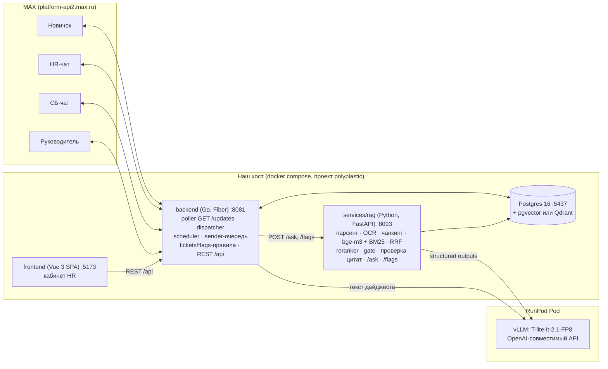
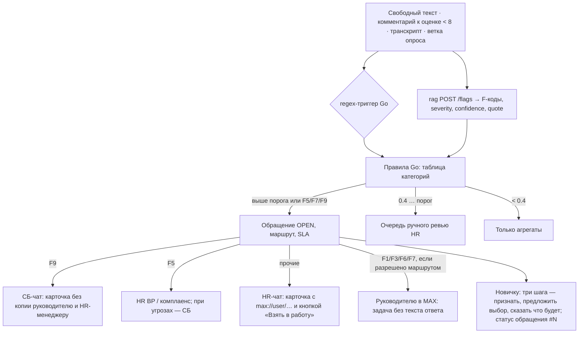
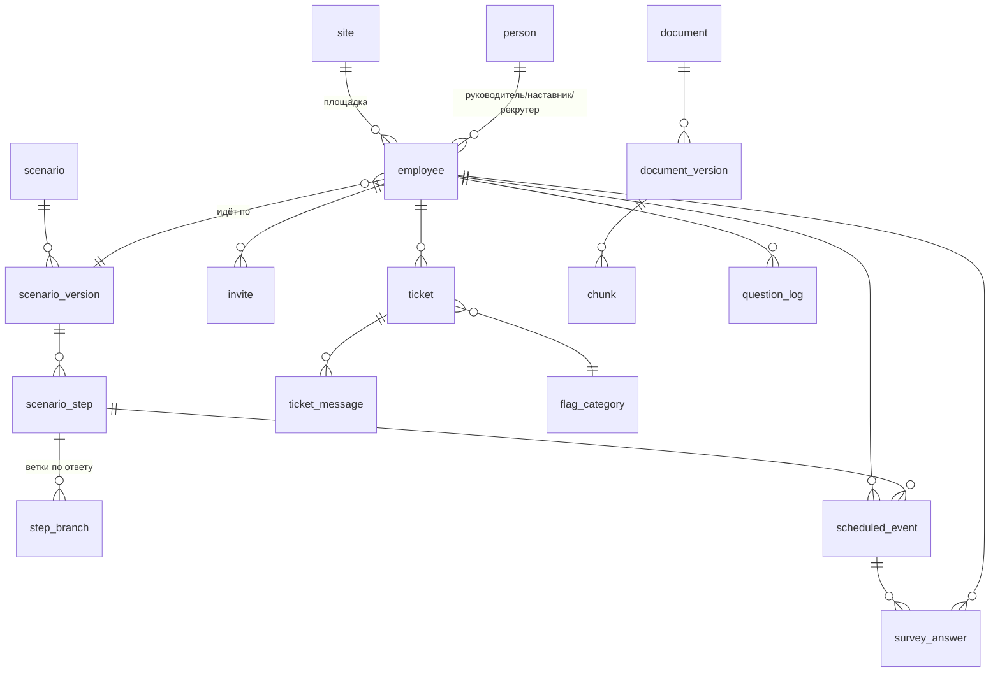

# 01. Архитектура

Стек принят в `system/a_core_stack.md`, межсервисные контракты — в `system/api_contract.md`.
Здесь компоненты, потоки, модель данных и то, где живут правила. Ресерч предлагал Python-бэкенд
(`maxapi` + FastAPI + APScheduler). У нас бот, планировщик, правила и эскалации на **Go**, Python
в Docker только для ML, фронт на **Vue**, LLM — **T-lite-it-2.1 FP8 на vLLM** на поде RunPod.

## Главный принцип: правила держит код

LLM формулирует ответ и размечает текст. Решения принимает код:

| Правило | Где | Чем проверяется |
|---|---|---|
| Когда и что отправить (D±N, время площадки, смена GTP, рабочие часы, перенос с выходных) | Go `services/scheduler` | юнит-тесты на календарь |
| ≤ 2 сообщения/с на диалог, ≤ 20 rps суммарно, ретрай 429 | Go `externalApi/max` (обёртка над SDK) | тест на подделке клиента |
| Бюджет сообщений (≤ 1 проактивного/день после первой недели), тихие часы, `notify:false` | Go `services/scheduler` | тест |
| Идемпотентность событий, перенос даты выхода без дублей, «что вы пропустили» | Go, уникальный ключ `(employee_id, step_id, scenario_version)` в Postgres | тест + ограничение БД |
| Gate «ответа нет»: порог реранкера, `needs_escalation` → `answer=null` | Python `services/rag` | golden set, ловушки |
| Проверка цитат: `clause_id` ∈ найденные чанки, `quote` ⊂ текст чанка (fuzzy ≥ 0.9) | Python `services/rag`, до ответа | тест на выдуманном пункте |
| Тематический маршрут без RAG (зарплата конкретного человека, конфликт, здоровье, увольнение, «как обойти») | Go (ключевые слова) + `topic` от rag | тест |
| Regex-триггеры (уволь*, взятк*, откат*, ударил*, угрож*) | Go, независимо от LLM | тест |
| Флаг → маршрут, двойной порог (авто / ручная очередь / только агрегаты), повтор флага → +1 severity | Go `services/tickets` по таблице категорий | таблица в БД + тест |
| F5/F9 не попадают к линейному руководителю, конфликт с руководителем не уходит ему | Go, фильтр получателей | обязательный тест |
| F10: категория без цитаты | Go (не сохраняет `quote`) + промпт флагов | тест |
| Пока обращение в HUMAN_ACTIVE, текст новичка идёт человеку, а не LLM | Go, состояние диалога | тест |
| Экранирование пользовательского текста в разметке | Go, функция рендера | тест |
| `temperature`, `presence_penalty` 1.0 в каждом запросе к T-lite | клиент LLM (Go и Python) | тест на клиенте |
| Таблицы дайджеста и агрегаты | Go (SQL); LLM пишет только связный текст по готовым числам | — |

## Компоненты



| Компонент | Ответственность | Не делает |
|---|---|---|
| `backend` poller | long polling `GET /updates?timeout=30` с `marker`; `marker` хранится в БД | не держит бизнес-логику |
| `backend` dispatcher | разбирает апдейт (`bot_started`, `message_created`, `message_callback`, `bot_added`, `bot_stopped`, `dialog_muted`) и решает, что это: ответ на опрос, свободный вопрос, сообщение в открытое обращение, команда | не зовёт LLM напрямую для ответа новичку |
| `backend` scheduler | раз в 30 с выбирает `scheduled_events` с `fire_at <= now()`, `status=pending`, `FOR UPDATE SKIP LOCKED`; вычисляет условия шага; рендерит шаблон `{ty}/{vy}` | не отправляет сам, кладёт в очередь отправки |
| `backend` sender | очередь по `chat_id`, пауза 0,6 с, обработка 429 и `attachment.not.ready`, `notify` | — |
| `backend` tickets | обращения, состояния OPEN → ASSIGNED → HUMAN_ACTIVE → RESOLVED, SLA, маршруты F1–F10, прокси ответов HR | — |
| `backend` REST | кабинет: новички, приглашения, траектория, обращения, сценарии, публикация, машина времени, база знаний (прокси к rag), аналитика | — |
| `services/rag` | загрузка → парсинг/OCR → чанки по пунктам → индекс; `/ask` с gate и проверкой цитат; `/flags` | не знает о сотрудниках и маршрутах |
| `frontend` | экраны UX-спеки, п. 3 (паттерны Gravity UI, компоненты shadcn-vue) | — |
| vLLM на RunPod | генерация и structured outputs | не видит ПДн: маскирование до запроса |

Голос, контур (а): `message_created` с `attachments[type=audio]` → взять `transcription`, если оно
есть **[проверить]** → иначе скачать `payload.url` → ffmpeg → PCM 16 кГц (частоту проверить) →
T-one. Где запускать T-one, в Go (`sherpa-onnx-go`, как в clinik) или в Python-сервисе, решается
на итерации 5. Аудио держим в памяти или во временном файле и удаляем сразу после ASR.

## Потоки

### 1. Таймлайн-событие → отправка

```mermaid
sequenceDiagram
  participant HR as Кабинет
  participant BE as backend
  participant DB as Postgres
  participant MAX as MAX API
  participant N as Новичок
  HR->>BE: Запустить адаптацию (карточка, площадка, дата выхода, сценарий vN)
  BE->>DB: employee + invite_token (случайный, ≤128, без ПДн)
  BE-->>HR: ссылка deep link + QR (формат ссылки — см. 02)
  N->>MAX: открыл ссылку
  MAX->>BE: bot_started {user_id, chat_id, payload}
  BE->>DB: связать user_id ↔ employee; развернуть шаги сценария vN в scheduled_events (fire_at от D0, время площадки/смены, перенос с выходных); пропущенные → «Что вы пропустили»
  BE->>MAX: знакомство (ты/вы) → согласие → D−3
  loop каждые 30 с
    BE->>DB: SELECT pending WHERE fire_at<=now() FOR UPDATE SKIP LOCKED
    BE->>BE: условие шага, бюджет, тихие часы → рендер карточки
    BE->>MAX: POST /messages?user_id (через очередь чата, ≤2/с)
    BE->>DB: status=sent, message_id
  end
  N->>MAX: тап кнопки
  MAX->>BE: message_callback {callback_id, payload}
  BE->>DB: survey_answer
  BE->>MAX: POST /answers (message: «✅ Оценка: 8/10» + следующий вопрос | notification «Записал»)
```

«Машина времени»: REST `POST /api/employees/{id}/time-travel {day}` сдвигает виртуальное «сейчас»
только для этого сотрудника (поле `clock_offset`) и будит планировщик. В тестовом режиме
сообщения помечены «[ТЕСТ]» и не попадают в аналитику.

Публикация сценария: новая `scenario_version`; режим «только к новым запускам» или «к активным с
сегодняшнего дня». Во втором случае недоставленные события пересобираются под новую версию,
уже отправленные остаются как были.

### 2. Свободный вопрос → rag → ответ или отказ

```mermaid
sequenceDiagram
  participant N as Новичок
  participant BE as backend
  participant RAG as services/rag
  participant LLM as vLLM (RunPod)
  N->>BE: текст вне ожидаемого ответа
  BE->>BE: обращение HUMAN_ACTIVE? → переслать человеку, стоп
  BE->>BE: regex-триггеры, тематический маршрут → «Это вопрос для человека», стоп
  BE->>BE: маскирование ПДн (паспорт, СНИЛС, ИНН, телефон, ФИО)
  BE->>RAG: POST /ask {question, site, trace_id}
  RAG->>RAG: BM25 + bge-m3 → RRF top-20 → reranker top-5
  alt max score < порога
    RAG-->>BE: needs_escalation=true, abstain_reason=below_threshold
  else
    RAG->>LLM: фрагменты в <doc>, JSON-схема ответа
    LLM-->>RAG: {answer, sources, confidence, topic}
    RAG->>RAG: проверка clause_id и quote; провал → needs_escalation
    RAG-->>BE: ответ по контракту
  end
  alt answer есть
    BE->>N: суть + «📄 Источник: ПВТР, п. X.Y.Z» + [Подробнее][Открыть документ][👍][Не то][Спросить человека]
  else
    BE->>N: отказ «не нашёл, выдумывать не буду» + [Передать HR][Переформулирую][Не нужно]
    BE->>BE: запрос в лог «вопросы без ответа»
  end
```

Число уверенности новичку не показываем никогда. «👍» идёт в метрику deflection.

### 3. Флаг → обращение → HR-чат / СБ



Если флаг сработал посреди опроса, опрос прерывается и предлагается продолжить на следующий день.

### 4. HR отвечает → прокси новичку

Два входа, один выход:

```mermaid
sequenceDiagram
  participant HR as HR (кабинет или HR-чат)
  participant BE as backend
  participant N as Новичок
  alt кабинет
    HR->>BE: POST /api/tickets/{id}/reply
  else HR-чат в MAX
    HR->>BE: message_created с link.type=reply на карточку (или кнопка «Ответить» + сообщение)
  end
  BE->>BE: найти ticket по message_id карточки / id; статус → HUMAN_ACTIVE; LLM для диалога на паузе
  BE->>N: «Анна, HR (по обращению #1042):» + текст (экранирован) + [Ответить Анне][Вопрос закрыт]
  N->>BE: ответ новичка
  BE->>HR: в карточку обращения (кабинет) и/или reply в HR-чат
  HR->>BE: Решить / Вернуть боту
  BE->>N: «✅ Вопрос закрыт» + [👍 Помогли][👎 Не помогли]
```

Видит ли бот в группе ответы без упоминания, зависит от `read_all_messages` **[проверить]**.
Если не видит, основной путь — кабинет. Внутренние заметки HR в MAX не уходят.

## Модель данных верхнего уровня



| Сущность | Ключевые поля | Заметки |
|---|---|---|
| `site` | code (GrPP/GTP/Luzhniki), tz, рабочие часы, смены | правила календаря |
| `person` | роль (hr, recruiter, manager, mentor, security, head_recruiting), `max_user_id` | белый список кабинета |
| `employee` | ФИО, площадка, подразделение, должность, дата выхода, смена, manager/mentor/recruiter, `scenario_version_id`, `max_user_id`, `chat_id`, ты/вы, согласие (дата), статус подключения, `clock_offset` (машина времени), `is_test` | телефон — только хэш для сверки; демо на синтетике |
| `invite` | token (≤ 128, случайный), employee_id, expires_at, used_at | payload deep link |
| `scenario` / `scenario_version` | название, площадки; версия: номер, статус (draft/published), автор, «что изменилось», published_at | откат = публикация старой версии как новой |
| `scenario_step` | step_id, роль-получатель (новичок/руководитель/наставник), метки площадок, offset (дни ± от D0), время или «по смене», тип (текст/карточка/файл/опрос/задача), тексты `{ty}`/`{vy}`, кнопки, шкала (1–10 / 1–5 / да-нет), порог «просить причину», условие показа, `notify`, описание для ИИ | столбцы совпадают с Excel ТЗ (сверить после загрузки) |
| `step_branch` | step_id, ответ/кнопка, действие (сообщение / подветка / обращение F-код + маршрут / напомнить ≤ 2) | ветка «иначе / нет ответа» обязательна |
| `scheduled_event` | event_id, employee_id, step_id, scenario_version, fire_at, status (pending/sent/answered/skipped/expired/failed), message_id, attempts | уникальность `(employee_id, step_id, scenario_version)` |
| `survey_answer` | employee_id, event_id, question_no, value (число), scale, text, flags (jsonb), sentiment, created_at | шкалы 1–10 и 1–5 хранятся раздельно (см. 02) |
| `ticket` | номер, employee_id, категория F1–F10, severity, priority P0–P2, route, status, assignee, SLA, источник (кнопка/флаг/отказ rag/regex), visibility (обычная / только СБ-HR BP), анонимность | F10 без цитаты |
| `ticket_message` | ticket_id, автор (бот/новичок/HR), текст, внутренняя заметка (bool), max message_id | для reply-прокси |
| `flag_category` | код, название, маршрут, порог, SLA, «никогда руководителю», «анонимно доступно» | правится в Настройках |
| `document` / `document_version` | название, тип, аудитория (все/HR/СБ), площадки, статус (загружен/OCR/готов/ошибка), «отвечать новичкам» | в `services/rag` |
| `chunk` | version_id, clause_id, section, page, text, embedding, «показывать в ответах», «проверить номер» | метаданные для цитаты |
| `question_log` | employee_id (или хэш), вопрос (маскированный), ответ/отказ, sources, latency, 👍/«не то» | deflection, «вопросы без ответа» |
| `bot_state` | `marker` long polling, `chat_id` HR-чата и СБ-чата | |

Чьи таблицы: `chunk`, `document*` пишет `services/rag`, остальное — `backend`. Схема одна, в
одном Postgres, rag-таблицы в отдельной schema `rag`. pgvector или Qdrant решаем на старте
итерации 2; по умолчанию pgvector, чтобы не добавлять сервис.

## Развёртывание

- Локально: `docker compose` с `name: polyplastic`, порты из `api_contract.md`, всё на 127.0.0.1.
- vLLM на поде RunPod (как `hack-ru-clinik/deploy/pod/README.md`); перед каждым подъёмом
  называем цену в час, под гасим сами.
- Webhook не нужен: long polling работает без домена. Кабинет жюри смотрит по видео или
  локально; публичный стенд — открытый вопрос (см. 02).
- Деградация без LLM: таймлайн, опросы и напоминания работают; вопросы уходят в обращения.
