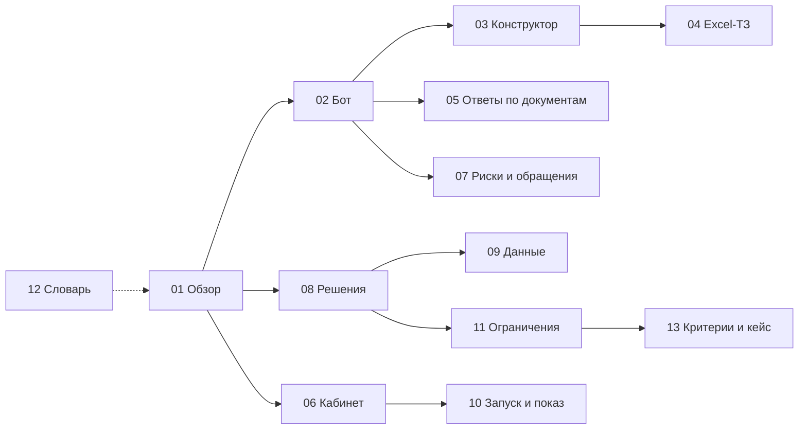

# Корсик: набор для руководителя команды

Четырнадцать документов о платформе «Корсик» простым языком: чтобы уверенно защищать её перед жюри, отвечать кейсодержателю ПОЛИПЛАСТИК и решать открытые вопросы.

Каждое утверждение опирается на код или документы проекта; где проверить не удалось, так и написано — «не проверено». Тексты конфиденциальных материалов кейса (Excel-ТЗ, ПВТР, презентации) не цитируются, только номера строк и пересказ. Секретов и значений переменных в наборе нет.

Состояние на 24.10.2026 утро, последний коммит — `e0e8172` (шаг сценария открывается в модалке).

---

## Карта набора

| # | Документ | О чём |
|---|---|---|
| 01 | [01-platform-overview.md](01-platform-overview.md) | что это, для кого, роли, из чего состоит, путь новичка до D+90, главные цифры |
| 02 | [02-bot-behaviour.md](02-bot-behaviour.md) | что видит новичок: подключение, таймлайн, «Дальше →», ветки, опросы, ты/вы, вопросы, команды, голос, напоминания, «Что вы пропустили» |
| 03 | [03-scenario-editor-guide.md](03-scenario-editor-guide.md) | руководство HR по конструктору: шаги, ветки, действия, опросы, исходы, импорт и экспорт Excel, вариант на «вы», публикация |
| 04 | [04-excel-to-platform.md](04-excel-to-platform.md) | как каждая колонка и конструкция Excel-ТЗ ложится в конструктор; доказательство полноты |
| 05 | [05-knowledge-base-rag.md](05-knowledge-base-rag.md) | как бот отвечает по документам, когда отказывается, цифры качества |
| 06 | [06-hr-cabinet-guide.md](06-hr-cabinet-guide.md) | экраны кабинета: что на каждом делать |
| 07 | [07-risk-and-escalation.md](07-risk-and-escalation.md) | флаги F0–F10, когда создаётся обращение, статусы, SLA, зоны риска, руководитель |
| 08 | [08-decisions.md](08-decisions.md) | 15 ключевых решений «почему / что отвергли / цена» и открытые решения за человеком |
| 09 | [09-data-and-security.md](09-data-and-security.md) | какие данные храним, согласие, что уходит в модель, п. 4.3.2, секреты |
| 10 | [10-run-and-demo.md](10-run-and-demo.md) | `make demo`, порты, сценарий показа, что делать, если упал под модели |
| 11 | [11-limitations-and-roadmap.md](11-limitations-and-roadmap.md) | что не готово, дыры ТЗ, мелочи, план пилота |
| 12 | [12-glossary.md](12-glossary.md) | словарь: D0, ИС, площадки, RAG, реранкер, порог, обращение, флаг, исход опроса |
| 13 | [13-criteria-coverage.md](13-criteria-coverage.md) | критерии жюри с честной оценкой, требования кейса построчно с доказательствами, пп. 4.3.1–4.3.4, сверх кейса, чего нет, одна согласованная цифра на метрику |

---

## Маршрут 1: за 15 минут перед чек-поинтом

| Минуты | Что прочитать | Зачем |
|---|---|---|
| 3 | [13](13-criteria-coverage.md): «Итог на одном экране» и «Цифры для защиты» | оценки по критериям, козыри, риски и какие числа называть |
| 2 | [01](01-platform-overview.md): «Что и зачем», «Роли», «Цифры» | одна фраза о продукте и цифры, на которые можно опираться |
| 4 | [10](10-run-and-demo.md): «Перед показом», «Сценарий показа», «Если упал под LLM» | что проверить и в каком порядке кликать |
| 2 | [11](11-limitations-and-roadmap.md): «Уровни проверки», первая таблица | что говорить только с оговоркой |
| 2 | [08](08-decisions.md): «Открытые решения за человеком» | что спросить у кейсодержателя и что решить |
| 2 | [09](09-data-and-security.md): «Вопрос п. 4.3.2» | одна формулировка про модель на RunPod и чего не говорить |

Три фразы, которые стоит держать в голове:
1. «Ваш Excel-ТЗ импортируется целиком: 21 блок, 57 шагов, 29 веток, 5 опросов. Мы прогнали все 70 строк на трёх площадках, но на подделке MAX; в настоящем MAX пройден базовый путь».
2. «Бот отвечает только с пунктом регламента. На новых разговорных вопросах — 59–68 %, ловушки — 100 % отказов. Остальное он не выдумывает, а передаёт человеку».
3. «Модель открытая, развёрнута нами на арендованной GPU, сторонних ИИ-сервисов нет. Без модели бот отвечает дословной цитатой».

---

## Маршрут 2: полное понимание за час

| Минуты | Документы | Что вынести |
|---|---|---|
| 5 | [12](12-glossary.md) | термины |
| 5 | [01](01-platform-overview.md) | общая картина |
| 10 | [02](02-bot-behaviour.md) | как бот ведёт диалог и почему «Дальше →» |
| 8 | [04](04-excel-to-platform.md) | почему «конструктор описывает ТЗ целиком» — правда и чем это доказано |
| 7 | [05](05-knowledge-base-rag.md) | как бот находит пункт и когда отказывается |
| 7 | [07](07-risk-and-escalation.md) | когда появляется обращение и кто что видит |
| 8 | [08](08-decisions.md) | решения и открытые вопросы |
| 5 | [09](09-data-and-security.md) | ПДн и конфиденциальность |
| 5 | [11](11-limitations-and-roadmap.md) | чего нельзя называть сделанным |

Руководства [03](03-scenario-editor-guide.md), [06](06-hr-cabinet-guide.md) и [10](10-run-and-demo.md) — справочники: открывать, когда нужно показать экран или ответить «а как HR это сделает».

---

## Где первоисточники

| Что | Где |
|---|---|
| Описание для жюри | `README.md` |
| Журнал работ и решений | `agency/LOG.md` |
| Контракты API | `agency/system/api_contract.md` |
| Разбор ТЗ и сверка | `agency/playbook/steps/05…07` |
| Ночной отчёт и решения за человеком | `agency/playbook/steps/08-night-report.md` |
| Питч, ответы на вопросы, дыры | `agency/pitch/` |
| Ресерчи | `agency/playbook/artifacts/research/` |

---

## Расхождения, найденные при написании

Код не менялся. Ниже — где другие документы проекта расходятся с кодом или между собой. Пути кода — от корня репозитория.

### Устаревшие утверждения в документах

| # | Где написано | Что написано | Что в коде |
|---|---|---|---|
| 1 | `README.md` («Сознательно не сделано», «Ограничения», план пилота недели 7–8); `agency/pitch/qa.md` №20; `agency/pitch/gaps.md` G16; `agency/pitch/checkpoint-2410.md` «Не сделано» | экспорта сценария в Excel нет | экспорт есть: `backend/services/scenario_xlsx_export.go`, кнопка «Скачать Excel», коммит `f2c8b31` |
| 2 | `README.md` (таблица «Кабинет, RAG и остальное», строка «Голосовые»); `qa.md` N7; `gaps.md` G15 | код только читает расшифровку от MAX | есть локальное распознавание T-one: `services/rag/asr.py`, `backend/services/bot_voice.go`, коммит `a4d78c2`. В таблице ИИ-инструментов README T-one не указан |
| 3 | `services/rag/README.md`, «Что заглушено или не сделано» | `/flags` всегда отдаёт пустую разметку; генерация на настоящей модели не прогонялась | `/flags` размечает моделью (`services/rag/flags.py`); метрики с моделью в том же README есть |
| 4 | `services/rag/README.md`; `agency/system/api_contract.md` (раздел backend → rag) | загруженные документы пропадают при рестарте | файлы хранятся в Postgres, бэкенд перезаливает их в сервис поиска (`backend/domain/documents.go`, `backend/services/documents.go` `Resync`) |
| 5 | `services/rag/README.md` («бот ждёт 8 с»), `RAG_ASK_BUDGET` | бот ждёт ответ поиска 8 с | `RAG_ASK_TIMEOUT` по умолчанию 12 с (`backend/config/config.go:115`), в `docker-compose.demo.yml` 20 с, затем ещё 20 с ожидания (`backend/services/bot_ask.go`, `lateAskWindow`) |
| 6 | `agency/system/api_contract.md` v4, абзац о `survey.questions` | правила после опроса — Should | реализованы (`backend/services/branch_survey.go`, `OutcomesEditor.vue`) |
| 7 | `agency/system/a_core_stack.md` («Статус: план, кода ещё нет»); `agency/playbook/steps/01-architecture.md` (правила-слова уволь*, взятк*, откат*, ударил*, угрож*; маскирование ПДн до запроса) | план | правила-слова только для F7, F5, F9: увол…, ударил…, взятк…, откат (`backend/pkg/flags/flags.go:52-57`), «угрож*» нет. Маскирования имён в вопросе нет (README это признаёт) |
| 8 | `agency/pitch/qa.md` N14 | самый тяжёлый сигнал без кнопки «связаться» становится карточкой HR без сообщения новичку | без ветки флаг высокой серьёзности даёт обращение **с** сообщением новичку; «тихая» карточка — только когда у варианта своя ветка без эскалации (`backend/services/bot_flags.go:315-321`, `branch_survey.go:331-332`) |
| 9 | разные документы | 83 правки «вы» и 0 ошибок (`08-night-report.md`) против 87 текстов и одного «ты» (`README.md`, `qa.md` N16); 49 замечаний импорта (`LOG.md`, e2e) против 54 (`README.md`); отложенный набор 59–64 % (`services/rag/README.md`) против 59–68 % (`README.md`) | разные прогоны; какое число верное — [13](13-criteria-coverage.md), раздел 7 |
| 10 | `README.md`, строка «Конструктор описывает ТЗ целиком… личный файл плана из карточки (r36)» с меткой «✅ API» | личный файл загружается из карточки | сервер принимает файл (`POST /api/newcomers/{id}/files`), но кнопки загрузки в кабинете нет (`frontend/src/api/newcomers.ts`) |

### Мелкие нестыковки в продукте

| # | Что | Где |
|---|---|---|
| 11 | Превью телефона обрезает подпись кнопки на 18 символах, хотя лимит 18 сняли как ложный | `frontend/src/components/scenarios/PhonePreview.vue:9` |
| 12 | Текст «Подробнее» о согласии предлагает «нажмите кнопку согласия в сообщении выше», а после ответа кнопки убираются | `backend/services/bot_render.go:63-66`, `bot.go:322-324` |
| 13 | «Проверить по телефону»: бот пишет «Передам рекрутеру», но ни обращения, ни сообщения рекрутеру не создаётся | `backend/services/bot.go:777-783` |
| 14 | Сроки SLA из `data/taxonomy.yaml` код не читает; у F0 там «тихие часы не действуют», а SLA P0 считается в рабочих часах | `backend/services/sla.go:10-24` |
| 15 | Уведомление руководителю по обращению (F1, F2, F6) — только строка в логе | `backend/services/tickets.go:212-214` |
| 16 | Поле «тон» (sentiment) от разметки бэкенд не использует; «настроение» в кабинете — средний пульс | `backend/externalApi/rag/flags.go:49`, `backend/services/overview.go` |
| 17 | Нет ключа локали `scenarios.test.noRecipient`; подпись «Вы отвечаете как» есть, но поля смены имени оператора нет; подпись `label_truncated` для кода, который импорт больше не выдаёт | `frontend/src/pages/scenarios/ScenarioEditorPage.vue:305`, `frontend/src/i18n/locales/ru/tickets.json:104`, `scenarios.json` |
| 18 | Устаревший комментарий TODO про «Что вы пропустили» — сводка уже сделана | `backend/services/scheduler.go:318` |
| 19 | Страница «Мои новички» открывается по имени без проверки, кто смотрит | `backend/handlers/manager.go:42-52` |

### Вопросы к оркестратору

- В `agency/playbook/steps/08-night-report.md` есть живая ссылка-приглашение тестового новичка с токеном. Это не секрет инфраструктуры, но персональная ссылка: стоит убрать перед публикацией репозитория.
- В `agency/LOG.md` записаны идентификаторы и адреса подов RunPod. Ключей там нет, но адрес модели лучше не публиковать.
- Расшифровку аббревиатур GrPP и GTP мы в документах не нашли — стоит уточнить у кейсодержателя, чтобы правильно называть площадки на защите.
