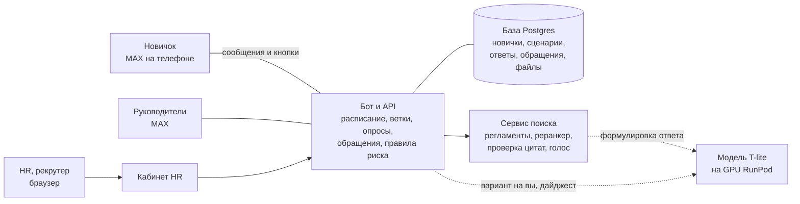
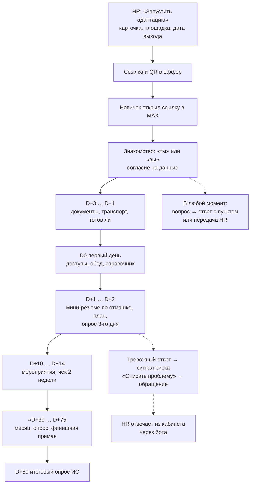

# Корсик: что это и для кого

Корсик — ИИ-помощник адаптации новичков ПОЛИПЛАСТИК в мессенджере MAX плюс веб-кабинет HR. Бот ведёт новичка от приглашения до конца испытательного срока, отвечает по регламентам с пунктом-источником и зовёт человека, когда нужно.

**Карта набора:** [00-index.md](00-index.md) | **Связанные:** [02-bot-behaviour.md](02-bot-behaviour.md), [06-hr-cabinet-guide.md](06-hr-cabinet-guide.md), [08-decisions.md](08-decisions.md)

---

## Что и зачем

Хакатон «Открой#Моспром» 2026, кейс ПОЛИПЛАСТИК. По формулировке кейса у компании уже есть бот адаптации; его нужно воспроизвести в MAX и расширить ИИ: ответы по непубличной базе знаний, корпоративный стиль, панель управления для рекрутеров (`agency/pitch/deck.md`, раздел 0). Поэтому в питче — «было → стало», а не «бот с нуля».

Проблема, которую решаем:
- на заводе у рабочего часто нет компьютера и корпоративной почты, но есть телефон;
- HR тратит время на одни и те же вопросы новичков (наше допущение — 4 часа на новичка, его нужно подтвердить у кейсодержателя);
- проблемы новичка (нет пропуска, конфликт, хочет уйти) замечают поздно.

Что сделано:
- сценарий заказчика из его Excel-ТЗ импортируется и исполняется ботом целиком, по дням от даты выхода;
- ответы на вопросы — только по регламентам и с пунктом, иначе честный отказ и передача HR;
- риски и обращения с маршрутами, где жалоба на руководителя ему не попадает;
- кабинет HR, дайджест руководителю подбора, поводы 1:1 руководителю подразделения.

---

## Роли

| Роль | Где живёт | Что получает | Чего не видит |
|---|---|---|---|
| **Новичок** | чат с ботом в MAX | маршрут по дням, опросы, ответы по регламентам, ответы HR через бота | кабинет |
| **HR, рекрутер** | веб-кабинет | новички, траектории, обращения, сценарии, база знаний, медиатека | — (ролей в кабинете пока нет) |
| **Руководитель подразделения** | MAX + страница «Мои новички» | поводы встретиться 1:1: второй низкий пульс, молчит больше 3 дней, конец ИС через 3 дня, месяц работы | тексты ответов, обращения, категории F0, F4, F5, F9, F10 |
| **Руководитель подбора** | MAX + «Аналитика» | дайджест недели по понедельникам в 9:00: темы, зоны риска, площадки, динамика | имена и группы меньше 5 человек |
| HR-партнёр, СБ | через обращения | конфликты, грубость, намерение уйти; коррупция (СБ) | — |

---

## Из чего состоит система

| Часть | Что делает | Технология |
|---|---|---|
| Бот и API | ведёт новичков по расписанию, принимает кнопки и тексты, заводит обращения, отдаёт данные кабинету | Go (Fiber, GORM), папка `backend/` |
| База | всё состояние: новички, сценарии и версии, события, ответы, обращения, документы базы знаний | Postgres 16 |
| Сервис поиска | разбирает документы, ищет пункт, проверяет ответ, распознаёт голос | Python, папка `services/rag/` |
| Модель | формулирует ответ, размечает риск, переписывает на «вы», пишет текст дайджеста | T-lite-it-2.1 на vLLM, арендованная GPU |
| Кабинет | экраны HR | Vue 3, папка `frontend/` |

Пунктир на схеме — модель необязательна: без неё бот отвечает дословной цитатой пункта, а сценарии, опросы и обращения работают так же ([10-run-and-demo.md](10-run-and-demo.md)).

---

## Путь новичка от приглашения до D+90

Пример: Анна выходит в понедельник 9 ноября на площадку GrPP. В пятницу 6 ноября она получает пакет D−3 и D−1 (бот пишет «в понедельник, 9 ноября», а не «завтра»). В понедельник в 10:00 — первый день. На третий день — опрос; она выбирает «задачи не объяснили» и жмёт «Описать проблему» — у рекрутера появляется обращение, а в карточке Анны — сигнал риска с причиной.

---

## Цифры, на которые можно опираться

| Что | Значение | Где измерено |
|---|---|---|
| Импорт настоящего Excel-ТЗ | 21 блок, 57 шагов, 29 веток, 5 опросов на 30 вопросов, 54 предупреждения | кабинет, API |
| Сверка ТЗ r1–r70 | 18 новичков × 3 площадки, D−3…D+92 | подделка MAX |
| Верный пункт на разговорных вопросах | 85 % (основной набор), 59–68 % (отложенный) | настоящие регламенты, локально |
| Отказ на ловушках и инъекциях | 100 % | там же |
| Тесты | RAG больше 200, бэкенд 189 функций, кабинет 76 | README «Качество» |

---

## Полезно знать

- **Данные в репозитории синтетические.** Настоящие ТЗ, ПВТР и презентации лежат только локально и конфиденциальны.
- **Модель на арендованной GPU** — не «on-prem». Формулировка — [09-data-and-security.md](09-data-and-security.md).
- **Расшифровку названий площадок** GrPP и GTP в документах проекта мы не нашли. По документам GrPP и Luzhniki — офисы, GTP — производство.
- **ИИ-инструменты раскрываются** по п. 4.3.3–4.3.4 Положения: код писали агенты Claude Code под контролем команды, в продукте — T-lite, bge-m3, bge-reranker (README, «Использованные ИИ-инструменты»). Модель распознавания голоса T-one добавлена позже и в эту таблицу README пока не внесена.

---

## Связанные документы

- [02-bot-behaviour.md](02-bot-behaviour.md) — что новичок видит в чате
- [06-hr-cabinet-guide.md](06-hr-cabinet-guide.md) — экраны кабинета
- [08-decisions.md](08-decisions.md) — почему так устроено
