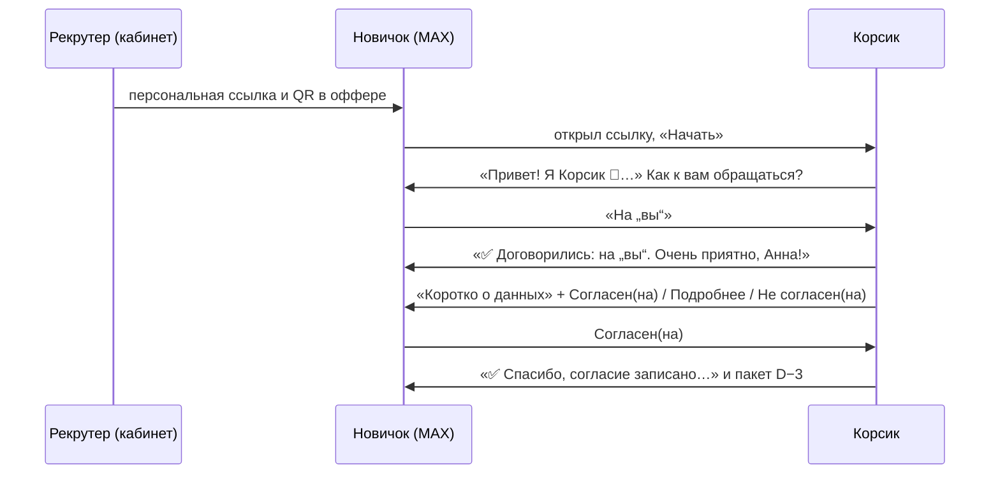
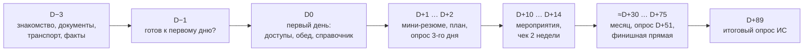
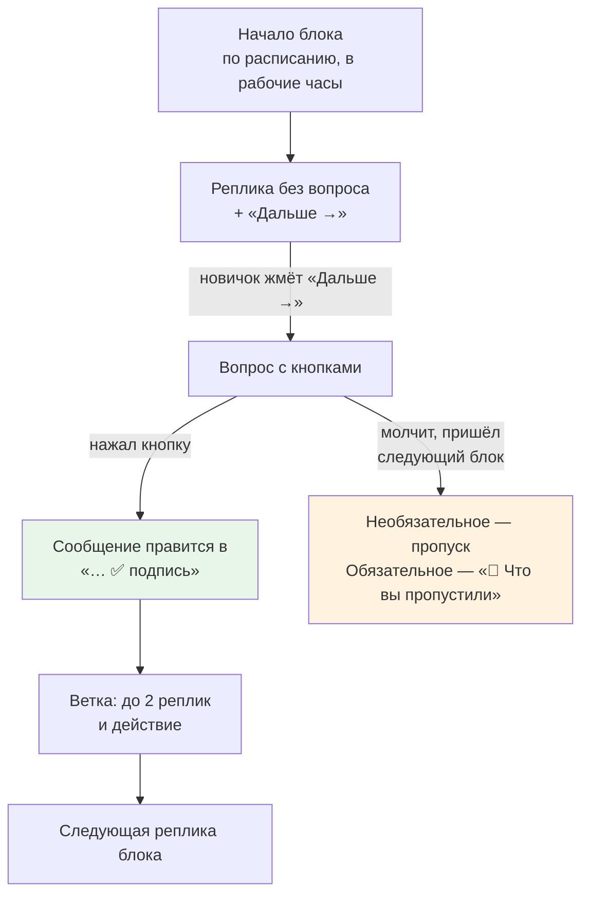
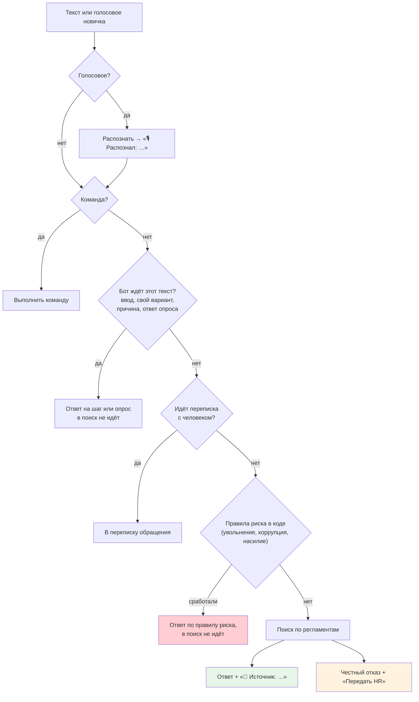

# Как бот ведёт себя в чате

Что видит новичок в MAX: от первой ссылки до конца испытательного срока, как устроены кнопки, опросы, ответы на вопросы и напоминания.

**Карта набора:** [00-index.md](00-index.md) | **Связанные:** [03-scenario-editor-guide.md](03-scenario-editor-guide.md), [05-knowledge-base-rag.md](05-knowledge-base-rag.md), [07-risk-and-escalation.md](07-risk-and-escalation.md)

Все строки бота ниже взяты из кода (`backend/services/bot_render.go`, `bot_ask_render.go`, `branch*.go`). Пути к файлам даны от `backend/`.

---

## Что и зачем

Новичок на заводе часто без компьютера, но с телефоном. Бот должен вести его по маршруту адаптации, не заваливая сообщениями, отвечать на вопросы только по документам и вовремя звать человека. Поэтому почти всё поведение задано правилами в коде, а модель только формулирует текст.

---

## Подключение: ссылка, «ты/вы», согласие

| Ситуация | Что делает бот |
|---|---|
| Новичок открыл свою ссылку | находит его карточку, знакомится, спрашивает форму обращения, просит согласие |
| «Начать» без ссылки | чужому аккаунту пишет «Ссылка не сработала. Напишите рекрутеру — он пришлёт новую.» и даёт кнопку «Проверить по телефону» |
| Ссылка просрочена или ею уже вошёл другой аккаунт | то же «Ссылка не сработала…» |
| Срок ссылки | дата выхода плюс 30 дней (`INVITE_TTL`) |
| Новичок нажал «Проверить по телефону» | бот отвечает «Спасибо! Передам рекрутеру…». **Внимание:** в коде здесь только этот текст, обращение не создаётся и рекрутеру ничего не уходит (`services/bot.go:777-783`) |
| Вернулся уже подключённый | «С возвращением! Я на связи 🐾» |

**Почему только по ссылке.** В API MAX не описано, что бот может написать первым человеку, который его не открывал. Кроме того, QR в оффере требует само ТЗ (r8, колонка «Форма/Макет»).

**Согласие.**
- «Согласен(на)»: бот говорит, когда пришлёт первые материалы («Первые материалы пришлю в понедельник в 10:00. А пока можете спросить меня о пропуске, графике или зарплате…»), и запускает всё созревшее.
- «Не согласен(на)»: «Понял. Опросы присылать не буду — только напоминания и ответы на вопросы.» Опросы помечаются пропущенными, обычные шаги идут дальше. Без согласия бот не сохраняет тексты вопросов.
- После ответа кнопки согласия исчезают. Текст «Подробнее» предлагает «нажмите кнопку согласия в сообщении выше», но нажать уже нечего: передумать можно только через HR. Это мелкая нестыковка, она записана в [00-index.md](00-index.md).

**Поздно подключился.** До даты выхода созревшие шаги уходят сразу. После даты выхода — только шаги сегодняшнего дня, прошлые помечаются «пропущено: подключился позже даты шага» (`services/scheduler.go:315-340`).

---

## Таймлайн: когда приходят сообщения

Это пример по сценарию из Excel-ТЗ. Сами шаги задаёт HR в конструкторе.

| Правило | Как работает |
|---|---|
| Отсчёт | от даты выхода (D0) в календарных днях |
| Время | по часам площадки; шаг без времени уходит в 10:00 |
| Рабочие часы | у всех трёх площадок пн–чт 9:00–18:00, пт 9:00–17:00, Москва (`domain/site.go`) |
| Выходной | шаг переносится на следующий рабочий день. Шаг до выхода, который так попал бы на D0 или позже, уходит в предыдущий рабочий день |
| Праздники РФ | **не учитываются** (в коде TODO) |
| Смены GTP | **не учитываются**, запланированы на следующую итерацию |
| Площадки | шаг с метками площадок уходит только новичкам этих площадок |
| Перенос даты выхода | неотправленные шаги пересчитываются, отправленные остаются, дублей нет |
| Проверка расписания | планировщик просыпается раз в 30 с и смотрит каждого новичка отдельно |

**Скорость отправки.** MAX разрешает не больше 2 сообщений в секунду в один диалог. Бот держит паузу 600 мс между сообщениями одному человеку, а при ответе MAX «слишком часто» повторяет до 3 раз. Разные новички друг друга не ждут.

---

## Блок как диалог и кнопка «Дальше →»

Блок — это сообщения одного дня и времени (реплики с разницей до 2 минут считаются одним блоком). Блок идёт как разговор, а не как пачка.

**«Дальше →» по умолчанию.** Каждое сообщение без вопроса, за которым в блоке есть ещё сообщения, получает кнопку «Дальше →». Новичок листает блок как карточки. После нажатия клавиатура исчезает и приходит следующая реплика.

Почему так, а не подряд:
- в ТЗ есть блоки по 10 и больше реплик (D−3). Без паузы новичок получает стену текста, а MAX ещё и режет скорость до 2 сообщений в секунду;
- «Дальше» даёт сигнал, что человек читает. Молчание становится видно;
- это решение человека 24.10 «против спама» (`agency/LOG.md`, «Ветвления: вердикт ресерчера»). Режим «сразу, с „печатает…“» оставлен только как ручная настройка HR, и даже в нём подряд без участия новичка уходит не больше двух сообщений.

Исключения: вступление прямо перед опросом идёт без «Дальше» (опрос приходит сразу), у последней реплики блока «Дальше» нет.

**Вопрос держит поток.** Шаг с кнопками-ответами, опрос или шаг «ввод ответа» останавливает блок до ответа. После нажатия:
1. сообщение правится в «исходный текст ✅ подпись», всплывает «Записал»; повторное нажатие даёт «Уже записал»;
2. уходит ветка этой кнопки (до двух реплик);
3. идёт следующая реплика блока.

Если новичок ответил ночью или в выходной, продолжение уходит сразу: это реакция на его действие. Рабочие часы касаются только начала блока и напоминаний.

**Кнопки.** Две в ряд, только если обе подписи не длиннее 16 символов, иначе по одной. В сообщениях с кнопками последний ряд — «Спросить человека». Сообщение старше 24 часов MAX править не даёт, поэтому продолжение тогда приходит новым сообщением.

---

## Ветки и действия

Ветка — ответ бота на конкретную кнопку или вариант опроса: **до двух реплик** и действие. Одна ветка может срабатывать на несколько кнопок («если 1 или 2»). Кнопки внутри ветки — только конечные, своих веток у них нет.

| Действие | Что видит новичок |
|---|---|
| Описать проблему (ждать текст) | «Напишите одним сообщением — я передам.» Текст уходит обращением указанному адресату, в поиск по регламентам не идёт |
| Связаться с человеком | открывается переписка с рекрутером, HR или СБ через бота |
| Завести обращение | обращение с категорией и адресатом из ветки |
| Прислать файл | «📎 имя файла»; файл своей площадки. Нет файла: «Файл пока не загружен — HR пришлёт его отдельно.» |
| Личный файл (адаптационный план) | файл из карточки. Нет файла: «Плана ещё нет — я напомнил HR, он пришлёт его сюда.» и задача HR |
| Поставить отметку | например, отмашка рекрутера; отпускает шаги «по отмашке» |
| Задать форму обращения | ты или вы |

После ветки поток продолжается, либо блок заканчивается, либо бот переходит к другому блоку (настройка «что дальше»). Если у реплики нет ни текста, ни найденного файла, бот пишет «Материал скоро добавим. А пока можно спросить меня или HR.» и пустых сообщений не шлёт.

---

## Опросы

| Тип вопроса | Как выглядит в MAX |
|---|---|
| Шкала 1–10 | два ряда по 5 кнопок. Оценку можно написать текстом: «7», «7/10», «семь» |
| Шкала 1–5 | пять эмодзи 😞😕😐🙂😄 |
| Да / нет | две кнопки |
| Выбор одного | кнопки вариантов, у варианта может быть своя ветка |
| Несколько ответов | переключатели «✓ …» и кнопка «Готово»; без выбора — «Отметьте хотя бы один вариант» |
| «Свой вариант» | кнопка «Другое — свой ответ» → «Напишите свой вариант одним сообщением.» |
| Открытый | «Напишите ответ одним сообщением.» |

- Сверху каждого вопроса «Вопрос N из M».
- **Причина при низкой оценке или «нет».** Если оценка ниже порога (в ТЗ — ниже 8) или ответ «нет», бот обязательно просит: «Напишите, пожалуйста, одним сообщением, что не так.», без «Пропустить».
- **Необязательный комментарий:** «Хотите добавить комментарий?» с кнопками «Добавить комментарий» / «Дальше →».
- **Обязательный вопрос:** кнопки «Пропустить» нет, на попытку пропуска — «Этот вопрос обязательный».
- **Конец опроса:** сообщение правится в итог «✅ Спасибо! Ответы записаны.» со строками «✅ 1. вопрос: ответ». Лента не захламляется.
- **Исходы опроса.** После последнего ответа срабатывают правила «После опроса»: в одной группе — первое подходящее («ЛИБО»), разные группы — независимо («+»). Так исполняется r57 ТЗ.
- **Флаг варианта** ставит сигнал риска в карточку, а обращение заводится только нажатием или текстом новичка. Подробности — [07-risk-and-escalation.md](07-risk-and-escalation.md).
- «Свой вариант» и причины идут только в ответ опроса и в разметку риска, в поиск по регламентам они не уходят.

---

## Ты и вы

- Форму выбирает сам новичок при знакомстве. Пока форма не выбрана, бот говорит на «вы».
- У шага два текста: на «ты» и на «вы». Если один пуст, бот берёт другой.
- Вопросы и варианты опроса тоже имеют вариант на «вы».
- ТЗ заказчика написано на «ты». Вариант на «вы» не генерируется в момент отправки: его заранее готовит ИИ в кабинете, код проверяет, HR вычитывает ([03-scenario-editor-guide.md](03-scenario-editor-guide.md)).
- Подстановки: `{Имя}` (второе слово ФИО) и `{start_day}` («сегодня», «завтра» или «в понедельник, 26 октября», считается в момент отправки).

---

## Свободный вопрос → ответ по документам

Когда новичок пишет текст, бот сначала проверяет, не ждёт ли он этот текст для чего-то другого. Только если нет, текст считается вопросом.

**Ответ найден.** Суть жирным, текст, строка «📄 Источник: документ, п. X». Кнопки «Подробнее» (дословная цитата пункта), «👍 Помогло», «Не то», «Спросить человека». «Не то» в первый раз предлагает до трёх других пунктов или переформулировать, во второй — «Передать HR?».

**Ответа нет.** «В регламентах я этого не нашёл, а выдумывать не буду 🐾. Могу передать вопрос HR — обычно отвечают в течение рабочего дня.» Кнопки «Передать HR», «Переформулирую», «Не нужно». Если в сценарии есть правило r69, вместо этого текста уходит текст правила с его картинкой и кнопками.

**Вопрос не для бота** (зарплата конкретного человека, конфликт, здоровье, увольнение): «Это вопрос для человека.» и кнопки «Передать HR», «Передать рекрутеру», «Не нужно».

**Медленно.** Если поиск не ответил за `RAG_ASK_TIMEOUT` (по умолчанию в коде 12 с, в `make demo` 20 с), бот пишет «Ищу в документах дольше обычного — пришлю ответ сюда же, подождите немного.» и ждёт ещё 20 с. Пока ищет — «печатает».

Как идёт поиск и почему бот отказывается — [05-knowledge-base-rag.md](05-knowledge-base-rag.md).

---

## Команды

| Команда | Что делает |
|---|---|
| `/start` | начать (без ссылки — текст помощи) |
| `/help` | что умеет бот |
| `/menu` | меню |
| `/human` | связаться с человеком |
| `/hr` | связаться с HR (если в сценарии нет своей `/hr`) |
| `/food` и другие команды сценария | действия из сценария: например, PDF «где пообедать» своей площадки |

Команды сценария главнее встроенных и берутся из опубликованной версии. Меню команд в MAX обновляется при запуске бота и после каждой публикации. Команды работают и во время переписки с HR. Незнакомая команда даёт текст помощи.

---

## Голосовые

1. Если MAX прислал свою расшифровку, бот берёт её.
2. Иначе скачивает файл (до 20 МБ, не длиннее 120 с) и распознаёт у нас локально моделью T-one. Пока распознаёт — «печатает».
3. Новичку приходит «🎙 Распознал: …», и дальше текст идёт как набранный: вопрос, свой вариант, ввод, ответ опроса.
4. Не вышло: «Не разобрал голосовое, напишите текстом, пожалуйста.»

Звук и текст никуда наружу не уходят. **Не проверено на живом MAX:** приходит ли расшифровка от MAX и отдаёт ли MAX файл голосового без токена бота. Это решение за человеком в `08-night-report.md` (п. 5): отправить голосовое с телефона.

---

## Напоминания и молчуны

| Ситуация | Что делает бот |
|---|---|
| Не ответил на вопрос с кнопками (у шага настроено «если не ответил») | «🔔 Напоминаю:» с теми же кнопками через заданные часы (24, 48), только в рабочие часы. Через сутки после последнего напоминания шаг считается неотвеченным, поток идёт дальше |
| Не прошёл опрос (правило r70) | через 24 и 48 ч от отправки, в рабочие часы: текст правила и «Опрос: „…“ — он выше в чате». Сроки, пропущенные за выходные, сливаются в одно напоминание |
| Нажал «Напомнить завтра» в опросе | «🕓 Хорошо, напомню завтра.» Не больше двух раз, потом «Хорошо, не буду напоминать…» |
| Шаг «по отмашке рекрутера», а отмашки нет | шаг ждёт и поток не держит. Рекрутер включает отмашку в карточке — шаг уходит |
| Отключил бота в MAX | статус «отключил бота», зона риска поднимается до жёлтой |

**Молчун не тормозит других.** Планировщик ведёт каждого новичка отдельно. До ночного исправления 24.10 молчун получал одно сообщение за 90 дней и задерживал рассылку новичкам GTP.

---

## «Что вы пропустили»

Если новичок не ответил на вопрос блока, а пришло время следующего блока:
- **необязательные** реплики старого блока пропускаются;
- **обязательные** приходят перед новым блоком одним сообщением «📌 Что вы пропустили:», реплики разделены «— — —», длинная сводка режется на части по 4000 символов.

В сводку не попадают опросы, задачи HR, шаги без отмашки и опросы без согласия. Об опросах бот напоминает отдельно.

---

## Если чего-то нет

| Чего нет | Как бот себя ведёт |
|---|---|
| Модели (LLM) | на вопросы отвечает дословной цитатой пункта; разметка риска только правилами в коде; сценарии, опросы, напоминания и обращения работают как обычно |
| Сервиса поиска (RAG) | «Сейчас не могу проверить по документам: справочная база не отвечает. Могу передать вопрос HR…» с кнопками «Передать HR» / «Не нужно». Голосовые не распознаются |
| Базы данных | на всё отвечает «Корсик на связи» |
| Файла в медиатеке | сообщение без вложения или «Материал скоро добавим…» |

---

## Полезно знать

- **Демо-режим.** Машина времени шлёт шаги с пометкой «[ТЕСТ]» и помечает новичка тестовым. Такие ответы не идут в дайджест.
- **Групповые чаты.** Сообщения из групп бот игнорирует.
- **Старые кнопки.** Кнопка удалённого сообщения отвечает «Эта кнопка больше не работает». Но ветка, удалённая в новой версии сценария, у уже отправленного сообщения продолжает работать: бот смотрит в ту версию, по которой сообщение ушло.
- **Не проверено вживую:** «печатает», обработка ответа MAX «слишком часто», голосовые и сценарий из Excel-ТЗ на телефоне. Базовый путь (ссылка, согласие, шаги, ответ с источником, отказ, обращение, ответ HR) пройден в настоящем MAX 24.10 01:08–01:15.

---

## Связанные документы

- [05-knowledge-base-rag.md](05-knowledge-base-rag.md) — как устроен поиск ответа
- [07-risk-and-escalation.md](07-risk-and-escalation.md) — когда создаётся обращение
- [03-scenario-editor-guide.md](03-scenario-editor-guide.md) — как HR настраивает всё описанное выше
