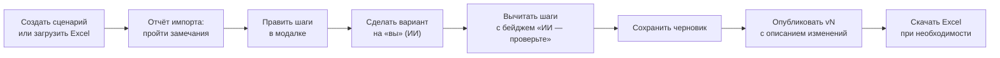

# Конструктор сценариев: руководство HR

Как HR собирает и меняет маршрут адаптации сам, без программиста: шаги, кнопки, ветки, опросы, файлы по площадкам, импорт и выгрузка Excel, вариант на «вы» и публикация.

**Карта набора:** [00-index.md](00-index.md) | **Связанные:** [04-excel-to-platform.md](04-excel-to-platform.md), [02-bot-behaviour.md](02-bot-behaviour.md)

Источники: `frontend/src/pages/scenarios/*`, `frontend/src/components/scenarios/*`, подписи из `frontend/src/i18n/locales/ru/scenarios.json`, `rewrite.json`; правила — `agency/system/api_contract.md`, раздел v4.

---

## Что и зачем

Правило из UX-спеки: «HR правит сценарий — бот меняет поведение». Всё, что видит сотрудник, редактируется в кабинете. Конструктор выражает Excel-ТЗ заказчика целиком (доказательство — [04](04-excel-to-platform.md)).

---

## Основные понятия

| Понятие | Что это |
|---|---|
| Сценарий | весь маршрут: шаги, команды, правила |
| Блок | шаги с одним днём и временем. В таблице объединены одной ячейкой «день, время, N сообщения» |
| Шаг | одно сообщение блока |
| Ветка | что бот отвечает на конкретную кнопку или вариант: до 2 реплик и действия |
| Черновик и версия | правите черновик, «Опубликовать» создаёт версию vN. Сотрудники идут по своей версии |

---

## Путь работы

---

## Список сценариев

- **«Создать сценарий»**: название, площадки, «Начать с» — пустого сценария или копии другого (берутся шаги его последней опубликованной версии).
- **«Загрузить Excel-таймлайн»**: файл `.xlsx`, после импорта открывается черновик. Старый формат `.xls` получает понятную ошибку.
- Статусы: «Черновик», «Черновик · опубликована vN», «Опубликован vN».
- Меню «⋯» у строки: «Открыть», «Скачать Excel (черновик)», «Скачать Excel (опубликованная vN)».
- **Удалить** можно только черновик, который ни разу не публиковался и по которому нет активных сотрудников: кнопка «Удалить черновик» в редакторе, с подтверждением.

---

## Экран редактора

**Шапка:** статус, число шагов, ошибок и замечаний, «есть несохранённые изменения». Кнопки «Удалить черновик», «Сделать вариант на «вы» (ИИ)», «Добавить шаг», «Сохранить черновик», «Скачать Excel», «Опубликовать».

**Три вида:**

| Вид | Что в нём |
|---|---|
| «Таблица» | шаги по блокам. Колонки: день, время, площадки, тип, текст, кнопки, ветки («2/3» — у двух кнопок из трёх есть ветка), статус. Значки «Письмо HR — бот не отправляет» и «По отмашке рекрутера». У кнопок — бейдж «%», сколько сотрудников её нажали |
| «Таймлайн» | колонка на день, отметка «выход» на D0, карточки шагов. Перетаскивание внутри блока, Alt+↑/↓, «+» вставляет реплику |
| «Команды и правила» | команды бота и правила сценария (ниже) |

**Шаг открывается в широкой модалке**: слева редактор шага, справа превью телефона. Esc или клик мимо закрывают. Порядок в блоке меняется кнопками «Выше в блоке», «Ниже в блоке», «Вставить реплику после». Если поменять день или время шага, он переезжает в конец нужного блока, и кабинет говорит об этом всплывающим сообщением. Уход со страницы с несохранёнными изменениями спрашивает подтверждение.

---

## Поля шага

| Поле | Что задаёт |
|---|---|
| «Название шага» | подпись для HR, сотрудник её не видит |
| «День от выхода» | 0 — день выхода, −3 — за три дня. Допустимо D−3…D+90 |
| «Время» | ЧЧ:ММ по площадке. Пусто — 10:00 |
| «Этап» | до выхода, первый день и т. д. |
| «Площадки» | ни одна не отмечена — все |
| «Тип» | «Текст», «Карточка с картинкой», «Файл», «Опрос», «Задача руководителю», «Ввод от сотрудника» |
| «Текст на «вы»» / «Текст на «ты»» | оба нужны, иначе замечание. Подстановки `{Имя}`, `{Руководитель}`, `{Наставник}`, `{Дата выхода}`, `{Площадка}` |
| «Добавить альтернативу текста» | второй вариант формулировки для HR; бот его не шлёт (ТЗ r8) |
| «Вложения» | выбор из медиатеки и флажок «Личный файл сотрудника: адаптационный план» |
| «Кнопки» | подпись, флажок «Свой вариант» (откроет поле для текста), «Добавить кнопку». Без кнопок сообщение не ждёт ответа |
| «Как перейти дальше» | для шага без вопроса: «По кнопке «Дальше →» (по умолчанию)» или «Сразу, с «печатает…»» |
| «Если не ответил» | для шага с вопросом: «продолжать молча» или «напомнить через 24 и 48 ч» |
| «Показ» | «Обязательный этап», «Письмо HR — бот не отправляет», «По отмашке рекрутера», «Только в рабочие часы» |
| «Условие показа» | свободный текст |

Внизу: «Отправить себе в МАКС» (только в режиме разработки: шаг уходит первому подключённому сотруднику с пометкой «[ТЕСТ]», реальный таймлайн не трогается), «Вставить реплику после», «Удалить шаг».

**Превью телефона** («Предпросмотр диалога») переключается на «вы» и «ты», показывает `{Имя}` как «Анна», а при открытой вкладке ветки — путь этой ветки. Подпись «Схематичный предпросмотр — не пиксель в пиксель».

---

## Кнопки и ветки

У каждой кнопки своя вкладка **«При ответе «…»»** рядом с вкладкой «Сообщение». Без ветки — «Ответ просто запишется».

| Что можно в ветке | Правило |
|---|---|
| Реплики | не больше двух, у каждой текст на «вы» и «ты» и вложения |
| Кнопки под репликой | только конечные, без своих веток; до 7 в ряд. «Что делает кнопка»: только записать нажатие, открыть поле для текста, связаться с, обращение, отправить файл по площадке |
| Действия | см. таблицу ниже |
| «Дальше» | продолжить блок, закончить блок или перейти к другому блоку |
| Общая ветка | «Эта ветка и для кнопок:» — отметить другие кнопки. На их вкладках будет «Открыть общую ветку» и «Отделить» |

| Действие | Настройки | Что сделает бот |
|---|---|---|
| «Обращение» | категория F0–F10, кому (HR, рекрутер, СБ), уведомить руководителя | заведёт обращение |
| «Связаться с» | кто ответит: рекрутер, HR, СБ | откроет живой диалог через бота |
| «Запомнить обращение» | на «ты» или «вы» | сменит форму обращения |
| «Запомнить флаг» | имя флага | поставит отметку в карточке (например, отмашку рекрутера) |
| «Отправить файл по площадке» | файл из медиатеки | пришлёт файл площадки сотрудника |
| «Открыть поле для текста» | подсказка сотруднику | дождётся текста и передаст его обращением |

Пара из ТЗ «передать через Корсика / связаться с рекрутером» собирается двумя кнопками под репликой: «Открыть поле для текста» + «Обращение» и «Связаться с».

---

## Опрос

Тип шага «Опрос». Текст шага остаётся вступлением, вопросы задаются ниже. Кнопка «Сделать текст первым вопросом» переносит текст в вопрос 1.

| Настройка вопроса | Варианты |
|---|---|
| «Тип вопроса» | «шкала», «да / нет», «один вариант», «несколько вариантов», «открытый» |
| «Шкала» и «Порог» | 1–10 или 1–5; ниже порога считается низкой оценкой |
| «Комментарий» | «нет», «по желанию», «при оценке ниже порога», «при „нет“» |
| «Варианты ответа» | список с вариантом на «вы», вверх/вниз, «Добавить вариант» |
| «Свой вариант» | для выбора: сотрудник может написать своё |
| «Обязательный вопрос — без «Пропустить»» | нельзя пропустить |
| «Ветки и флаги вариантов» | у каждого варианта «Флаг риска» (F0–F10 или без флага) с серьёзностью и своя ветка |

Ограничения: 1–20 вопросов, у выбора не меньше двух вариантов. Новый вопрос получает тип предыдущего.

**Флаг варианта** не создаёт обращение сам: он ставит сигнал риска. Обращение появится, когда сотрудник нажмёт кнопку связи в ветке. Подробно — [07-risk-and-escalation.md](07-risk-and-escalation.md).

### «После опроса» (исходы)

Сообщение «Спасибо за обратную связь!» уходит всегда. Дальше — правила:

| Настройка | Смысл |
|---|---|
| «Группа» A–E | правила одной группы — «ЛИБО»: срабатывает первое подходящее. Разные группы — «+»: независимо |
| «Как сочетать условия» | все условия или любое |
| «Если» | вопрос N, «=» значение или «содержит» (только для «несколько вариантов») |
| Ответ | своя реплика и действия, как у ветки |

Так собирается r57 ТЗ: «вопрос 1 = 2 ЛИБО вопрос 1 = 3» в одной группе и «+ вопрос 2 содержит „Никто!“» в другой.

---

## Площадки, вложения и медиатека

- Шаг для одной площадки — отметить её в «Площадках». Разные тексты по площадкам — несколько шагов с разными метками в одном блоке (так импорт раскладывает r9/r10, r11–r13).
- Вложение выбирается **по имени** из медиатеки. Файл под каждую площадку загружается в медиатеке, бот сам берёт нужный. Нет файла — замечание «вложение без файла», бот шлёт сообщение без вложения.
- Личный файл (адаптационный план) — флажок у шага; файл берётся из карточки сотрудника.

---

## Команды и правила

Вкладка «Команды и правила». Сохраняется кнопкой «Сохранить команды и правила» и автоматически при уходе с вкладки.

| Раздел | Что настраивается |
|---|---|
| «Команды» | «Добавить /food», «Добавить /hr», «Другая команда» (косая черта и латиница/цифры). Текст на «вы» и «ты» и «Что делает». Занятые имена: `/start`, `/help`, `/menu`, `/human` |
| «Свободный вопрос» (ТЗ r69) | текст отказа на «вы» и «ты» и две кнопки, когда бот не нашёл ответа в документах |
| «Напоминание об опросе» (ТЗ r70) | через 24 и 48 ч, текст, картинка |

Меню команд в МАКС обновляется после публикации.

---

## Импорт Excel и отчёт замечаний

1. «Загрузить Excel-таймлайн» в списке или «Загрузить Excel» в пустом сценарии. Импорт в существующий сценарий **заменяет** его шаги, команды и правила.
2. Открывается блок **«Отчёт импорта ТЗ»**: блоков, сообщений, вопросов, веток, правил, медиа-имён и «Требуют внимания: N. Нажмите на строку, чтобы открыть шаг.»
3. Фильтры по типу замечания. Каждая строка: «Строка N · тип · текст». **Клик открывает шаг.**
4. Импорт сразу заводит в медиатеке заглушки для всех имён картинок и файлов.

Отчёт хранится только в этой вкладке браузера. Закрыли вкладку — отчёт пропал, сценарий остался.

| Замечание | Что делать HR |
|---|---|
| «Нет материала ответа», «Вопрос без вариантов» | загрузить материал (маршрут, карту) в медиатеку |
| «Нет вложения» | загрузить файл с этим именем |
| «Форма обращения» | нажать «Сделать вариант на «вы» (ИИ)» |
| «Текст в роде» | проверить «Готов / Готова» и подобное, поправить руками |
| «Смешаны «ты» и «вы»» | выбрать одну форму |
| «Доступы не через бота» | доступы выдаёт HR или ИТ, не бот |
| «Задача HR» | письмо HR кандидату бот не шлёт |
| «По отмашке рекрутера» | не забыть дать отмашку в карточке сотрудника |
| «Приближение даты» | проверить день: рабочие дни считаются календарными, месяц = 30 дней, конец ИС = D+89 |
| «Два приветствия подряд», «Опрос не найден» | нестыковка в самом ТЗ, решить, что оставить |
| «Уже спрошено при знакомстве», «Текст из /help», «Завтра» → день выхода | информационные: импорт уже поправил сам |
| «Ссылка без https» | ссылка покажется текстом |
| «Длинная подпись кнопки» | подпись длиннее 24 символов может обрезаться на телефоне. Публикацию не блокирует |

---

## Экспорт в Excel

«Скачать Excel» в шапке редактора или в меню «⋯» списка (черновик или опубликованная версия). В файле два листа: «Сценарий» в формате ТЗ и «Корсик — расширения» с тем, чего в формате ТЗ нет. Файл можно поправить в Excel и загрузить обратно. Если HR поменял строку на первом листе, для неё побеждает первый лист.

---

## Вариант на «вы» через ИИ

ТЗ написано на «ты». Импорт копирует «ты» в «вы» (замечание «Форма обращения»), и сотрудник на «вы» получил бы «с тобой».

**Как пользоваться.** Кнопка «Сделать вариант на «вы» (ИИ)» в шапке редактора или в отчёте импорта. Сначала сохраните изменения: иначе кнопка неактивна. Идёт по шагам: «Переписываю: шаг N из M», потом команды и правила. Попутно убирается мужской и женский род.

**Что проверяет код** в каждом тексте модели:
- числа, ссылки, `{подстановки}`, эмодзи и переносы строк не изменились;
- длина в пределах ±35 %;
- не осталось «ты» и глаголов на «ты»;
- слова бота о себе («я», «мы») не тронуты;
- нет ошибок числа при «вы» («вы смог», «вы пришли подготовленный»);
- названия в кавычках не правятся.

Не прошло — повтор с подсказкой, затем словарь кода (метка «Машинная правка — проверьте»). Для удаления рода словаря нет: такой текст остаётся как был.

**Что переписывается:** только черновик. Тексты шагов, реплики веток, вопросы и варианты опроса, исходы, команды и правила. Опубликованные версии не меняются. Письма HR не трогаются.

**Бейдж «ИИ — проверьте»** висит на шаге, пока HR не поправит текст руками.

Результат на настоящем ТЗ: 83 правки моделью, ни одного «ты» в «вы» (живой стек 24.10 ~05:40); в другом прогоне — 87 текстов, в одном «ты» осталось. Без модели работает только словарь.

---

## Публикация и версии

1. «Опубликовать» → «Опубликовать сценарий», «Будет создана версия vN». Несохранённое сохраняется само.
2. «Что изменится»: список изменённых шагов, отдельно «удалены или переименованы кнопки».
3. Цифры: «затронет сотрудников», «сейчас внутри опроса», «удалённых веток в живых сообщениях».
4. «Применить»: «только к новым запускам» (по умолчанию) или «к активным с сегодняшнего дня». Сервер ставит «рекомендуем»: если кнопки удалены или переименованы, рекомендует только новые запуски. Для активных новая версия касается только неотправленного.
5. «Что изменилось» — обязательное поле.
6. Пока есть ошибки, кнопка неактивна: «N ошибки мешают публикации — исправьте в таблице шагов».

Уже отправленные сообщения живут по своей версии: ветка, удалённая в новой версии, у старого сообщения продолжает работать.

### Ошибки и замечания

| Ошибки (блокируют публикацию) | Замечания (не блокируют) |
|---|---|
| кнопка без подписи | подпись длиннее 24 символов |
| больше 7 кнопок в ряду | вложение без файла |
| «Связаться с» без получателя | нет варианта для площадки |
| переход в несуществующий блок | пустая ветка |
| | 3 и больше сообщений подряд «сразу» — пачка |
| | день вне D−3…D+90, нет названия, нет текста на «ты» или «вы», не настроен опрос, время не ЧЧ:ММ |

Сервер ошибки публикации сам пока не проверяет: проверяет кабинет.

---

## Полезно знать

- **Лимита 18 символов на подпись кнопки нет.** В МАКС его нет, было ложное ограничение, его сняли. Но превью телефона по-прежнему обрезает подпись на 18 символах — это только картинка превью.
- **Статистика веток** («%») учитывает и тестовые отправки машины времени.
- **Отчёт импорта не хранится на сервере** — пройдите замечания до закрытия вкладки или скачайте Excel.
- **Отмашка рекрутера** включается в карточке сотрудника, а не в редакторе.

---

## Связанные документы

- [04-excel-to-platform.md](04-excel-to-platform.md) — каждая конструкция ТЗ и её место в редакторе
- [02-bot-behaviour.md](02-bot-behaviour.md) — что в итоге видит сотрудник
- [06-hr-cabinet-guide.md](06-hr-cabinet-guide.md) — медиатека и карточка сотрудника
