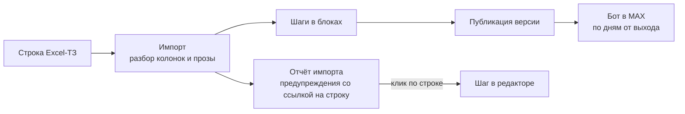
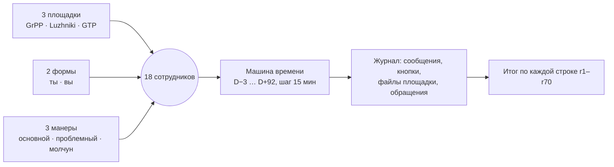

# Как Excel-ТЗ заказчика ложится в платформу

Каждая колонка и каждая конструкция старого Excel-ТЗ ПОЛИПЛАСТИК находит своё место в конструкторе и своё поведение в боте. Ниже это показано по номерам строк, без текстов ТЗ.

**Карта набора:** [00-index.md](00-index.md) | **Связанные:** [03-scenario-editor-guide.md](03-scenario-editor-guide.md), [02-bot-behaviour.md](02-bot-behaviour.md)

> Файл заказчика «Финал. ТЗ. Чат-бот Корсик» конфиденциален и в git не лежит. Здесь только номера строк Excel (лист «27.02.2026», r1–r70) и пересказ конструкций. Тексты ТЗ на слайды и в видео не выносим.

---

## Что и зачем

Кейсодержатель уже описал своего старого бота в Excel. Если конструктор не сможет это выразить, HR придётся переписывать сценарий руками. Наша позиция: **HR загружает свой Excel как есть, бот исполняет его целиком, а то, чего в ТЗ не хватает, импорт показывает предупреждением со ссылкой на строку.**

Что в ТЗ (по разбору `agency/playbook/steps/05-excel-tz-mapping.md`, `06-excel-tz-line-by-line.md`):

| Что | Сколько |
|---|---|
| Строк данных на листе | 68 (r3–r70); r1–r2 — заголовок и шапка |
| Сообщений по таймлайну | 61 |
| Опросов | 4 в ТЗ (импорт даёт 5, потому что опрос D+51 разделён на два варианта по площадкам) |
| Картинок и открыток по имени | 19 разных имён, 28 мест использования |
| Площадок | 3: GrPP, Luzhniki, GTP |
| Глобальных правил | 2 (r69, r70) |

Результат импорта настоящего файла (README, `07-tz-conformance.md`): **21 блок, 57 шагов, 29 веток, 5 опросов на 30 вопросов, 2 правила, 2 команды, 54 предупреждения**.

---

## Колонки ТЗ → поля конструктора

Импорт ищет шапку по словам, а не по позиции (`backend/services/scenario_xlsx_tz.go`, список `tzColumns`). Экспорт пишет ту же шапку обратно (`scenario_xlsx_export.go`).

| Колонка ТЗ | Как её находит импорт | Куда ложится в конструкторе | Что делает бот |
|---|---|---|---|
| A «№ п/п» | слово «№» | не используется: в ТЗ номера неточные, Excel превратил часть в даты | — |
| B «Месяц/день/время информирования» | «когда», «информирован» | день от даты выхода и время шага; пустая ячейка — продолжение блока выше | шлёт блок в этот день по рабочим часам площадки |
| C «Информационный повод» | «повод» | заголовок шага | сотруднику не показывается, это подпись для HR |
| D «Тег сотрудника» | «тег», «метка» | площадки шага | шаг уходит только сотрудникам этих площадок |
| E «Форма/Макет» | «макет», «форма» | тип шага: текст, карточка, файл, опрос, задача, ввод ответа, письмо HR | определяет, как шаг выглядит в MAX |
| F «Текст сообщения» | «текст» | текст шага; из прозы внутри разбираются кнопки, ветки, опросы, вложения | текст сообщения с кнопками |
| G «Обязательный этап» | «обязательн» | флажок «обязательный» | обязательный шаг не теряется: приходит сводкой «Что вы пропустили» |
| H (без шапки) | слово «отмашк» в ячейке | показ «по отмашке рекрутера» | шаг ждёт, пока рекрутер включит отмашку в карточке |
| I «Сопроводительное изображение» | «изображ», «вложен» | имя файла медиатеки | бот прикладывает файл площадки сотрудника |
| J (без шапки) | правее текста | дописывается к тексту (список документов) | часть текста сообщения |

### Как читается колонка «когда» (B)

| Запись в ТЗ (пересказ) | Во что превращается | Оговорка |
|---|---|---|
| «за 2–3 дня до выхода», «за день до выхода» | D−3, D−1 | диапазон «2–3» берётся как −3 |
| «в первый / второй / третий рабочий день в ЧЧ:ММ» | D0, D+1, D+2 | рабочие дни считаются календарными; выходной сдвигается планировщиком |
| «через N дней / недель после выхода» | D+N | — |
| «первый день второго / третьего месяца» | ≈ D+30, ≈ D+60 | месяц = 30 дней |
| «через N месяцев и M недель» | ≈ D+44, D+51, D+75 | месяц = 30 дней |
| «последний день испытательного срока» | D+89 | дата из ТЗ, а не из карточки сотрудника (открытый вопрос) |
| пусто | продолжение блока | — |
| только время «в 09.01», «12:01» | сразу после предыдущей реплики того же блока | — |
| «в случае варианта ответа „Да“» | ветка последнего вопроса | — |
| «если сотрудник …» | глобальное правило сценария | — |
| строка без времени | 10:00 по площадке | если в блоке есть «в 09.01», строки до него получают 09:00 |

Каждое приближение импорт отмечает один раз предупреждением `when_approx` (`scenario_xlsx_when.go`).

---

## Конструкции ТЗ → конструктор → поведение бота

| Конструкция в ТЗ | Где в ТЗ | В конструкторе | Поведение бота |
|---|---|---|---|
| Цепочка «Следующая реплика» | блок r3–r15 и др. | несколько шагов одного блока | сообщения листаются кнопкой «Дальше →» |
| Кнопки-варианты в отдельной строке | r5 → r6 | кнопки предыдущего шага | — (см. «Знакомство» ниже) |
| Ветка «Если ответили …: текст» | r16, r49 и др. | ветка у кнопки, до двух реплик | после нажатия сообщение правится в «✅ …», уходит ветка, потом поток дальше |
| Общая ветка на несколько кнопок | r16 (варианты 1–2), r49 | одна ветка на список кнопок | одинаковый ответ на любую из кнопок |
| Общий хвост после веток | конец r16 | следующая реплика блока | уходит после любого ответа |
| Ветка строками по площадкам | r25 → r26–r28 | ветка кнопки «да» + действие «прислать файл по площадке» | каждая площадка получает свой PDF |
| Вопрос без вариантов | r11–r13, r20–r21, r37 | кнопки «да / нет» + заготовка ветки с заглушкой | на «да» уходит файл, если загружен, иначе «Материал скоро добавим…» |
| Пара «передать через Корсика / связаться с рекрутером» | r39–r41, r49, r57, r69 | две кнопки-действия: «описать проблему» и «связаться с человеком» | первая ждёт текст и заводит обращение, вторая открывает переписку с человеком |
| Разный адресат эскалации | рекрутер (r39, r41, r49, r57, r63), HR (r40) | адресат в действии кнопки | обращение уходит указанному адресату |
| Опрос: выбор с веткой на вариант | r39–r41, r62–r63 | вопрос «выбор», у варианта ветка и флаг | ответ по варианту, затем следующий вопрос |
| Опрос: несколько ответов | r55/r56, вопрос 2 | вопрос «несколько ответов» | переключатели «✓ …» и кнопка «Готово» |
| Опрос: «свой вариант» / «другое» | r55/r56 вопрос 3, r62 | вариант «свой ответ» | бот ждёт текст, в поиск по регламентам он не уходит |
| Опрос: шкалы 1–10 с причиной ниже 8 | r47, r64 | вопросы «шкала», порог, комментарий при низкой оценке | при оценке ниже 8 обязательно спрашивает причину |
| Опрос: да/нет с причиной при «нет» | r47, r64 | вопрос «да/нет», комментарий при «нет» | при «нет» спрашивает причину |
| Обязательный вопрос | r47, вопрос 7 | флажок «обязательный» у вопроса | кнопки «Пропустить» нет |
| Открытый вопрос | r65 | вопрос «текст» | следующий текст сотрудника — ответ |
| Правила после опроса «ЛИБО» и «+» | r57 | «После опроса»: группы правил | в группе срабатывает первое подходящее, разные группы — независимо |
| Разные варианты опроса по площадкам | r55 / r56 | два шага-опроса с разными площадками | у GTP свой набор вариантов |
| Площадка в колонке «когда» или «повод» | r33, r35, r59 | площадки GrPP, Luzhniki | только офисным |
| Сдвиг колонок | r17 | текст из D становится заголовком, шаг для всех | — |
| «По отмашке рекрутера» | r34, r36 (колонка H) | флажок у шага | ждёт отмашки из карточки сотрудника |
| Ввод текста и фото от сотрудника | r34 | тип шага «ввод ответа» | принимает текст и фото, сохраняет в карточку, заводит обращение HR |
| Личный файл сотрудника | r36 | вложение «личный файл: адаптационный план» | шлёт файл из карточки; нет файла — пишет, что плана ещё нет, и ставит задачу HR |
| Гиперссылка на слове | r67 | ссылка в разметке текста | ссылка на слове |
| Ссылка без https | r31 | текст со ссылкой + предупреждение `non_https_link` | ссылка показывается текстом |
| Авторские альтернативы текста | r8 | первый вариант — текст, второй — заметка для HR | второй вариант не уходит |
| Заглушка «что умеет бот» | r3 | текст встроенной справки `/help` + команды сценария | уходит первым в пакете D−3 |
| Вопрос о форме «ты/вы» и реакция на выбор | r5–r7 | шаги с условием «форма ещё не выбрана» | пропускаются: форму уже спросило встроенное знакомство |
| Логины и пароли | r18 | предупреждение `out_of_scope_credentials` | доступы бот не шлёт, только поздравление |
| Письмо HR кандидату | r19 | шаг «письмо HR» (задача HR) | бот его не отправляет |
| Команды `/Food`, `/HR` | r25, r49 | вкладка «Команды и правила» | `/food` присылает PDF своей площадки, `/hr` открывает связь с HR |
| Свободный вопрос боту | r69 | правило сценария «свободный вопрос» | если в документах ответа нет, бот пишет текст правила с его кнопками |
| Напоминание о непройденном опросе | r70 | правило сценария «напоминание об опросе» | через 24 и 48 ч от отправки, в рабочие часы |
| Картинки по имени | колонка I | заглушки в медиатеке | файл площадки, иначе общий; нет файла — сообщение без вложения |
| Имя «Х», «Имя кандидата» | 15 мест | подстановка `{Имя}` | имя сотрудника |
| «Завтра» в шагах D−1 | r16 | подстановка `{start_day}` | бот пишет настоящий день выхода («в понедельник, 9 ноября») |
| Лист «Лист1» | одна строка-дубль | пропускается | — |

---

## Чего в ТЗ нет: предупреждения для HR

Импорт не останавливается на неразобранной строке, а пишет предупреждение. Клик по строке отчёта открывает шаг. Это не ошибки платформы, а дыры самого ТЗ:

| Чего не хватает | Строки | Что видит сотрудник сейчас |
|---|---|---|
| Маршруты транспорта | r11–r13 | «Материал скоро добавим…» |
| Карты территории GTP и этажей Luzhniki | r20, r21 | то же |
| PDF «где пообедать» на три площадки | r26–r28 | сообщение без файла |
| Корпоративная презентация | r32 | только текст |
| Образец мини-резюме | r34 | текст без образца |
| Расписание спортзала | r37 | заглушка |
| Фото с праздников | r45 | галерея без фото |
| 19 картинок | колонка I | сообщения без картинок |
| Вторая форма обращения: ТЗ целиком на «ты» | весь файл | закрывается кнопкой «вариант на „вы“ (ИИ)», см. [03](03-scenario-editor-guide.md) |
| Род в текстах | r9/r10, r16, r17, r59 | предупреждение `gendered_text` |
| Два приветствия подряд | r50/r51 | оба уходят, HR видит предупреждение |
| В поводе упомянут опрос, а опроса нет | r58 | предупреждение `survey_missing` |
| Смешанные «ты» и «вы» в одной ячейке | r23, r47 | предупреждение `mixed_address_form` |

---

## Доказательство полноты

### 1. Круговой путь «импорт → экспорт → импорт»

HR может выгрузить сценарий обратно в Excel (кнопка «Скачать Excel»). Файл состоит из двух листов:

| Лист | Что в нём |
|---|---|
| «Сценарий» | тот же формат, что лист ТЗ: колонки A–J, проза «Варианты ответов», «Если ответ N», «Опции для сотрудника» |
| «Корсик — расширения» | то, чего в формате ТЗ нет: текст на «вы», флаги вариантов, «Дальше →», «если не ответил», действия веток, прочие поля |

Если HR поправил строку на первом листе, побеждает первый лист, а для этой строки расширения не применяются (предупреждение `ext_stale`).

**Итог** (`agency/LOG.md`, «Экспорт сценария в Excel», 24.10 ~06:20; тесты `services/scenario_xlsx_export_test.go`):
- с листом расширений — **0 расхождений** по шагам, правилам, командам и площадкам: на синтетике и на файле заказчика, для черновика и для версии v1;
- только по первому листу из 57 шагов файла заказчика 50 совпали целиком. Остальные 7 расходятся в тексте на «вы» и в заглушке «Материал: …», которую ставит сам импорт. Эти расхождения разрешены в тесте с причинами.

### 2. Сверка r1–r70 на трёх площадках

Прогон `TestTZConformance` (`backend/services/tz_conformance_test.go`): настоящий файл импортируется, публикуется, и **18 синтетических сотрудников** проходят машиной времени от D−3 до D+92 на подделке MAX.

Итог по строкам — в `agency/playbook/steps/07-tz-conformance.md`: OK, ИСПР (было расхождение, исправлено), ДЫРА ТЗ, ЗАМЕЧ.

| Площадка | Основной сотрудник, сообщений | Молчун, сообщений | Проблемный: обращений |
|---|---|---|---|
| GrPP | 60 | 34 | 8 |
| Luzhniki | 62 | 35 | 8 |
| GTP | 55 | 33 | 8 |

Восемь обращений у проблемного сотрудника — это ровно восемь его действий (нажатий и текстов), после правила «обращение только по нажатию» (было 12). До исправлений ночью 24.10 молчун получал 1 сообщение за 90 дней, а сотрудники GTP останавливались после D+2.

### 3. Сборка «с нуля» руками

Все 7 сложных конструкций ТЗ собраны в редакторе только кликами (~200 действий Playwright) и опубликованы: общие ветки, опрос с ветками и флагами вариантов, несколько ответов, «свой вариант», правила после опроса, варианты по площадкам, ввод фото, `/food`, напоминание (`agency/LOG.md`, «Ручная сборка конструкций ТЗ», 24.10 ~06:00).

---

## Полезно знать

- **Проверено на подделке MAX.** Сценарий ТЗ целиком прогнан на подделке MAX и в демо-чате. На телефоне в настоящем MAX пройден базовый путь, но на синтетическом сценарии.
- **Приближения календаря.** Рабочие дни сейчас считаются календарными, месяц равен 30 дням, праздники РФ не учтены (`backend/domain/site.go`). Шаг, попавший на выходной, сдвигается.
- **Конец испытательного срока = D+89.** В прогоне это суббота, и бот переносит сообщение на понедельник D+91, то есть после конца срока. Вопрос к кейсодержателю.
- **Числа зависят от прогона.** В разных документах встречаются 49 и 54 предупреждения, 83 и 87 переписанных текстов: это разные прогоны в разное время ночи. Последние числа — в README и `07-tz-conformance.md`.

---

## Связанные документы

- [03-scenario-editor-guide.md](03-scenario-editor-guide.md) — как HR работает с этими конструкциями в редакторе
- [02-bot-behaviour.md](02-bot-behaviour.md) — как бот исполняет блоки, ветки и опросы
- [11-limitations-and-roadmap.md](11-limitations-and-roadmap.md) — что из дыр ТЗ нужно просить у кейсодержателя
