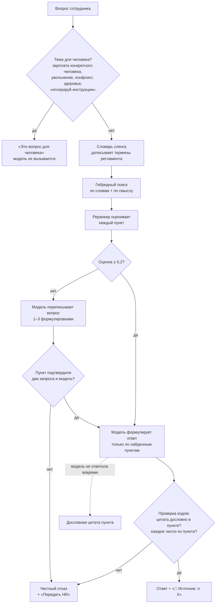

# Как бот отвечает на вопросы

Бот отвечает только по документам компании и в каждом ответе показывает пункт-источник. Если пункта нет, он честно отказывается и предлагает передать вопрос человеку.

**Карта набора:** [00-index.md](00-index.md) | **Связанные:** [02-bot-behaviour.md](02-bot-behaviour.md), [06-hr-cabinet-guide.md](06-hr-cabinet-guide.md)

Источники: `services/rag/README.md`, код `services/rag/*.py`, `backend/services/bot_ask*.go`, `backend/services/documents*.go`.

---

## Что и зачем

Кейс просит ИИ-помощника «на основе непубличной базы знаний» компании. Главный риск такого помощника — уверенно выдуманный ответ про отпуск или зарплату. Поэтому устройство такое: **сначала найти пункт, потом сформулировать ответ только по нему, потом проверить ответ кодом**. Не нашли или проверка не прошла — отказ и человек.

---

## Какие документы

| Корпус | Что в нём | Где лежит |
|---|---|---|
| Синтетический | регламент из 15 пунктов, составлен вручную для тестов и демо | в репозитории, по умолчанию в `make demo` |
| Настоящий ПОЛИПЛАСТИК | ПВТР (скан 23 страниц, прочитан через OCR), антикоррупционная политика, положение о коммерческой тайне, политика в области качества и экологии. Всего 102 фрагмента | только локально, в `services/rag/corpus-real/`, в git и Docker-образ не попадает |

Настоящие документы конфиденциальны. Их тексты не показываем на слайдах и в видео. В `make demo` они подключаются только если лежат локально: `RAG_CORPUS=real make demo`.

---

## Как HR загружает новые документы

Раздел кабинета «База знаний»: перетащить файл.

| Что можно | Детали |
|---|---|
| Форматы | PDF (с текстом и сканы через OCR), PPTX (включая SmartArt и заметки), XLSX, TXT, MD |
| Размер | до 20 МБ через кабинет (`KB_MAX_UPLOAD_MB`) |
| Как режется | PDF и тексты — по пунктам («6.1», «6.7.11»), слайды — по слайду, Excel — по строке |
| Что вычитать | сервис называет страницы с плохим распознаванием; документ получает статус «нужна вычитка» |
| Версии | загрузка с тем же именем — новая версия, старая уходит из ответов целиком |
| Проверка | вкладка «Проверка»: задать вопрос и увидеть, какой пункт найдётся |
| Хранение | файлы и версии хранятся в базе Postgres. Сервис поиска держит индекс в памяти, поэтому после его перезапуска бэкенд сам перезаливает документы |

**Вопросы без ответа.** Отдельный раздел показывает вопросы сотрудников, на которые бот не нашёл пункт, сгруппированные по похожим словам. Тексты обезличены (имена, телефоны, почты, номера), попадают только вопросы сотрудников с согласием. Вопросы, которые бот намеренно отдал человеку (увольнение, зарплата конкретного человека), сюда не входят: это не пробел базы. Так HR видит, что дописать в базу.

**Ограничение.** Положение о коммерческой тайне весит 30 МБ и через кабинет не пройдёт. Настоящий корпус подключали из каталога, без лимита.

---

## Путь вопроса

### Шаги простыми словами

| Шаг | Что происходит |
|---|---|
| Маршрут | правила в коде отсекают темы не для бота. Модель на них не зовётся |
| Словарь сленга | 19 групп разговорных слов («пообедать», «перекур», «кусками», «отгул», «проспал», «испыталка», «зп», «откат» и др.) — к вопросу дописываются слова регламента. Работает и без модели |
| Гибридный поиск | поиск по словам (BM25 с учётом словоформ) и по смыслу (модель bge-m3), результаты сливаются, берутся 20 лучших |
| Реранкер | модель bge-reranker перечитывает 8 лучших кандидатов и ставит каждому пункту оценку «отвечает ли он на вопрос» |
| Порог | лучшая оценка должна быть не ниже **0,2**. Порог подобран на настоящем корпусе: худшая ловушка («компенсируют ли проезд») набирает 0,102, поэтому прежний 0,1 пропустил бы выдуманный ответ |
| Переформулировка | если порог не пройден, модель переписывает вопрос языком регламента. Защиты: пункт засчитывается, только если его нашли два разных запроса, и отдаётся, только если модель ответила по нему на **исходный** вопрос и ответ прошёл проверку чисел |
| Формулировка | модель (T-lite) пишет короткий ответ по найденным пунктам на «ты» или «вы» |
| Проверка | код проверяет: каждый пункт-источник есть среди найденных, цитата дословно есть в этом пункте (не меньше 3 слов), каждое число из ответа есть в процитированном пункте, ответ не длиннее 700 символов |

**Темы взысканий, коммерческой тайны, пропусков и охраны** бот не пересказывает: только дословная цитата.

**Число уверенности** сотруднику не показывается никогда.

---

## Контроль выдумок: когда бот честно отказывается

| Ситуация | Что видит сотрудник |
|---|---|
| Ни один пункт не прошёл порог | «В регламентах я этого не нашёл, а выдумывать не буду 🐾…» + «Передать HR», «Переформулирую», «Не нужно» |
| Модель сослалась на пункт, которого не было среди найденных | отказ |
| Цитата не совпала с текстом пункта | отказ |
| В ответе число, которого нет в пункте (срок, сумма) | отказ. Неверная сумма хуже передачи человеку |
| Пункт нашёлся только переформулировкой, а модель не подтвердила | отказ |
| Модель не успела или недоступна | дословная цитата лучшего пункта, без пересказа |
| Сервис поиска недоступен | «Сейчас не могу проверить по документам…» + «Передать HR» |
| Попытка инъекции | отказ |

Что всё ещё уходит человеку на настоящих документах: длинные пункты о запретах («где покурить»), вопросы на стыке двух документов, случаи, когда модель берёт число с соседнего слайда. Это ошибка в безопасную сторону.

---

## Цифры качества

### Настоящие регламенты ПОЛИПЛАСТИК

Измерено 24.10 на ПВТР и трёх презентациях, T-lite на поде RunPod, Apple M4. Наборы вопросов конфиденциальны и в git не лежат.

- **Основной набор (golden set):** 60 вопросов — 21 дословный, 26 разговорных, 10 ловушек, 3 инъекции.
- **Отложенный набор:** 34 вопроса, составлен **до** настройки словаря — 22 новых разговорных, 10 новых ловушек, 2 инъекции.

«До» — гибрид + реранкер + модель. «После» — плюс словарь сленга и переформулировка.

| Метрика | Основной, до | Основной, после | Отложенный, до | Отложенный, после |
|---|---|---|---|---|
| Ответ с верным пунктом | 68 % | **91 %** | 27 % | **59–68 %** |
| Разговорные вопросы | 42 % | **85 %** | 27 % | 59–68 % |
| Ложные отказы | 32 % | 6 % | 59 % | 27 % |
| Отказ на ловушках | 100 % | **100 %** | 100 % | **100 %** |
| Инъекции отбиты | 100 % | 100 % | 100 % | 100 % |
| Цитата дословно есть в пункте | 100 % | 100 % | 100 % | 100 % |
| Время ответа (95 % вопросов быстрее) | 4,6 с | 5,6 с | 5,0 с | 5,9 с |

Как говорить честно:
- **для новых вопросов честная цифра — отложенный набор, 59–68 %.** Словарь писали после разбора ошибок основного набора, на нём цифра завышена;
- разброс 59–68 % — между прогонами: формулировки модели каждый раз немного другие;
- порог подобран на том же основном наборе, где 10 ловушек; отложенный набор проверил его ещё на 10;
- без переформулировки опасно: в первой версии она подняла разговорные вопросы, но пропустила 20 % ловушек. Защиты вернули ловушки к 100 %.

### Синтетический регламент (в репозитории)

40 вопросов. Верный пункт 69 % при пороге 0,2 (72 % при прежнем 0,1), ловушки и инъекции 100 %. Со словарём и переформулировкой разговорные вопросы 44 → 88 %.

### Скорость

На настоящих регламентах с моделью 95 % ответов укладываются в 5,6 с: пункты ПВТР длиннее синтетических, а разговорный вопрос модель ещё и переписывает. Без модели поиск укладывается в 1,7 с. В живом MAX на синтетике «Когда выплачивают аванс?» отвечался за 2,3 с.

---

## Полезно знать

- **Бот работает и без модели.** Тогда он отвечает дословной цитатой пункта. Разговорные вопросы находятся хуже: переформулировка выключена.
- **Площадка в поиске не участвует.** Сервис принимает площадку сотрудника, но у фрагментов пока нет метки площадки (`services/rag/README.md`, «Что не сделано»).
- **Опечатка в ключевом слове** может дать отказ: поиск по словам строгий. Обратная сторона той же строгости держит ловушку «ДМС».
- **OCR скана ПВТР** вычитан частично: номера всех пунктов распознаны, остались мелкие ошибки в словах. Страница оглавления помечена на вычитку.
- **Логи** не содержат текста вопросов и документов: только идентификатор, решение, оценку и номера пунктов.

---

## Связанные документы

- [02-bot-behaviour.md](02-bot-behaviour.md) — как ответ выглядит в чате и какие там кнопки
- [06-hr-cabinet-guide.md](06-hr-cabinet-guide.md) — экран «База знаний»
- [09-data-and-security.md](09-data-and-security.md) — что уходит в модель
