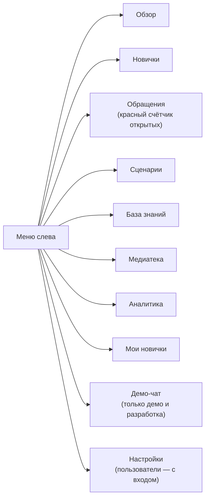
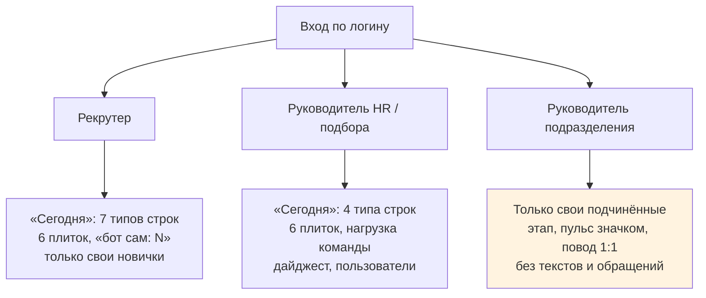

# Кабинет HR: экраны и что на них делать

Веб-кабинет — рабочее место HR, рекрутера и руководителя подбора. Новичок его не видит. Здесь по каждому экрану: зачем он и какие кнопки на нём есть.

**Карта набора:** [00-index.md](00-index.md) | **Связанные:** [03-scenario-editor-guide.md](03-scenario-editor-guide.md), [07-risk-and-escalation.md](07-risk-and-escalation.md)

Источники: `frontend/src/pages/**`, `frontend/src/components/**`, подписи из `frontend/src/i18n/locales/ru/*.json`. Адреса в `make demo`: кабинет http://localhost:18080.

---

## Что и зачем

Кейс просит «панель управления для рекрутеров». Кабинет закрывает три задачи: **завести новичка и следить за его маршрутом**, **отвечать на обращения** и **править сценарий и базу знаний без программиста**. Руководителю подбора здесь же видна неделя целиком.

---

## Меню

- Меню по умолчанию раскрыто с названиями. Кнопка «Свернуть меню» оставляет иконки, выбор запоминается в браузере.
- Сверху: переключатель площадки «Все / GrPP / Luzhniki / GTP» и плашка «API: работает / частично / недоступен».
- **Без `FEATURE_AUTH`** входа и ролей нет: имя оператора — «Анна К.» по умолчанию, хранится в браузере.
- **С `FEATURE_AUTH`** (итерация 24.10) — вход по логину и паролю и три роли, раздел «Вход и экраны по ролям» ниже. Для жюри заведены демо-аккаунты на каждую роль; доступы — в ЛК, не в этом документе.

---

## Вход и экраны по ролям

У каждой роли своё утро. Экран строится сверху вниз: список решений «Сегодня», плитки-фильтры, затем контекст. В «Сегодня» попадает только то, где бот уже сделал всё, что мог сам.

| Роль | Видит | Может | Не видит |
|---|---|---|---|
| Рекрутер | своих новичков: карточка, траектория, тексты ответов, обращения по ним | «Связаться», «Напомнить», «Взять», «Отметить: связался», запускать адаптацию, отвечать в обращениях | чужих новичков, пользователей |
| Руководитель HR / подбора | всё по всем площадкам, нагрузку команды, дайджест | всё, что рекрутер, плюс пользователи (добавить, деактивировать) и массовое переназначение новичков | — |
| Руководитель подразделения | только своих подчинённых: этап, пульс значком, повод для встречи, решение по ИС | отметить встречу, решение по ИС | тексты ответов, обращения и их категории, тон, других подразделений |

Ограничения руководителя подразделения держит сервер: тексты и обращения ему просто не отдаются.

### «Сегодня» рекрутера

**Строки (7 типов):** выход завтра, а приглашение не открыто; срок обращения истекает сегодня или просрочен; мысли об уходе, и новичок согласился на передачу; не отвечает после двух напоминаний; выход сегодня, а плана от руководителя нет; решение по ИС через 3 дня или раньше; догоняет после позднего входа и отстаёт. Красные выше жёлтых, дальше по сроку.

**Кнопки:** «Связаться» (после звонка — «Отметить: связался», строка вернётся через 2 рабочих дня, если ответа так и нет), «Напомнить», «Взять», «Открыть».

**Строка «бот сам: N напоминаний, M сводок»** — что автоматика сделала без человека.

**Плитки (6):** «Не отвечают» (после двух напоминаний), «SLA сегодня» (истекает / просрочен), «Выходят» (сегодня / на неделе), «Решения по ИС» (в ближайшие 7 дней), «Низкий пульс» (за неделю), «Догоняют» (после позднего входа). Клик по плитке фильтрует список «Мои новички». Ниже строка «Пульс за неделю»: сколько ответили, сколько низких и тон при n ≥ 5.

**Пусто** — «Сегодня всё под контролем» и три факта: что бот сделал сам, следующее событие с датой, сколько новичков он ведёт.

Каждое утро рекрутер получает в MAX одну сводку, если есть красное.

### «Сегодня» руководителя HR

**Строки (4 типа):** обращения без исполнителя дольше 2 ч; просроченный срок с именем рекрутера; новички без рекрутера; тема недели без ответственного.

**Плитки (6):** «Без исполнителя», «SLA просрочен», «Без рекрутера», «Красная зона», «Отклик на пульс», «Решения по ИС» на этой неделе.

**Кнопки:** «Назначить», «Переназначить», «Закрепить», «Назначить ответственного».

**Нагрузка:** рекрутер — новичков — открытых обращений — просрочено SLA. Рейтингов нет, первый ответ HR — только медиана по команде.

**Карточка «Дайджест недели»** в три строки со ссылкой на «Аналитику». Прежний «Обзор» стал страницей «Обзор площадок». Пользователи — в «Настройках».

---

## Обзор

**Зачем:** за минуту понять, где горит.

| Блок | Что показывает |
|---|---|
| Плитки | в адаптации (по этапам), выходят на неделе, просрочки, обращения и «SLA просрочен», отклик на пульс за 30 дней, **тон текстов за неделю** (при n ≥ 5, иначе «мало данных»). Каждая плитка ведёт в отфильтрованный список |
| «Требуют действия сегодня» | просрочен SLA, без исполнителя, красные зоны, SLA истекает сегодня, не подключились, просроченные опросы, выходят сегодня, решения по ИС |
| «Зоны риска» | список с причинами словами; «Открыть всех в красной зоне». С `FEATURE_RISK_V2` у новичка одна зона и одна главная причина ([07](07-risk-and-escalation.md)) |
| «Настроение по неделям» | средний пульс за 4 недели по площадкам. Точка скрыта, если ответивших меньше 5 |
| «Темы за N дней» | тепловая карта F1–F10 × площадка. Ячейки, где меньше 5 человек, скрыты |

Что делать: кликнуть плитку или имя в «Зонах риска» и перейти к человеку. Модель в обзоре не участвует, тексты новичков сюда не попадают. На демо обзор заполнен 150 синтетическими персонами: открыто 10 ячеек из 30.

---

## Новички

**Зачем:** реестр и запуск адаптации.

- Поиск «ФИО, подразделение, руководитель».
- Быстрые фильтры: «Выходят на этой неделе», «Не отвечает боту > 3 дней», «Красная зона», «Не подключился».
- Колонки: ФИО, площадка, подразделение, дата выхода, этап, активность в боте, настроение, риск, обращения, подключение.

**«Запустить адаптацию».** Поля: ФИО, телефон (для сверки), дата выхода, площадка, смена, подразделение, должность, руководитель, наставник, рекрутер, сценарий. Справа «Предпросмотр плана». Кнопка «Запустить и получить приглашение» открывает страницу приглашения.

**Приглашение.** QR-код («Скачать PNG»), персональная ссылка и текст для письма, у каждого «Скопировать». Это и есть QR в оффер, который требует ТЗ (r8).

### Карточка новичка («Индивидуальная траектория»)

| Часть | Что на ней |
|---|---|
| Шапка | должность, площадка, люди, дата выхода, «сегодня D…», этап, «на ты / на вы», согласие, версия сценария, подключение, зона риска |
| «Приглашение» | снова открыть ссылку и QR |
| «Пригласить руководителя» | ссылка для руководителя подразделения, «Скопировать ссылку» |
| «Перенести дату выхода» | новая дата; неотправленные шаги пересчитываются, отправленные остаются |
| «Машина времени» | поле «День» и «Прокрутить до этого дня»: шаги уходят сразу с пометкой «[ТЕСТ]» и не идут в аналитику |
| «Траектория» | события по дням: «Запланировано», «Отправлено», «Ответил», «Пропущено», «Не доставлено», «Ждёт отмашки рекрутера». Строка «Ответ: …» и раскрывающийся «Что ушло в МАКС» с текстом сообщения |
| Отмашка рекрутера | плашка «Ждут отмашки рекрутера: N шаг» и кнопка «Дать отмашку рекрутера» (только когда такие шаги есть) |
| Обращения | обращения этого новичка |
| Пояс | «10:00 по времени новичка» рядом со временем шага; пояс можно поменять в карточке (с `FEATURE_TZ`) |
| Напоминания | история «🔔 1/2 авто, 2/2 вручную», статус «Не отвечает», кнопка «Напомнить» |
| Поздний вход | прогресс «Догоняет N из M», потом «Догнал ✓» |
| Тон | 5 значков тона по последним текстам с подписью «подсказка, не оценка». Руководителю подразделения не показывается |
| Адаптационный план | кнопка загрузки файла плана |
| Рекрутер | закреплённый рекрутер; руководитель HR переназначает |

**Машина времени** — главный инструмент демо: показывает за минуту, что получит новичок за три дня. Если новичок не подключён, кабинет предупреждает. Без согласия опросы не уходят.

**Личный план-файл (ТЗ r36).** В карточке есть кнопка загрузки адаптационного плана (итерация 24.10), бот шлёт этот файл новичку по шагу сценария.

---

## Обращения

**Зачем:** очередь вопросов и проблем, которые бот передал людям.

| Где | Что |
|---|---|
| Вид | «Список» или «Канбан» (колонки «Новое», «Назначено», «В диалоге», «Решено»; перетаскивания нет) |
| Представления | «Все», «Не назначены», «Срочные (P0/P1)», «Просрочен SLA», «Закрытые» и фильтр по площадке |
| Пусто | «Все обращения закрыты» |

**Карточка обращения:**
1. «Взять в работу» (клавиша **A**, работает и в русской раскладке) или «Назначить» (исполнитель, «Это я», комментарий; при переназначении комментарий обязателен).
2. Внизу две вкладки: **«Ответить в МАКС»** и **«Внутренняя заметка»**. Кнопки «Отправить» и «Отправить и решить». Ctrl/Cmd+Enter отправляет.
3. «Решить» закрывает обращение, новичку приходит «✅ Вопрос закрыт» с 👍 / 👎.
4. Справа «Контекст»: траектория, подразделение, руководитель, наставник, текущий день, зона риска, маршрут, исполнитель, переключатель «Уведомить руководителя» (не для скрытых категорий), другие обращения новичка.

**Шапка обращения (итерация 24.10):** одна строка сути, цитата новичка, значок тона с подписью «подсказка», полный текст по клику. Для обращений о здоровье цитаты нет.

**«Решить» с «что сделано».** HR пишет, что сделано, и новичок получает «По вашему сигналу: …» (кроме анонимных и конфиденциальных). Эти записи собираются в дайджесте в блок «Сделано по темам».

**F5 и F9:** плашка «Конфиденциальное обращение…», текст новичка скрыт.

---

## Сценарии

Конструктор маршрута адаптации. Подробное руководство — [03-scenario-editor-guide.md](03-scenario-editor-guide.md).

---

## База знаний

**Зачем:** документы, по которым бот отвечает.

| Вкладка | Что делать |
|---|---|
| «Документы» | «Загрузить документ»: перетащить PDF, PPTX, XLSX, TXT, MD до 20 МБ, указать название и площадки. Файл с тем же названием становится новой версией. Статус: «Готов», «Проверьте страницы», «Не в поиске». Видно, сколько пунктов и страниц на вычитку |
| Клик по документу → «Проверка» | задать вопрос по этому документу и увидеть «Ответ бота», «Источники» и причину, если бот не ответит сам |
| Клик по документу → «Версии» | история и «Загрузить новую версию» |
| «Вопросы без ответа» | вопросы, на которые бот не нашёл пункт, сгруппированные по темам, за 7/30/90 дней; «Как ещё спрашивали». Тексты обезличены |

Если сервис поиска лежит, сверху плашка. Вне режима разработки этот раздел и медиатека требуют ключа оператора (`KB_OPERATOR_TOKEN`), а сам кабинет этот ключ не подставляет: его должен добавлять прокси перед API. Как устроен поиск — [05-knowledge-base-rag.md](05-knowledge-base-rag.md).

---

## Медиатека

**Зачем:** все картинки и файлы сценария по имени, с отдельным файлом на каждую площадку.

- «Загрузить» или перетащить файлы на страницу. Форматы PNG, JPG, GIF, WEBP, PDF, DOCX, XLSX, PPTX, до 20 МБ.
- Фильтры «Нет файла», «Картинки», «Документы», поиск «Имя или файл».
- Колонки: имя, превью, тип, **файлы по площадкам** («Общий» + GrPP, Luzhniki, GTP), «Используется», статус «Нет файла / Готово».
- В ячейке площадки: загрузить, заменить, убрать (можно перетащить файл прямо в ячейку).
- «Переименовать» правит ссылки во всех черновиках. «Удалить» запрещено, пока запись используется в сценариях.

Бот берёт файл площадки новичка, а если его нет, — общий. После импорта ТЗ здесь 19 заглушек «Нет файла»: это картинки, которых в ТЗ нет.

---

## Аналитика (дайджест)

**Зачем:** неделя для руководителя подбора.

- Переключение «Предыдущая неделя / Следующая неделя / Текущая неделя», фильтр площадки, «Обновить».
- Блоки: «Сводка недели» (на пульсе, ответили, индекс W, проблем), «Темы недели», «По площадкам», решения по ИС, «Зоны риска», превью «Сообщение в MAX».
- Тот же текст уходит в МАКС по понедельникам в 9:00 получателям из `MAX_DIGEST_USER_IDS` с кнопкой «Открыть аналитику». Получателей нет — текст пишется в лог.
- Темы, где меньше 5 новичков, скрыты. F5/F9 — только «Есть конфиденциальные сигналы». Связный текст пишет модель по готовым числам, код сверяет каждое число; не сошлось — шаблон.
- «Отправить сейчас» — только в режиме разработки.

---

## Мои новички

**Зачем:** страница для руководителя подразделения (кнопка «Подробнее» в его сообщениях из МАКС).

- С `FEATURE_AUTH` руководитель входит под своей учётной записью и видит только своих подчинённых. Без флага — выбор из списка «Выберите руководителя», адрес вида `/manager?name=…`.
- Карточки новичков: дата выхода, последний пульс, решение по ИС, повод встретиться, встреча 1:1.
- **Не показывает** обращения, причины риска, тексты ответов и категории.
- Без `FEATURE_AUTH` проверки, что страницу открывает именно этот руководитель, нет.
- В MAX руководитель получает плановые поводы D+14, D+30 и D+87 (их получают все, поэтому по молчанию бота нельзя угадать жалобу), на D+87 — кнопки «Оставить / Продлить / Обсудить с HR», на D+1 — «приложите план», если его нет. Решение по ИС хранится и видно рекрутеру. Проверено на подделке MAX.

---

## Демо-чат

**Зачем:** пройти путь новичка без телефона, на подделке МАКС. Есть в `make demo` и в режиме разработки, в обычной сборке скрыт.

1. Выбрать новичка.
2. «Подключить к боту»: форма обращения и согласие.
3. «Машина времени»: «До дня» → «Отправить шаги».
4. Переписка как в телефоне: кнопки нажимаются, текст пишется. Лента обновляется раз в 5 с.

Работает только без токена живого бота: если бот подключён к настоящему МАКС, демо-чат недоступен.

---

## Настройки

С `FEATURE_AUTH` здесь пользователи кабинета: руководитель HR добавляет и деактивирует рекрутеров. Без флага — заглушка «Настройки пока не подключены».

---

## Полезно знать

- **Тестовые отправки.** Всё, что ушло машиной времени, помечено «[ТЕСТ]» и не идёт в дайджест. Статистика веток в редакторе их учитывает.
- **Обращения без группового чата.** Пока не заданы чаты HR и СБ в МАКС, единственное место, где видны обращения, — этот кабинет.
- **Без входа.** Без `FEATURE_AUTH` ролей и паролей нет, и кабинет нельзя открывать в сеть без защиты (`DEMO_BIND` по умолчанию держит его только на этой машине). Прод `lk.plexet.ru` работает за HTTPS.
- **Новые экраны** «Сегодня» и роли проверены в кабинете на синтетических новичках.

---

## Связанные документы

- [03-scenario-editor-guide.md](03-scenario-editor-guide.md) — экран «Сценарии» подробно
- [07-risk-and-escalation.md](07-risk-and-escalation.md) — откуда берутся обращения и зоны
- [10-run-and-demo.md](10-run-and-demo.md) — как показать кабинет на чек-поинте
