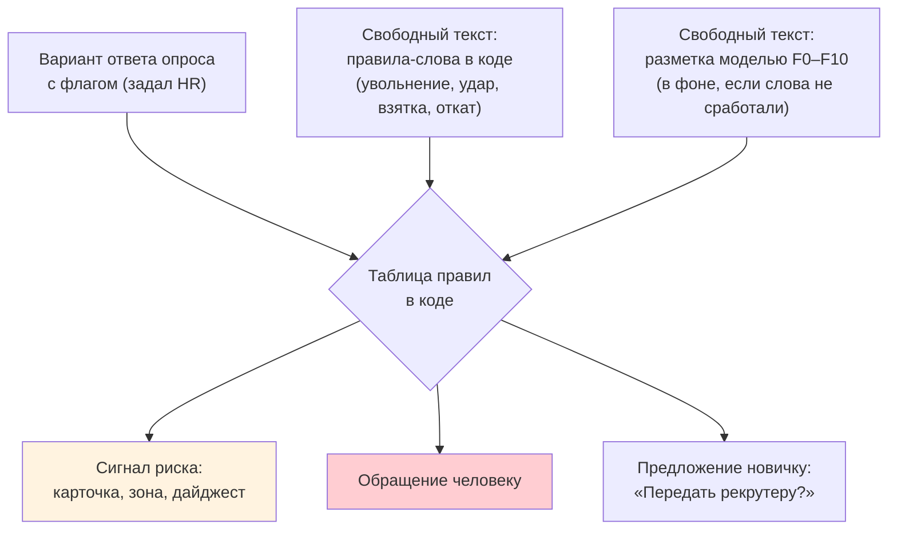
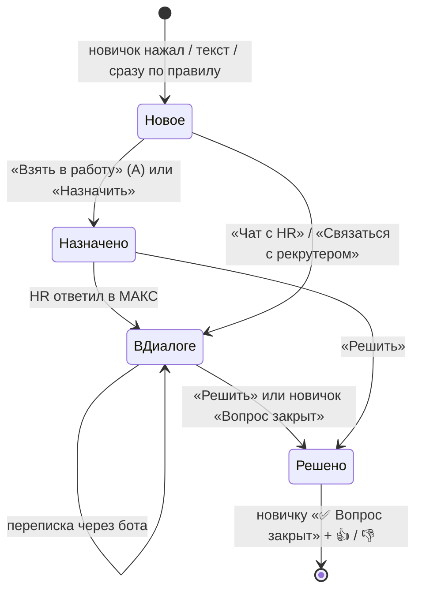

# Риски, обращения и передача человеку

Как бот замечает, что новичку плохо, кому и когда передаёт проблему и почему жалоба на руководителя не попадёт к этому руководителю.

**Карта набора:** [00-index.md](00-index.md) | **Связанные:** [02-bot-behaviour.md](02-bot-behaviour.md), [06-hr-cabinet-guide.md](06-hr-cabinet-guide.md)

Источники: `data/taxonomy.yaml`, `backend/pkg/taxonomy/taxonomy.go`, `backend/pkg/flags/flags.go`, `backend/services/bot_flags.go`, `branch_survey.go`, `tickets.go`, `sla.go`, `manager_rules.go`, `overview.go`.

---

## Что и зачем

Кейс требует, чтобы ИИ анализировал ответы опросов и эскалировал красные флаги. Опасность в двух крайностях: пропустить жалобу на коррупцию или завалить HR обращениями от каждого «устал». Поэтому:
- **куда отправить и что скрыть, решает таблица в коде**, а не модель;
- **обращение появляется, когда новичок сам попросил** (нажал кнопку или написал текст). Сразу уходит только серьёзное;
- всё остальное становится **сигналом риска**: цветом в карточке, причиной в «Зонах риска» и строкой в дайджесте.

---

## Анализ настроения: что есть на самом деле

Отдельного анализа настроения как логики **нет**. Сервис разметки возвращает поле «тон» (негатив, нейтрально, позитив), но бэкенд его не использует. «Настроение» в кабинете и дайджесте — это **средняя оценка по шкалам опросов** и **индекс W**, посчитанный по формуле из ресерча. Индекс на реальных данных не откалиброван.

Что работает вместо этого — категории проблем F0–F10 и три способа их заметить:

| Способ | Где работает | Особенность |
|---|---|---|
| Флаг варианта опроса | ответ кнопкой в опросе | мгновенно и предсказуемо, без модели. HR видит и меняет флаг в редакторе |
| Правила-слова в коде | свободный вопрос, ответ текстом в опросе, «свой вариант», ввод, переписка с HR | только три кода: F7 (увол…), F5 (ударил…), F9 (взятк…, откат). Срабатывают и на отрицание («меня не уволят»): это сигнал посмотреть, а не вердикт |
| Разметка моделью | свободный вопрос, ответ текстом в опросе, «свой вариант» | в фоне, только если слова не сработали. Модель недоступна — остаются правила-слова. Флаги с уверенностью ниже 0,4 отбрасываются |

На 12 граничных случаях модель дала 12 верных кодов: «придавило паллетой» — угроза жизни, а «умираю от скуки» — нет (README, «Качество»). Путь «живой бот → разметка моделью» целиком на телефоне не прогонялся.

---

## Категории F0–F10

Из `data/taxonomy.yaml` (статус файла — `draft`, часть маршрутов помечена «ждёт решения человека»).

| Код | Что это | Кому идёт | Руководитель видит | Приоритет |
|---|---|---|---|---|
| F0 | Угроза жизни и здоровью | дежурный, HR | нет | P0 |
| F1 | Непонимание задач и ожиданий | руководитель, HR | категорию | P2 |
| F2 | Нет доступов, техники, СИЗ, пропуска | HR, руководитель | категорию | P1 |
| F3 | Нет поддержки руководителя | HR-партнёр, минуя руководителя | только сигнал | P1 |
| F4 | Конфликт с наставником или коллегами | HR-партнёр | нет | P1 |
| F5 | Грубость, унижение, харассмент | HR-партнёр, СБ при угрозах | нет | P0 |
| F6 | Перегрузка, выгорание | руководитель, HR | категорию | P2 |
| F7 | Намерение уйти | рекрутер, HR-партнёр | только сигнал («встреча 1:1») | P0 |
| F8 | Оплата или график не как обещали | HR, рекрутер | категорию | P2 |
| F9 | Этика, коррупция, нарушения ТБ, служебная тайна | СБ напрямую | нет | P0 |
| F10 | Личные обстоятельства и здоровье | HR | нет | P2 |

Особые правила:
- **F5 и F9 — конфиденциальные.** Текст новичка скрыт даже в кабинете, руководителю не показывается, карточка уходит в чат СБ. Новичку бот пишет, что переписку видит только HR-партнёр или СБ и копия руководителю не уходит.
- **Руководителю никогда:** F0, F4, F5, F9, F10.
- **F10 без цитаты.** Цитата текста о здоровье не сохраняется. Цитата также обнуляется, если в ней телефон, почта или паспорт.
- **Повтор того же кода** в следующем опросе поднимает серьёзность на 1.

---

## Когда создаётся обращение, а когда нет

### Создаётся по действию новичка

| Действие | Что появляется |
|---|---|
| «Спросить человека», `/human`, `/hr` | обращение «вопрос человеку» к HR |
| «Передать HR» / «Передать рекрутеру» под ответом или отказом бота | обращение с вопросом |
| «Описать проблему» в ветке (ТЗ: «передать через Корсика») | бот ждёт текст, потом обращение указанному адресату. Если в тексте сработали правила-слова, категория берётся от них |
| «Чат с HR», «Связаться с рекрутером» | обращение сразу в живом диалоге |
| «Чего-то нет» | выбор «Техника / Учётка / Пропуск / Другое» и обращение F2 |
| Ввод ответа (ТЗ r34: опыт и фото) | обращение HR с текстом и фото |

Если обращение той же категории уже открыто, новое не заводится: текст дописывается, новичку уходит «уже передано». Исключение: у другого адресата (рекрутер против HR) — своё обращение.

### Сразу, без нажатия

| Что | Почему |
|---|---|
| F5, F9 в свободном тексте (правила-слова) | конфиденциально и срочно: обращение сразу, карточка в чат СБ |
| F0, F5, F9 во флаге варианта опроса | экстренное и конфиденциальное уходит по своему маршруту при любой ветке |
| Флаг варианта с серьёзностью «высокая» или кодом немедленной эскалации, **если у варианта нет ветки со связью с человеком** | обращение с сообщением новичку о передаче |
| Флаг высокой серьёзности, у варианта своя ветка ТЗ без эскалации | карточка HR без сообщения новичку: говорит только ветка ТЗ |
| Разметка моделью: уверенность не ниже порога категории и (серьёзность от 2 или код F0/F5/F7/F9) | обращение (кроме F7) |

### Не создаётся

| Что | Что вместо |
|---|---|
| Флаг варианта, а в ветке есть «Описать проблему» или «Чат с HR» | только сигнал риска. Обращение появится по нажатию, с категорией и серьёзностью флага. Сколько нажатий, столько обращений |
| Средняя и низкая серьёзность без ветки | сигнал риска |
| F7 «хочу уволиться» в тексте | обращения нет. Бот предлагает «Передать рекрутеру» / «Сначала напишу, что случилось» / «Пока не надо». Решение уйти — право новичка. Повторно предложение не показывается сутки |
| Тема «для человека» (зарплата коллеги, увольнение, конфликт, здоровье) | кнопки «кому передать», обращение по нажатию |
| Правила-слова в ответе текстом на опрос | красная зона и код в ответе |
| Разметка моделью ниже порога | жёлтая зона «на ручной просмотр HR» |

**Почему так решили.** В первом прогоне сверки проблемный новичок получал 12 обращений, из них 5 автоматически от вариантов опроса, поверх веток ТЗ. После правила «по нажатию» их 8, ровно по числу его действий (`07-tz-conformance.md`). Так и записано в ТЗ: варианты дают кнопки «описать проблему» и «связаться с рекрутером».

---

## Жизненный цикл обращения

| Статус в кабинете | Код | Что значит |
|---|---|---|
| Новое | open | никто не взял |
| Назначено | assigned | есть исполнитель |
| В диалоге | human_active | идёт переписка через бота |
| Решено | resolved | закрыто |

Номера обращений начинаются с 1001. Ответить в МАКС можно, только когда у обращения есть исполнитель.

**Ответ HR** приходит новичку с подписью «**Анна К., HR** (по обращению #1009):» и кнопками «Ответить» и «Вопрос закрыт». Роль в подписи: HR, рекрутер, HR-партнёр или служба безопасности. **Внутренние заметки** в МАКС не уходят.

---

## Живой диалог с HR

Пока обращение «в диалоге»:
- текст новичка уходит в переписку обращения, а **не** в поиск по регламентам и не в модель;
- правила-слова всё равно проверяют текст и поднимают зону до красной;
- «Передал — ответ придёт сюда же (обращение #N)» бот пишет только на первое сообщение после ответа HR;
- команды `/help`, `/menu`, `/human` работают;
- диалог заканчивается кнопкой новичка «Вопрос закрыт» или «Решить» в кабинете.

Оставлять ли так, решает человек: [08-decisions.md](08-decisions.md), открытое решение 3.

---

## SLA

| Приоритет | Срок | Кого касается |
|---|---|---|
| P0 | 1 рабочий час | F0, F5, F7, F9 |
| P1 | 1 рабочий день | F2, F3, F4 |
| P2 | 3 рабочих дня | F1, F6, F8, F10 |

- Считается в рабочих часах: пн–чт 9:00–18:00, пт до 17:00, Москва. Праздники не учтены.
- Обращение вне рабочего времени начинает отсчёт с начала ближайшего рабочего дня.
- Таймер идёт, пока обращение «новое» или «назначено». Первый ответ HR сбрасывает таймер.
- Сроки из `taxonomy.yaml` («≤ 2 рабочих дня» и т. п.) код **не читает**: срок берётся только из приоритета.

---

## Зоны риска

Зона в карточке только повышается, вниз её код не опускает, ручного сброса нет.

| Зона | Когда |
|---|---|
| Зелёная | по умолчанию |
| Жёлтая | оценка ниже порога; новичок отключил бота; сигнал варианта; разметка моделью ниже порога. В обзоре ещё: приглашение не открыто за 3 дня до выхода, опрос без ответа 48 ч, сообщение не доставлено, открытое обращение |
| Красная | любое срабатывание правил-слов; обращение по флагу; вариант с высокой серьёзностью. В обзоре ещё: два низких пульса подряд (≤ 5 из 10), открытое обращение P0 |

Причина всегда пишется словами. F5 и F9 в причине называются «конфиденциальное».

---

## Руководитель подразделения

Руководитель получает в МАКС только **повод встретиться 1:1**, без категорий и ответов:

| Повод | Условие |
|---|---|
| Второй низкий пульс подряд | оба ≤ 5 из 10, последний не старше 14 дней |
| Молчит | опрос без ответа больше 72 ч (если бот не отключён) |
| Конец ИС через 3 дня | до D+90 осталось 0–3 дня |
| Месяц работы | D+30…D+33 |

Если рядом с низким пульсом стоит скрытая от руководителя категория (F0, F4, F5, F9, F10), повод **не отправляется вовсе**. Кнопки «Встретился», «Запланирую», «Подробнее». Проверка раз в 5 минут, в рабочие часы, каждый повод один раз.

---

## Полезно знать

- **Групповые чаты HR и СБ в МАКС не настроены.** Без `MAX_HR_CHAT_ID` и `MAX_SB_CHAT_ID` карточка обращения пишется в лог. Обращения при этом видны в кабинете.
- **Уведомление руководителю по F1, F2, F6** из обращения в коде пока только строка в логе: канала нет. Поводы 1:1 из правил выше работают.
- **F0 и тихие часы.** В таксономии для F0 «тихие часы не действуют», карточка уходит сразу, но SLA P0 всё равно считается в рабочих часах.
- **Ролей в кабинете нет.** Отдельного входа для HR-партнёра и СБ нет: конфиденциальность F5/F9 держится на скрытии текста.
- **Маршруты F0, F2, F3, F7** в таксономии помечены как ждущие решения человека: кто дежурный, нужны ли чаты ИТ и АХО.

---

## Связанные документы

- [06-hr-cabinet-guide.md](06-hr-cabinet-guide.md) — экраны «Обращения», «Обзор», «Аналитика», «Мои новички»
- [09-data-and-security.md](09-data-and-security.md) — что скрыто и что хранится
- [08-decisions.md](08-decisions.md) — почему обращения по нажатию
