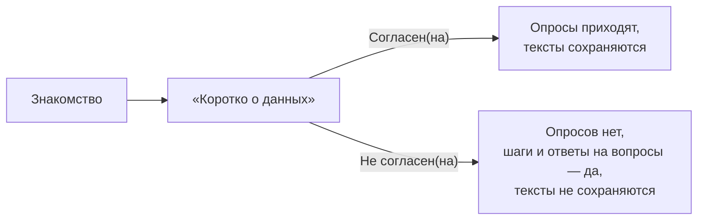
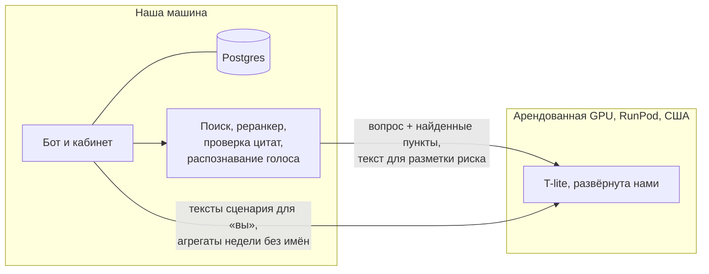

# Данные, ПДн и безопасность

Какие данные о новичке хранит система, что уходит в модель и куда, как защищены материалы кейса и секреты.

**Карта набора:** [00-index.md](00-index.md) | **Связанные:** [07-risk-and-escalation.md](07-risk-and-escalation.md), [08-decisions.md](08-decisions.md)

Источники: README, раздел «Безопасность и ПДн»; `backend/domain/employee.go`; `agency/pitch/facts.md` §5, §7; `agency/pitch/gaps.md` S8, S9; `08-night-report.md`.

---

## Что и зачем

Бот работает с персональными данными новичков и с непубличными регламентами заказчика. Жюри и кейсодержатель спросят про 152-ФЗ, про то, где модель, и про коммерческую тайну. Ниже — что есть сейчас, без приукрашивания.

---

## Какие данные храним

Всё лежит в одной базе Postgres на нашей машине.

| Что | Поля | Заметки |
|---|---|---|
| Карточка новичка | ФИО, телефон, площадка, подразделение, должность, руководитель, наставник, рекрутер, дата выхода, смена, сценарий и версия | **телефон хранится открытым текстом** |
| Связь с MAX | идентификатор пользователя и чата MAX, форма обращения, согласие и его дата, статус подключения | |
| Состояние | последняя активность, последний пульс, зона риска и причина, отметка «тестовый» | |
| Ответы | ответы на кнопки и опросы, тексты причин и «своего варианта» | текст — только при согласии |
| Вопросы боту | вопросы и отказы для раздела «Вопросы без ответа» | только при согласии, обезличиваются перед показом |
| Обращения | категория, маршрут, статус, исполнитель, переписка, внутренние заметки | **пока обращение у человека, текст переписки хранится всегда**, в том числе у F10 (здоровье) |
| Ввод от новичка (ТЗ r34) | текст и фото | |
| Документы базы знаний | файлы и версии | в Postgres, вместе с бэкапом базы |
| Медиатека | картинки и файлы сценария | |

В репозитории — только синтетика: регламент, сценарии, новички с пометкой «(синтетика)» в ФИО и телефонами `+7 000 …`, персоны и ответы на опросы.

---

## Согласие на обработку ПДн

- Шаг согласия идёт **до первого диалога**.
- Бот говорит прямо: ответы видит HR-команда, руководитель — только общую картину, автоматических кадровых решений система не принимает.
- **Кнопка — фиксация, а не документ.** С 01.09.2025 согласие на обработку ПДн оформляется отдельным документом, его должен дать работодатель. Текст «Подробнее» в боте помечен как демо-текст.
- Ст. 16 152-ФЗ и ст. 86 ТК по первоисточнику не сверены (`gaps.md` T4): говорить без номеров статей.

---

## Что уходит в модель и куда

| Что уходит на модель | Когда |
|---|---|
| Текст вопроса и найденные пункты регламента | ответ на вопрос, переформулировка вопроса |
| Текст свободного сообщения | разметка риска F0–F10 |
| Тексты сценария | кнопка HR «Сделать вариант на «вы» (ИИ)» |
| Числа недели без имён | связный текст дайджеста |

**Не уходит:** ФИО, телефон и другие поля карточки. Поиск, эмбеддинги, реранкер, проверка цитат, распознавание голоса и база работают локально. Голос и его текст наружу не уходят.

**Чего нет:** маскирования имён **внутри** текста вопроса. Если новичок сам напишет имя коллеги, оно уйдёт в модель.

**Логи** сервиса поиска не содержат текста вопросов и документов: только идентификатор, решение, оценку и номера пунктов.

---

## Видимость внутри компании

| Правило | Как работает |
|---|---|
| F5, F9 | текст новичка скрыт даже в кабинете, руководителю не показывается, F9 — в СБ |
| Руководителю никогда | F0, F4, F5, F9, F10; повод 1:1 рядом с такой категорией не отправляется |
| F10 | цитата не сохраняется |
| Порог анонимности 5 | в обзоре и дайджесте скрыты ячейки, недели и темы, где меньше пяти человек; F5/F9 в дайджесте — только «есть конфиденциальное» |
| Цитата флага с телефоном, почтой, паспортом | обнуляется |
| «Мои новички» | без обращений, причин риска, текстов и категорий |

---

## Конфиденциальность материалов кейса

| Что | Где | Правило |
|---|---|---|
| Excel-ТЗ, ПВТР, три презентации, условия кейса | `agency/playbook/artifacts/case/` | в `.gitignore`, в git не едут |
| Настоящий корпус для поиска | `services/rag/corpus-real/` | в `.gitignore` и `.dockerignore`, в образ не попадает |
| Наборы вопросов к настоящим документам | `golden-real*.csv` | в `.gitignore` |
| Журнал сверки с ТЗ | каталог вне репозитория | там тексты ТЗ |

В документах проекта тексты этих материалов **не цитируются**: только номера строк и пунктов и пересказ. На слайдах, в видео и тизере их не показывать (`gaps.md` S9). В демо-чате и на скриншотах импортированного ТЗ видны его тексты: снимать без читаемых текстов.

---

## Вопрос п. 4.3.2 Положения хакатона

**Что требует пункт:** не передавать конфиденциальные данные кейса в публичные ИИ-сервисы (`agency/pitch/deck.md`, раздел 0).

**Факт:** при проверке на материалах заказчика фрагменты ПВТР и презентаций (замеры качества поиска) и тексты ТЗ (переписывание на «вы») уходили на нашу модель T-lite на арендованной GPU RunPod в США. Модель открытая, развёрнута нами, сторонних ИИ-сервисов нет. Распознавание голоса — локально.

**Решение за человеком** (`08-night-report.md`, п. 1; `gaps.md` S8): спросить разрешение у кейсодержателя или впредь гонять материалы заказчика только без модели. Варианты и рекомендация — в [08-decisions.md](08-decisions.md).

**Как говорить** (одна формулировка для всех спикеров, `facts.md` §7, вариант 1): «На хакатоне открытая модель, которую мы сами развернули, крутится на арендованной GPU; сторонних ИИ-сервисов нет. Архитектура рассчитана на одну GPU на 24 ГБ: в пилоте ставим её в контур ПОЛИПЛАСТИК или в российское облако, код не меняется — адрес модели задаётся одной переменной».

**Не говорить:** «у нас on-prem», «данные не покидают контур», «на модель идёт только синтетика». Сейчас это не так.

---

## Секреты

- Все секреты — только в файлах `.env` (корневом и `backend/.env`), они в `.gitignore`. Шаблоны без значений — `.env.example`.
- Имена: `MAX_BOT_TOKEN` (токен бота), `RUNPOD_API_KEY`, `LLM_API_KEY`, `LLM_BASE_URL`, `KB_OPERATOR_TOKEN`, `DATABASE_URL`.
- Перед пушем `make check` и `make secrets` запускают поиск секретов (gitleaks) в истории и в коммите.
- Значения ключей нигде не выводятся, в том числе в логах сервисов: объект настроек модели скрывает ключ.

---

## Открытые вопросы до пилота

| Вопрос | Что сейчас |
|---|---|
| Шифровать ли телефон | хранится открытым |
| Сроки хранения переписки в обращениях, особенно F10 | хранится всегда, пока обращение у человека |
| Маскирование имён в тексте вопроса до модели | нет |
| Роли и вход в кабинет | нет; разделы «База знаний» и «Медиатека» вне режима разработки закрыты ключом оператора |
| Авторизация у сервиса поиска | нет; он слушает только внутренний адрес машины, права проверяет бэкенд |
| Где модель в пилоте | решает ИБ заказчика: свой сервер, российское облако или внешний API для нечувствительных вопросов |

Всё это нужно согласовать с HR и юристом заказчика до пилота.

---

## Связанные документы

- [08-decisions.md](08-decisions.md) — почему своя модель и открытые решения
- [07-risk-and-escalation.md](07-risk-and-escalation.md) — кому видны какие категории
- [11-limitations-and-roadmap.md](11-limitations-and-roadmap.md) — план пилота
