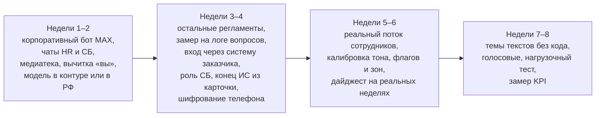

# Ограничения и что делать дальше

Что в прототипе не готово или слабо, чего не хватает в самом ТЗ, известные мелочи и план пилота. Здесь — всё, чего нельзя называть сделанным.

**Карта набора:** [00-index.md](00-index.md) | **Связанные:** [08-decisions.md](08-decisions.md), [10-run-and-demo.md](10-run-and-demo.md)

Источники: README («Ограничения и план пилота», «Сознательно не сделано»), `agency/pitch/gaps.md`, `08-night-report.md`, `07-tz-conformance.md`, проверка кода при написании этого набора.

---

## Что и зачем

Критерий жюри «Прототип» снимает баллы, если заявленное расходится с работающим. Этот документ — список того, что говорить с оговоркой или не говорить вовсе.

---

## Уровни проверки

| Метка | Что значит |
|---|---|
| Живой MAX | проверено на телефоне в настоящем MAX |
| API | проверено в браузере на настоящем API или тестами |
| Подделка MAX | бот прогнан целиком, но вместо MAX — наша имитация (демо-чат, тесты) |
| Не сделано | нет |

**В живом MAX пройден только базовый путь** на синтетическом сценарии (24.10 01:08–01:15): ссылка, «вы», согласие, шаги до дня выхода, ответ с пунктом, отказ про ДМС, обращение, ответ HR с подписью, «Вопрос закрыт».

**Итерация 24.10 (после чек-поинта)** включается флагами `FEATURE_*` по одной. На проде включены реплаи. Наджи, поздний вход, пояса, уточняющие вопросы, «По вашему сигналу», push руководителю и зоны v2 реализованы и проверены тестами и на подделке MAX; вход и роли — в кабинете на синтетике. Пока прогон на телефоне не прошёл, говорим «реализовано, проверено на подделке MAX».

---

## Что не готово или слабо

| Что | Состояние | Насколько важно |
|---|---|---|
| Сценарий из Excel-ТЗ, дайджест, поводы руководителю в живом MAX | проверены только на подделке MAX | говорить с оговоркой |
| Наджи, поздний вход, уточняющий вопрос, «По вашему сигналу», push D+14 / D+30 / D+87, утренняя сводка рекрутеру | реализованы, проверены на подделке MAX; на телефоне — после прогона волны 3 | говорить с оговоркой |
| Голосовые | распознаём сами (T-one на GPU-сервере), на записях работает; на телефоне не проверено | в демо не показывать без проверки |
| «Печатает», обработка «слишком часто» от MAX | тесты на подделке | — |
| Карточки обращений в групповые чаты HR и СБ | код есть, идентификаторы чатов не заданы — карточка пишется в лог | для пилота нужно |
| Уведомление руководителю по F1, F2, F6 из обращения | в коде только строка в логе | поводы 1:1 по правилам работают |
| Роли и вход в кабинет | есть с `FEATURE_AUTH`: три роли, свои логины, демо-аккаунты. Нет входа через систему заказчика и роли СБ | для пилота — подключить вход заказчика |
| «Настройки» | с входом — пользователи; остальное заглушка | — |
| Загрузка личного плана-файла (ТЗ r36) | кнопка в карточке есть (24.10) | — |
| Индекс W и пороги флагов | формулы ресерча, не откалиброваны | план пилота |
| Тональность | сохраняется у каждого текста, агрегат при n ≥ 5, подсказка в карточке. Точность 0,92 на 50 придуманных текстах, один разметчик; на реальных ответах не проверено | называть подсказкой, не оценкой сотрудника |
| Темы текстов без категории | группировки похожих текстов нет | следующий шаг |
| Обязательный вопрос | может держать маршрут дольше 48 ч; ограничение в плане | — |
| Новые разговорные вопросы | пункт находится в 59–68 % случаев, остальное уходит человеку | честная цифра |
| Скорость ответа с моделью | 95 % быстрее 5,6 с на настоящих регламентах | на своей карте быстрее |
| Модель | на арендованной GPU в США | «on-prem» не говорить |
| Площадка в поиске | не учитывается: у фрагментов нет метки площадки | — |
| Смены GTP | не учитываются | — |
| Праздники РФ, пояса | с `FEATURE_TZ` учитываются; без флага — нет | — |
| Рабочие дни и месяцы ТЗ | приближены: рабочий день = календарный, месяц = 30 дней | — |
| Конец ИС | D+89 по ТЗ, а не из карточки; на выходном переносится после срока | открытое решение |
| Зона риска | с `FEATURE_RISK_V2` одна зона и одна причина, в зоне 21 % демо-потока вместо 58 %; без флага только повышается, ручного сброса нет. Пороги экспертные | калибровка в пилоте |
| SLA | считается только по приоритету; сроки из таксономии код не читает; у F0 тоже в рабочих часах | — |
| Отказ от согласия | передумать в боте нельзя, только через HR | мелочь |
| «Проверить по телефону» | бот обещает передать рекрутеру, но ничего не создаёт | мелочь |
| ПДн | телефон открытым текстом; переписка в обращении хранится всегда; имена в вопросе не маскируются | согласовать с юристом |
| Интеграция с 1С ЗУП, нагрузочный тест | нет | вне 36 часов |
| Webhook вместо long polling | нет | для production нужен |

---

## Пробелы самого ТЗ (HR догружает)

| Чего нет в ТЗ | Строки | Что делает бот сейчас |
|---|---|---|
| Маршруты транспорта на 3 площадки | r11–r13 | честный ответ «материала пока нет» и «Спросить HR» (сценарий ТЗ v2) |
| Карта территории GTP, поэтажный план Luzhniki | r20, r21 | то же |
| PDF «где пообедать» на 3 площадки | r26–r28 | сообщение без файла |
| Корпоративная презентация | r32 | только текст |
| Образец мини-резюме | r34 | текст без образца |
| Расписание спортзала GTP | r37 | заглушка |
| Фото с праздников | r45 | без фото |
| Картинки и открытки | колонка I | 16 картинок Корсика от заказчика загружены (24.10); открыток и фото нет |
| Текст на «вы» | весь файл | готовит ИИ по кнопке |
| Логины и пароли | r18 | бот их не шлёт сознательно |
| Внутренние нестыковки | r50/r51 (два приветствия), r58 (опрос упомянут, а его нет), r23 и r47 (смешаны «ты» и «вы») | предупреждения импорта |

**Что просить у кейсодержателя:** файлы медиатеки, остальные регламенты, токен корпоративного бота MAX, идентификаторы HR-чата и чата СБ, дежурных, решение ИБ по модели, дату конца ИС, цифры для экономики (новых сотрудников в год, HR-часов на сотрудника), выгрузку вопросов текущего бота.

---

## Известные мелочи

- Превью телефона в редакторе обрезает подпись кнопки на 18 символах, хотя в MAX такого лимита нет.
- Отчёт импорта хранится только во вкладке браузера.
- В отчёте импорта есть подпись для старого кода «Длинная подпись кнопки» (`label_truncated`), которого импорт уже не выдаёт.
- Тестовый получатель «Отправить себе в МАКС» выбирается автоматически, выбора в панели нет.
- Статистика кнопок в редакторе учитывает тестовые отправки.
- Пять нейтрализаций рода модель не осилила, они остаются с замечанием.

---

## Что делать дальше: план пилота (оценка, 8 недель, один завод)

KPI пилота: доля вопросов без HR, время первого ответа HR, доля прошедших D+30 и D+90, отклик на опросы, хронометраж HR до и после.

Стоимость (оценка, README «Экономика»): пилот 1,2–2 млн ₽ работы плюс своя GPU ≈ 1 млн ₽ или аренда; все цифры экономики — допущения, пока кейсодержатель не дал свои. Главное допущение — 4 часа рутины HR на сотрудника.

**Принципиально не делаем:** эмоции по голосу и лицу, идентификацию по голосу (биометрия), индекс настроения отдельного человека, тон в решениях по испытательному сроку, автоматические решения о сотруднике — модель только подсвечивает, решает человек.

---

## Связанные документы

- [08-decisions.md](08-decisions.md) — открытые решения с вариантами
- [04-excel-to-platform.md](04-excel-to-platform.md) — дыры ТЗ по строкам
- [09-data-and-security.md](09-data-and-security.md) — вопросы ПДн до пилота
