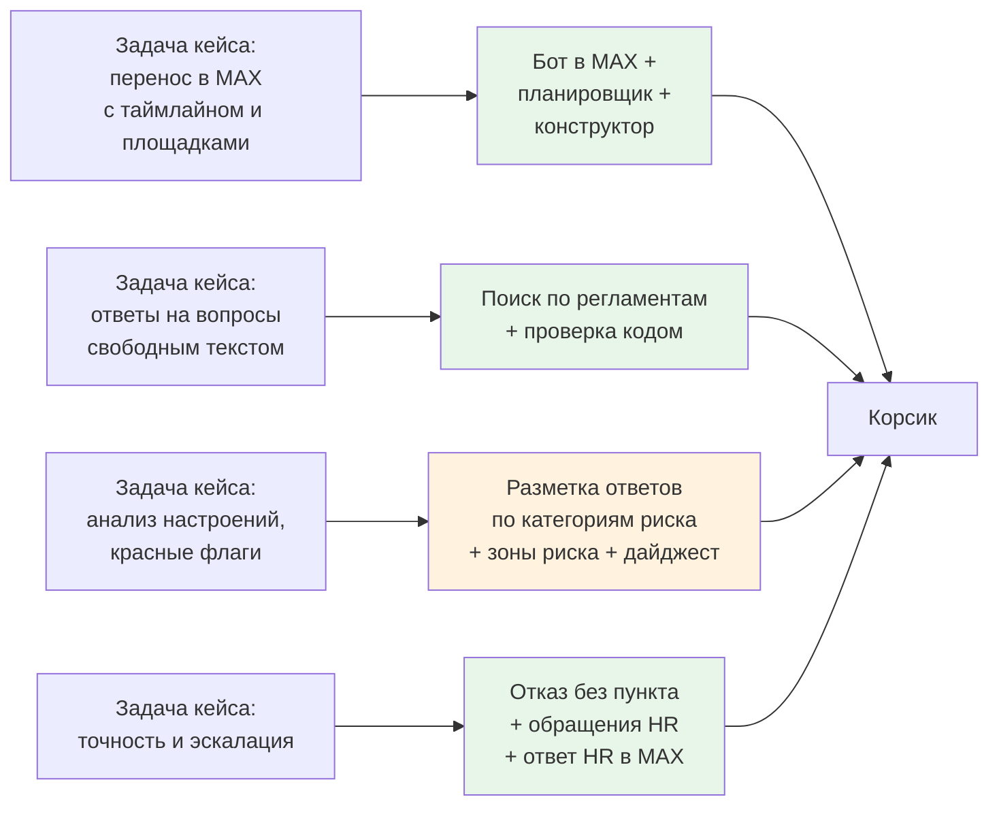

# Что мы сделали и чем закрываем кейс и критерии

Сводка для защиты: что жюри будет оценивать, что из требований ПОЛИПЛАСТИК закрыто, где это показать и чем доказать.

**Карта набора:** [00-index.md](00-index.md) | **Связанные:** [11-limitations-and-roadmap.md](11-limitations-and-roadmap.md), [08-decisions.md](08-decisions.md), [04-excel-to-platform.md](04-excel-to-platform.md), [05-knowledge-base-rag.md](05-knowledge-base-rag.md)

Состояние на 24.10.2026, утро. Последний коммит — `30605db`. Требования кейса взяты из презентации кейса (13 слайдов, конфиденциально) и здесь пересказаны своими словами. Критерии жюри и правила об ИИ взяты из Положения хакатона, пп. 4.1, 4.3 и 6.4; текст Положения сверен 24.10. Где проверить не удалось, так и написано: «не проверено».

---

## Что и зачем

По Положению жюри ставит от 0 до 3 баллов по каждому из семи критериев, весов нет. Первый критерий («Прототип») снижает оценку, если заявленное расходится с работающим. Поэтому у каждого утверждения в этом документе указано, где оно проверено:

| Метка | Что значит |
|---|---|
| **живой MAX** | проверено на телефоне в настоящем MAX |
| **кабинет** | проверено в браузере на настоящем сервере, с настоящим поиском и моделью, или тестами |
| **подделка MAX** | бот прошёл сценарий целиком, но вместо MAX работала наша имитация (демо-чат, тесты) |
| **не проверено** | доказательств нет |

---

## 1. Итог на одном экране

### Критерии жюри (Положение, п. 6.4)

| Критерий | Наша честная оценка | Чем закрываем | Доказательство |
|---|---|---|---|
| 6.4.1 Прототип | **2** | у каждой функции указано, где она проверена; базовый путь пройден в живом MAX; Excel-ТЗ сверено по 70 строкам | README, «Что работает»; `agency/LOG.md`, «Живой MAX, сквозной путь пройден» (24.10 01:08–01:15); `07-tz-conformance.md`. Слабое место: сценарий ТЗ, дайджест и руководитель проверены только на подделке MAX |
| 6.4.2 Решение основной проблемы | **2** | бот в MAX вместо Telegram, ответы ИИ по регламентам заказчика, разбор свободных ответов в опросах, передача человеку | `backend/externalApi/max/`, `services/rag/`, `backend/services/bot_flags.go`; цифры качества ниже. Слабое место: «анализ настроений» у нас — разметка по 10 категориям риска, а не оценка тональности |
| 6.4.3 Разработка и внедрение | **2** | `make demo` поднимает всё одной командой; одна видеокарта на 24 ГБ; расчёт эффекта и стоимости владения; план пилота | README, «Экономика»; `agency/pitch/facts.md` §3. Слабое место: экономика держится на допущениях (4 ч рутины HR на новичка, 2 200 новичков в год) |
| 6.4.4 Новаторские идеи | **2** | код проверяет каждую цитату и каждое число в ответе модели; вопрос переформулируется только с подтверждением; вариант текстов на «вы» готовит ИИ, а проверяет код; дни от даты выхода вместо минут; Excel туда и обратно без потерь | `services/rag/verify.py`, `rewrite.py`; `backend/services/scenario_xlsx_export.go`. Слабое место: связку «ответ по базе + передача оператору» уже отмечали в 2025 году (команда «Лайтхаус», `facts.md` H4) |
| 6.4.5 UX/UI | **2** | в боте блоки листаются кнопкой «Дальше →», нажатая кнопка превращается в итог; в кабинете 9 разделов, конструктор с превью телефона, шаг в широком окне, меню с названиями | коммиты `c0d81e4`, `6168a9c`, `e0e8172`, `a9e40a4`. Слабое место: нет входа и ролей в кабинете, «Настройки» — заглушка, часть скриншотов устарела |
| 6.4.6 Второстепенные проблемы | **3** | закрыты все три второстепенные проблемы из кейса, плюс найденные сами: согласие на обработку данных, жалобы мимо руководителя, порог анонимности, молчун не тормозит остальных, работа без модели | раздел 2 ниже; `07-tz-conformance.md`, «Что ещё исправлено» |
| 6.4.7 Аналитика | **2** | роли и аудитория, цифры адаптации на заводах, таблица аналогов, построчный разбор Excel-ТЗ с дырами самого ТЗ | `agency/playbook/artifacts/research/2026-10-23-deep-research.md` (блоки C–E); `facts.md` §1, §4; `06-excel-tz-line-by-line.md`. Слабое место: про текущего бота заказчика у нас нет данных (сколько вопросов, где ломается) |

**Итого:** 15 из 21 при честной подаче. Реалистичный потолок — 18: «Прототип» до 3, если сценарий из Excel пройдёт на телефоне; «Решение основной проблемы» до 3, если показать путь «текстовый ответ в опросе → категория риска → зона риска → тема в дайджесте».

### Пять главных козырей

1. **Исполняем сценарий заказчика целиком, а не свой.** Excel-ТЗ импортируется в конструктор (21 блок, 57 шагов, 29 веток, 5 опросов). Выгрузка обратно в Excel и повторный импорт дают 0 расхождений. Прогон на 18 новичках, трёх площадках и 90 днях выполнен на подделке MAX (`TestTZConformance`, `07-tz-conformance.md`).
2. **Бот не выдумывает, и это измерено на документах заказчика.** На вопросах-ловушках и попытках взлома 100 % отказов. На новых разговорных вопросах верный пункт находится в 13–14 из 22 (раздел 7). Каждое число в ответе код сверяет с пунктом регламента.
3. **Настоящий MAX пройден руками.** Пройден путь от ссылки-приглашения до ответа HR с подписью, включая ответ по пункту регламента и отказ на ловушке. По дороге решена проблема с сертификатом Минцифры (`deploy/certs/`, `LOG.md`).
4. **HR меняет всё без программиста:** сценарий (конструктор или Excel), документы базы знаний (перетащить файл), картинки по площадкам (медиатека). Именно это кейс называет проблемой масштабирования.
5. **Код решает, модель формулирует.** Куда уходит жалоба, что скрыть от руководителя, когда создавать обращение — правила в коде (`data/taxonomy.yaml`, `backend/pkg/flags/`). Без модели бот продолжает работать и отвечает дословной цитатой.

### Три главных риска

1. **Пункт 4.3.2 Положения: конфиденциальные данные и ИИ-сервисы.** Здесь три разных случая:
   - **наша модель.** Фрагменты регламентов и тексты ТЗ обрабатывала открытая модель, которую мы сами развернули на арендованной видеокарте (`08-decisions.md`, открытое решение 1);
   - **внешний ИИ-исследователь.** Файл Excel-ТЗ приложен к заданию для него (`agency/playbook/artifacts/prompts/2026-10-24-branching-ux.md`, коммит `59df4af`). Какой это был сервис, в документах не указано — **не проверено**;
   - **ИИ-агенты разработки.** Они читали материалы кейса при разработке.

   Решение за руководителем, подробнее — в разделе 4.
2. **«Прототип»: часть заявленного проверена только на подделке MAX.** Это сценарий ТЗ, дайджест, уведомления руководителю и голосовые. Если сказать «работает в MAX» без оговорки, балл снизят.
3. **Документы проекта противоречат коду и друг другу.** README пишет, что экспорта в Excel и голоса нет, хотя оба сделаны. Ещё в документах ходят разные числа: 83 и 87 текстов на «вы», 49, 54 и 55 предупреждений. Жюри читает README, поэтому одна согласованная пара чисел (раздел 7) обязательна.

Жёлтым отмечено то, что закрыто частично (подробнее в разделе 2).

---

## 2. Требования кейса построчно

Обозначения: ✅ сделано и проверено; 🟡 частично (только на подделке MAX, без файлов или без калибровки); ❌ нет. Пути в кабинете даны по названиям пунктов меню.

### Задачи и требования к результату

| Требование (пересказ) | Статус | Как сделано | Где показать в демо | Доказательство |
|---|---|---|---|---|
| Бот в MAX вместо Telegram с учётом ограничений платформы | ✅ живой MAX | официальный Go-клиент MAX; сообщения получаем опросом сервера MAX; не больше 2 сообщений в секунду на диалог; сертификат Минцифры | телефон: ссылка → «на вы» → согласие → шаги | `backend/externalApi/max/` (`poller.go`, `pacer.go`, `transport.go`); `LOG.md` «Живой MAX — первый запуск» и «…сквозной путь пройден» |
| Проактивные рассылки по таймлайну: от оффера до конца испытательного срока (D−3…D+90), по расписанию | ✅ кабинет, ✅ живой MAX до D−1, 🟡 до D+92 на подделке | планировщик считает дни от даты выхода, учитывает рабочие часы площадки и переносит шаги с выходных. Перенос даты выхода не создаёт дублей | Новички → карточка → «Машина времени» → телефон | `backend/services/scheduler.go`, `calendar.go` с тестами; 17 событий до D+2 в кабинете; в живом MAX 6 шагов до D−1 без ошибок |
| Персонализация по площадкам | ✅ кабинет, 🟡 подделка MAX | у шага, варианта опроса и файла медиатеки — свои площадки (GrPP, Luzhniki, GTP) и рабочие часы площадки | Сценарии → шаг → метки площадок; Медиатека | `07-tz-conformance.md`: каждая площадка получила свой список документов и свой файл; у GTP 55, у Luzhniki 62 сообщения. **Поиск по регламентам площадку не учитывает** (`05`, «Полезно знать») |
| Ответы на вопросы свободным текстом по базе знаний (RAG) | ✅ живой MAX на синтетике, ✅ замеры на документах заказчика | гибридный поиск, реранкер, порог 0,2, словарь сленга, переформулировка с подтверждением; ответ с «📄 Источник: п. X» | телефон: вопрос про отпуск по частям → п. 6.7.11 | `services/rag/` (`pipeline.py`, `retrieval.py`, `rewrite.py`); `services/rag/README.md`, «Реальный корпус»; коммиты `4922962`, `2aaa809` |
| Строгий контроль выдумок: бот не придумывает кадровые и юридические ответы | ✅ | нет пункта выше порога — отказ. Код сверяет цитату и каждое число с пунктом. Темы взысканий, коммерческой тайны и охраны — только дословной цитатой | телефон: «Положен ли ДМС после испытательного?» → отказ и «Передать HR» | `services/rag/verify.py`, `routing.py`; ловушки и инъекции 100 % на обоих наборах |
| Анализ настроений: ИИ читает текстовые ответы в пульс-опросах, находит скрытые проблемы и передаёт красные флаги HR | 🟡 | текстовый ответ в опросе и свободное сообщение размечает модель по 11 категориям F0–F10 (конфликт, нет доступов, мысли об уходе, коррупция…). Код задаёт серьёзность и маршрут. F0, F5 и F9 эскалируются сразу | Обзор → тепловая карта; Аналитика → темы; обращение F9 с плашкой | `backend/services/bot.go:621` (ответ опроса уходит на разметку вместе с вопросом), `bot_flags.go`, `services/rag/flags.py`; 12 из 12 граничных случаев на живой модели (`facts.md` R11). **Оценку тональности модель возвращает, но сервер её не использует** (`backend/externalApi/rag/flags.go:49`); пороги не откалиброваны; путь «телефон → разметка» целиком не прогнан |
| Бесшовная передача диалога живому рекрутеру или HR | ✅ живой MAX | отказ или кнопка → обращение со сроком реакции (SLA) → HR берёт в работу и отвечает из кабинета → новичок получает ответ в MAX с подписью и закрывает вопрос сам | Обращения → «Взять в работу» (A) → «Ответить в МАКС» → телефон | обращение #1009 в живом MAX (`LOG.md`, 24.10 01:08–01:15; HR-сторона тогда шла через сервер, а не кликами). **Карточки в групповой чат HR и чат СБ не настроены**: нет идентификаторов чатов, карточка пишется в журнал сервера |
| Интерактивные карточки и вложения: PDF-карты, изображения, кнопки эскалации | 🟡 | кнопки эскалации есть везде; медиатека хранит свой файл для каждой площадки; импорт заводит заглушки на все имена из ТЗ; PDF «где пообедать» уходит по площадке | Медиатека; Сценарии → шаг с файлом | `backend/services/media.go`, `branch_media.go`; в прогоне сверки каждая площадка получила свой файл. **Настоящих картинок и PDF в ТЗ нет** — только имена, поэтому в медиатеке заглушки. В живом MAX вложения не проверены |
| Кнопочное меню + свободный диалог (гибрид) | ✅ живой MAX | кнопки сценария и опросов, команды `/food`, `/hr`, `/help`, свободный вопрос в любой момент | телефон: нажать кнопку, потом спросить своими словами | `LOG.md` 01:08–01:15; `backend/services/bot.go` |
| Корпоративный стиль ответов | 🟡 | ответ модели строится только по пункту регламента; новичок выбирает «ты» или «вы», код откатывает ответ в чужой форме на цитату; длина ответа не больше 700 символов | телефон: ответ на «вы» | `agency/prompts/rag-answer.md`; `verify.py`; 0 ответов в чужой форме из 64 (`facts.md` R9). Отдельного стилевого гида заказчика у нас нет — **не проверено**, что тон совпадает с их корпоративным |
| HR сам обновляет базу знаний (PDF, регламенты) без кода | ✅ кабинет | раздел «База знаний»: перетащить файл (PDF, в том числе сканы, PPTX, XLSX), проверочный вопрос, версии, «вопросы без ответа» | База знаний → загрузить → «Проверка» | `backend/services/documents.go`, `services/rag/parsers.py`; смоук: PDF → ответ с п. 2.1. Ограничение: файл до 20 МБ, положение о коммерческой тайне (30 МБ) через кабинет не пройдёт |
| Добавлять площадки и менять сценарии без программиста | ✅ кабинет | конструктор: ветки, опросы, правила после опроса, команды, вид «Таймлайн», публикация версий; импорт и экспорт Excel | Сценарии → «Загрузить Excel» → отчёт → шаг | 7 сложных конструкций ТЗ собраны только кликами (~200 действий, `LOG.md` 24.10 ~06:00) |
| Старый Excel-сценарий бота заказчика | ✅ кабинет, 🟡 подделка MAX | импорт находит колонки по словам; предупреждения со ссылкой на строку; экспорт в формат ТЗ + лист расширений | Сценарии → импорт → клик по строке отчёта | `backend/services/scenario_xlsx_tz.go`, `scenario_xlsx_export.go`; `TestImportCustomerTZ` (55 предупреждений на текущем коде), `TestImportedStepsRoundTrip`, `TestTZConformance`; разбор — [04](04-excel-to-platform.md) |
| Масштаб: все новички группы и тираж на дочерние структуры | 🟡 | площадки — это данные, а не код; сценарии копируются; рабочие часы задаются по площадке; модель меняется одной настройкой адреса | — (говорить словами) | `backend/domain/site.go`. Нагрузочного теста нет; разделения на несколько компаний в одной установке нет — **не проверено** |
| Результат — ИИ-ассистент и интеграционный слой для MAX | ✅ | бот, сервер с правилами, сервис поиска, кабинет | весь показ | `backend/`, `services/rag/`, `frontend/` |

### Роли из кейса

| Роль (пересказ) | Статус | Как сделано | Где показать | Доказательство |
|---|---|---|---|---|
| 01 Новичок в первый день спрашивает, как попасть на корпоративный портал, и получает инструкцию со ссылками | 🟡 | механизм есть: вопрос → пункт регламента → ответ. Инструкции по порталу среди полученных документов нет (ПВТР и три презентации), поэтому на такой вопрос бот честно откажет и передаст HR. Кнопки «Открыть документ» со ссылкой нет | телефон | состав корпуса — [05](05-knowledge-base-rag.md); «Открыть документ» не сделано (`facts.md` M7) |
| 02 HR видит сводку (кто на каком этапе, какие темы трудные) и подключается только в нестандартных случаях | ✅ кабинет, синтетика | «Обзор»: этапы, зоны риска с причиной, тепловая карта категорий × площадок, тренд опросов; «Вопросы без ответа» в базе знаний; обращения со сроком реакции | Обзор, Обращения | `backend/services/overview.go`; на 150 синтетических новичках: 153 в адаптации, 90 зон риска (16 красных), 55 обращений (`LOG.md` «Демо-поток ~150 персон») |
| 03 Руководитель подразделения видит статус своего новичка и получает напоминания о встрече 1:1 | ✅ кабинет, 🟡 подделка MAX | своя ссылка в MAX, напоминания «встретьтесь 1:1» с кнопками; повод — второй низкий балл в опросе, молчание больше 3 дней, скорый конец испытательного срока, D+30. Чувствительные категории руководителю не уходят | Мои новички | `backend/services/manager*.go`; 38 поводов, 4 доставлены (`facts.md` K13). Страница «Мои новички» не проверяет, кто смотрит (`00-index.md`, расхождение 19) |
| 04 Руководитель подбора получает еженедельный дайджест настроений: ИИ группирует ответы в темы и подсвечивает зоны риска | ✅ кабинет, 🟡 подделка MAX | цифры и темы считает код: тема — категория риска, причина низкой оценки или группа похожих слов. Модель пишет только связный текст, код сверяет в нём каждое число. Группы меньше 5 человек скрыты. В MAX дайджест уходит по понедельникам в 9:00 | Аналитика | `backend/services/digest.go`, `digest_cluster.go`; неделя W43: 4 темы, 6 скрыто, текст модели прошёл проверку (`facts.md` K12) |

### Ценность и проблемы из кейса

| Что заявлено в кейсе | Статус | Чем отвечаем | Доказательство |
|---|---|---|---|
| Главная проблема: Telegram небезопасен для корпоративного контура, нет ИИ-слоя для свободного текста и эмоций | 🟡 | MAX ✅, ИИ для свободного текста ✅, «эмоции» — разметка по категориям риска 🟡 | см. таблицу выше |
| HR тратит много времени на разбор текстовых ответов и типовые вопросы | ✅ кабинет | типовые вопросы закрывает поиск по регламентам; текстовые ответы размечаются сами и собираются в дайджест | цифры раздела 7 |
| Нет предиктивной аналитики: бот видит только увольнение, а не ранние сигналы | 🟡 | зона риска появляется при первом сигнале (низкая оценка, тревожный вариант, флаг, молчание), а не после ухода | `overview.go`; правила кода. Индекс удержания не откалиброван — план пилота |
| Масштабирование требует программиста | ✅ | конструктор, импорт и экспорт Excel, база знаний, медиатека | см. выше |
| Ценность: снизить рутину HR до 70 % | 🟡 оценка | на документах заказчика верный пункт находится в 91 % вопросов основного набора и примерно в 60 % новых. Это не доля вопросов, которые снимает бот: реального журнала вопросов новичков у нас нет | `facts.md` §3, строка L |

---

## 3. Критерии жюри по одному

### 6.4.1 Прототип — соответствует ли работающее заявленному

| | |
|---|---|
| **Что оценивают** | не обещали ли больше, чем работает |
| **Чем закрываем** | в README у каждой функции стоит метка: живой MAX, кабинет или подделка MAX. Сверка ТЗ по 70 строкам с итогом по каждой. Список «чего нет» ([11](11-limitations-and-roadmap.md)) |
| **Что показать** | телефон в живом MAX (ссылка → ответ по пункту → отказ → ответ HR), затем слайд «что где проверено» |
| **Фраза** | «Всё, что на этом слайде отмечено зелёным, вы видели на телефоне. Сценарий из вашего Excel мы прогнали на имитаторе MAX — на 18 новичках и 90 днях» |
| **Где слабы** | сценарий ТЗ, дайджест, руководитель и голос в живом MAX не проверены. В README устаревшие строки: экспорта «нет», голос «только расшифровка от MAX» |
| **Как подать** | сказать про имитатор самим, раньше вопроса; до защиты исправить README |

### 6.4.2 Решение основной проблемы

| | |
|---|---|
| **Что оценивают** | закрыта ли главная проблема кейса: бот в MAX, ИИ для свободного текста и эмоций |
| **Чем закрываем** | MAX, сценарий заказчика, ответы по его регламентам, разметка свободных ответов, передача человеку |
| **Что показать** | вопрос по ПВТР → ответ с пунктом; отказ на ловушке; Аналитика → темы недели |
| **Фраза** | «Ваш бот переехал в MAX вместе с вашим сценарием, а ИИ отвечает только по вашим регламентам и сам разбирает, что новички пишут в опросах» |
| **Где слабы** | кейс просит анализ тональности, а у нас категории риска; оценку тональности модель возвращает, но мы её не показываем |
| **Как подать** | «Мы сознательно ищем не "грустно или весело", а конкретную проблему: нет доступов, конфликт, мысли об уходе. Спокойный текст "неделю нет доступа к 1С" — это проблема, а резкий текст может ею не быть» (`agency/prompts/flags-classify.md`: тон не влияет на флаг) |

### 6.4.3 Разработка и внедрение — эффект оправдывает затраты

| | |
|---|---|
| **Что оценивают** | окупится ли |
| **Чем закрываем** | эффект ≈ 7–8 млн ₽ в год против пилота 1,2–2 млн ₽ и своей видеокарты ≈ 1 млн ₽ (все цифры — допущения, `facts.md` §3); `make demo`; одна видеокарта на 24 ГБ; модель меняется одной настройкой |
| **Что показать** | слайд с формулой, где допущения выделены цветом |
| **Фраза** | «Главный множитель — 2 200 новичков в год. Даже при 2 часах рутины HR на новичка эффект больше затрат. Подставьте свою цифру» |
| **Где слабы** | часы HR на новичка и число новичков — наши допущения; кейсодержатель цифр не дал (`checkpoint-2410.md`, вопросы 3–4) |
| **Как подать** | не защищать цифру, а показать формулу и попросить их число |

### 6.4.4 Новаторские идеи

| | |
|---|---|
| **Что оценивают** | своё, а не копия существующего |
| **Чем закрываем** | код проверяет каждую цитату и каждое число в ответе модели, при провале отдаёт дословный пункт; вопрос переформулируется, но пункт отдаётся только после подтверждения; вариант на «вы» и нейтральный род пишет ИИ, а проверяет код; дни от даты выхода с рабочими часами площадки; Excel ↔ конструктор без потерь; жалобы мимо руководителя правилом в коде |
| **Что показать** | ловушка «компенсируют ли проезд»: порог 0,2 подобран так, что она не проходит (худшая ловушка — 0,102); кнопку «вариант на "вы" (ИИ)» с бейджем «проверьте» |
| **Фраза** | «Модель у нас только формулирует. Что считать ответом, кому отдать жалобу и что скрыть, решает код, и это проверяется тестами» |
| **Где слабы** | «RAG плюс оператор» уже отмечали в 2025 году (`facts.md` H4) |
| **Как подать** | «Одной этой связки мало. Новое у нас — проверка чисел кодом, ваш сценарий целиком и маршрут жалоб» |

### 6.4.5 UX/UI

| | |
|---|---|
| **Что оценивают** | проработанность интерфейса |
| **Чем закрываем** | **в боте:** блок листается «Дальше →» как карточки (подряд без участия новичка не больше двух сообщений); нажатая кнопка превращается в итог; «Что вы пропустили»; голосовое распознаётся и показывается текстом. **В кабинете:** меню слева раскрыто с названиями; шаг сценария открывается в широком окне рядом с превью телефона; отчёт импорта со ссылкой на шаг; «Таймлайн»; обращения со сроком реакции; обзор; дайджест |
| **Что показать** | Сценарии → шаг в широком окне → превью телефона; на телефоне — одна правка кнопки в итог |
| **Фраза** | «HR правит сценарий и сразу видит, как сообщение будет выглядеть на телефоне» |
| **Где слабы** | нет входа и ролей; оператор «Анна К.» задан в браузере; «Настройки» — заглушка; превью режет подпись кнопки на 18 символах, хотя MAX этого не делает (`PhonePreview.vue:9`) |
| **Как подать** | вход и роли — первая неделя пилота: они зависят от их системы входа |

### 6.4.6 Второстепенные проблемы

| | |
|---|---|
| **Что оценивают** | второстепенные проблемы из кейса и найденные сами |
| **Чем закрываем** | все три второстепенные проблемы кейса (раздел 2, последняя таблица) плюс найденные сами: согласие до первого диалога; F5 и F9 скрыты, F9 идёт в службу безопасности; F0, F4, F5, F9, F10 руководителю не видны; порог анонимности 5; молчащий новичок не останавливает рассылку остальным (было 1 сообщение за 90 дней, стало 33–35); обращение заводит нажатие новичка, а не каждый тревожный вариант (было 12, стало 8 = 8 его действий); логины и пароли бот не шлёт; без модели бот работает |
| **Что показать** | обращение F9 с плашкой «видно только HR-партнёру и СБ» |
| **Фраза** | «Жалоба на руководителя не попадёт этому руководителю. Это правило в коде, а не просьба к модели» |
| **Где слабы** | телефон новичка хранится открыто; переписка в открытом обращении хранится всегда (`09-data-and-security.md`) |
| **Как подать** | назвать как вопрос к юристу заказчика до пилота |

### 6.4.7 Аналитика — аудитория, проблемы UX, аналоги

| | |
|---|---|
| **Что оценивают** | исследование, а не дашборд (Положение 6.4.7) |
| **Чем закрываем** | пять ролей и их задачи; цифры адаптации на заводах (опрос 102 заводов, hh.ru, KORUS) — `facts.md` §1; таблица аналогов (Поток, Пульс, Websoft, VK WorkSpace, конструкторы MAX, западные системы) — `facts.md` §4; разбор Excel-ТЗ с дырами самого ТЗ — `06-excel-tz-line-by-line.md`, `07-tz-conformance.md` |
| **Что показать** | слайд «аналоги одной строкой» и «дыры вашего ТЗ» |
| **Фраза** | «HCM-системы живут в портале, конструкторы MAX считают минуты, западные решения недоступны. Мы взяли у них проверенное: три роли, контрольные точки, ответ с источником и передачу человеку» |
| **Где слабы** | о текущем Telegram-боте заказчика у нас нет данных; доля рабочих без ПК — допущение (`facts.md` P13) |
| **Как подать** | «Разбор вашего ТЗ — это и есть анализ вашего UX: два приветствия подряд, опрос, которого нет, смешанные "ты" и "вы", 19 картинок только по именам» |

---

## 4. Требования Положения к ИИ (пп. 4.3.1–4.3.4)

| Пункт (пересказ) | Как выполняем | Чего не хватает | Что раскрыть в презентации |
|---|---|---|---|
| 4.3.1 Существенный собственный вклад в архитектуру, логику и функции | архитектура, стек, правила маршрутов, приоритеты и все решения «за человеком» приняты командой (`08-decisions.md`, `LOG.md`) | — | одна фраза: «код писали ИИ-агенты под нашим контролем; архитектуру, правила и приёмку делали мы» |
| 4.3.2 Не передавать конфиденциальные данные кейса в **публичные** ИИ-сервисы | материалы кейса не в git (`.gitignore`); в продукте модель открытая и развёрнута нами, сторонних ИИ-сервисов в продукте нет | **три случая, решение за руководителем:** (1) фрагменты регламентов и тексты ТЗ обрабатывала наша модель на арендованной видеокарте; (2) файл Excel-ТЗ приложен к заданию внешнему ИИ-исследователю (`artifacts/prompts/2026-10-24-branching-ux.md`, `59df4af`), какой это был сервис — **не проверено**; (3) ИИ-агенты разработки читали материалы кейса. Поиск по регламентам переезжает на отдельную арендованную видеокарту — **в процессе**; тогда и сами регламенты будут лежать там | формулировку выбирает руководитель; рекомендация из `08-decisions.md` — спросить разрешение у кейсодержателя. «Данные не покидают контур» не говорить |
| 4.3.3 Помечать всё созданное ИИ: код, тексты, изображения, видео, презентацию | в README есть раздел «Использованные ИИ-инструменты» и абзац «Что создано с помощью ИИ» | пометки в самих файлах кода нет (поиск по коду 24.10 — 0 файлов); пометки на титуле презентации, в тизере и видео нет: презентация ещё не собрана (`gaps.md` S3) | строка на титуле и в тизере; подпись в видео |
| 4.3.4 Раскрыть ИИ-инструменты; код своей интеграции — в репозитории; на сторонние открытые инструменты сослаться в презентации | код интеграции в репозитории: `services/rag/llm.py`, `flags.py`, `rewrite.py`, `asr.py`, `backend/externalApi/`. В README перечислены Claude Code, T-lite-it-2.1, bge-m3, bge-reranker-v2-m3 | в таблице README нет распознавания голоса T-one (sherpa-onnx, коммит `a4d78c2`); «внешний ИИ-ресерч» не назван по имени сервиса | слайд «Как сделано»: инструменты разработки (Claude Code и сервис исследования — назвать), модели в продукте (T-lite, bge-m3, bge-reranker, T-one), лицензии |

Рядом стоят ещё два пункта Положения, которые жюри может задать формально:
- **4.1.2** — «без заранее заготовленного кода». Конвенции и стек взяты из прошлого проекта команды. Ответ должен быть готов (`gaps.md` S4).
- **4.1.6** — «только бесплатные ресурсы». Видеокарта RunPod платная, модель и библиотеки открытые и бесплатные. Без модели бот работает (`gaps.md` S5).

---

## 5. Сверх кейса

| Что | Почему ценно заказчику | Где проверено | Доказательство |
|---|---|---|---|
| Голосовые: распознавание на нашей машине (T-one), бот показывает «🎙 Распознал: …» и ведёт текст как набранный | у рабочего в цеху руки заняты; звук никуда не уходит; 30 с речи распознаются примерно за 1 с | на записях: ответ из ПВТР, отказ, «не разобрал». **На телефоне не проверено** (`08-night-report.md`, решение 5) | `services/rag/asr.py`, `backend/services/bot_voice.go`, `a4d78c2` |
| Экспорт сценария в Excel формата ТЗ + лист расширений | HR остаётся в привычном Excel; доказывает, что конструктор выражает ТЗ без потерь | 0 расхождений по кругу на синтетике и на файле заказчика | `scenario_xlsx_export.go`, `scenario_xlsx_export_test.go`, `f2c8b31` |
| Вариант текстов на «вы» и нейтральный род через ИИ | ТЗ целиком на «ты», а новичок может выбрать «вы»; ручная переделка — часы работы HR | на файле заказчика: 83 правки, ни одного «ты» не осталось | `rewrite-vy`, `agency/prompts/address-vy.md`; `LOG.md` «Живой стек к чек-поинту» |
| Машина времени | HR и жюри видят 90 дней адаптации за минуту | кабинет, живой MAX до D−1 | `LOG.md`; `f08-tt-done.png` |
| Конструктор: ветки, опросы с ветками вариантов, правила после опроса, «Таймлайн», перестановка шагов, широкое окно шага, превью телефона, сводка публикации | HR меняет сценарий без программиста | 7 конструкций ТЗ собраны кликами | `c0d81e4`, `9405b88`, `6168a9c`, `e0e8172` |
| Медиатека по площадкам | одна картинка или PDF для каждой площадки; переименование правит ссылки | кабинет | `media.go`, `LOG.md` «Медиатека и вложения» |
| «Вопросы без ответа» в базе знаний | HR видит, какой документ дописать; тексты обезличены | кабинет, синтетика | `backend/services/documents_unanswered.go` |
| «Что вы пропустили» | обязательный шаг не теряется, если новичок молчал | подделка MAX | `scheduler.go`; `07-tz-conformance.md` |
| Отмашка рекрутера | шаг ждёт, пока рекрутер включит его в карточке (как в ТЗ) | подделка MAX | `07`, r34/r36 |
| Персональная ссылка и QR для оффера | бот пишет только тому, кто сам пришёл; QR в оффере требует само ТЗ | живой MAX | `08-decisions.md`, решение 2 |
| Работа без модели | падение видеокарты не ломает продукт: бот отвечает дословной цитатой | замеры: без модели 89 % верных пунктов на основном наборе | `services/rag/README.md` |
| Общий ключ доступа к сервису поиска | закрывает сервис поиска, когда он стоит не на той же машине | код | `backend/config/config.go:118`, `6a9be82` |
| `make demo` | жюри и ИТ заказчика поднимают всё одной командой | — | README, «Быстрый запуск» |

---

## 6. Чего нет и почему

| Чего нет | Почему | Что сказать жюри |
|---|---|---|
| Сценарий из Excel, дайджест, напоминания руководителю, голос в живом MAX | живой прогон был до импорта ТЗ, на синтетическом сценарии | «На телефоне пройден базовый путь, ваш сценарий — на имитаторе на 18 новичках и 90 днях. На вашем корпоративном боте это первая неделя пилота» |
| Вход и роли в кабинете | не успели; зависит от системы входа заказчика | «Скрытие жалоб уже работает на уровне выдачи данных, вход — неделя 3–4 пилота» |
| Карточки обращений в групповые чаты HR и СБ | нужны чаты заказчика и их идентификаторы | «Бот готов, нужен ваш HR-чат: добавить бота и вписать один параметр» |
| Оценка тональности как отдельная метрика | выбрали категории риска; тон модель возвращает, но сервер его не использует | «Тон без причины HR не поможет, поэтому мы показываем причину» |
| Калибровка порогов риска и индекса удержания | нужны реальные ответы новичков | «Пороги заданы правилами, калибруем на реальном потоке в пилоте» |
| Настоящие картинки, PDF, маршруты, карты | их нет в самом ТЗ, только имена | «Медиатека готова, ждём ваши файлы» |
| Дата конца испытательного срока из карточки | в ТЗ это D+89; если он выпал на выходной, сообщение уходит после срока | «Ждём ваше решение: брать из 1С или переносить на пятницу» |
| Модель в контуре заказчика или в РФ | на хакатоне — арендованная видеокарта в США | формулировка из `facts.md` §7, вариант 1 |
| Учёт площадки в поиске по регламентам | у фрагментов документов нет метки площадки | «Сейчас регламенты общие для всех площадок, разметка — когда будут документы площадок» |
| Нагрузочный тест, интеграция с 1С ЗУП, адрес для приёма сообщений вместо опроса MAX | вне 36 часов | план пилота |
| «Открыть документ» со ссылкой из ответа | в ответе поиска нет ссылки на файл | — |
| Уведомление руководителю из обращения F1, F2, F6 | в коде только запись в журнал (`backend/services/tickets.go:212-214`) | поводы для встречи 1:1 работают по правилам, а это — доделка |
| «Проверить по телефону» | бот обещает передать рекрутеру, но ничего не создаёт (`bot.go:777-783`) | не показывать |

---

## 7. Цифры для защиты

Одно значение на каждую метрику. Где документы расходятся, указано, какое число верное и почему.

### Расхождения из `00-index.md`, разрешённые

| Метрика | Встречается | **Говорить** | Почему это число |
|---|---|---|---|
| Тексты, переписанные на «вы» | 83 и 0 ошибок; 87 и одно «ты» | **83 текста, ни одного «ты»** | 87 — прогон E2E-2 в 04:20 на коде до правок, и модель тогда не отвечала (в той базе все правки сделаны словарём, `LOG.md` «Доводка… по e2e»). 83 — рабочая база с опубликованным сценарием после правок `17c1472`, с настоящей моделью: 83 правки, `failed_vy` 0, род не нейтрализован в 4 местах (`LOG.md` «Живой стек к чек-поинту», ~05:40). Прогон экспорта дал 78 правок на другой копии: число зависит от прогона, на защите — 83 |
| Предупреждения импорта | 49; 54 | **55** | 49 — импорт через кабинет около 02:00 (`LOG.md`, e2e), 54 — после правок сверки около 05:30 (`07`). На текущем коде (`30605db`) разбор того же файла тестом `TestImportCustomerTZ` 24.10 дал **55**: 21 блок, 57 шагов, 24 вопроса, 29 веток, 5 опросов на 30 вопросов, 2 правила, 2 команды. Числа растут, потому что импорт учится находить новые дыры ТЗ. Если не хочется зависеть от числа — «больше 50 предупреждений со ссылкой на строку» |
| Новые разговорные вопросы (отложенный набор) | 59–64 %; 59–68 % | **около 60 %: 13–14 из 22** | в таблице выбранной настройки (порог 0,2, согласие формулировок и подтверждение моделью) — 59–64 % (`services/rag/README.md`, «До / после»). 68 % получалось только в настройках, которые мы не используем: без защит (ловушки тогда 80 %) или с порогом 0,15. Строка «разброс 59–68 %» в том же README и в корневом README смешивает эти прогоны |

### Остальные цифры

| Метрика | Говорить | На чём измерено |
|---|---|---|
| Импорт Excel-ТЗ | 21 блок, 57 шагов, 29 веток, 5 опросов | файл заказчика, код `30605db` |
| Круг Excel → конструктор → Excel | 0 расхождений | синтетика и файл заказчика, черновик и версия v1 (`LOG.md`, ~06:20) |
| Сверка ТЗ | 70 строк, 3 площадки, 18 новичков, D−3…D+92 | подделка MAX, `TestTZConformance` |
| Активный новичок получает | 55–62 сообщения за испытательный срок | там же (GTP 55, GrPP 60, Luzhniki 62) |
| Молчун | было 1 сообщение за 90 дней, стало 33–35 | там же |
| Обращения у «проблемного» новичка | 8 = 8 его действий (было 12) | там же, после правки 24.10 утром |
| Верный пункт, основной набор | 91 % | 60 вопросов на ПВТР и трёх презентациях; набор частично использовался при настройке — поэтому главная цифра другая |
| Разговорные вопросы, основной набор | 42 → 85 % | там же |
| Ловушки и попытки взлома | 100 % отказов | оба набора: 20 ловушек, 5 попыток взлома |
| Цитата дословно есть в пункте | 100 % | оба набора |
| Без модели | 89 % верных пунктов, ловушки 100 % | основной набор, только словарь |
| Время ответа с моделью | 95 % быстрее 5,6 с | основной набор, документы заказчика, Apple M4 + арендованная видеокарта |
| Время ответа в живом MAX | 2,3 с | «Когда выплачивают аванс?», синтетический регламент, 24.10 01:08 |
| Разметка флагов | 12 из 12 граничных случаев | живая модель, `facts.md` R11 |
| Голос | 30 с речи ≈ 1 с | Apple M4, процессор |
| Обзор | 153 в адаптации, 90 зон риска (16 красных), 55 обращений, 10 из 30 ячеек тепловой карты открыты | 150 синтетических новичков |
| Тесты | **«больше 200 тестов сервера и больше 200 тестов поиска»** | подсчёт по коду на `30605db`: сервер — 211 тестовых функций, поиск — 201 (при запуске с параметрами 252, все зелёные в последнем записанном прогоне, `LOG.md` ~06:30), кабинет — 96 (записанный прогон — 76 на ~03:00, потом тесты добавлялись). Общий прогон всех тестов после `30605db` не проверен, поэтому «все зелёные» про сегодняшний код не говорить |
| Стоимость видеокарты на хакатоне | $1,09 в час | RunPod L40S (`facts.md` L3) |
| Экономика | ≈ 7–8 млн ₽ в год, допущение | 2 200 новичков × 4 ч × 70 % (`facts.md` §3) |

---

## Полезно знать

- **Документы проекта сейчас противоречат коду** в README («экспорта нет», «голос только от MAX»), в `qa.md` и в `gaps.md` (G15, G16). Жюри будет читать README. Править его — вне рамок этой задачи, но это самая дешёвая прибавка к «Прототипу».
- **Не цитировать** тексты ТЗ, ПВТР и презентаций кейса на слайдах и в видео: только пересказ и номера строк.
- **Поиск по регламентам переезжает на отдельную арендованную видеокарту** — в процессе. До переезда и после него перепроверить вопрос для сцены и время ответа.
- **Формулировку про RunPod** выбрать одну на всю команду (`facts.md` §7). Не говорить «on-prem» и «данные не покидают контур».

---

## Связанные документы

- [11-limitations-and-roadmap.md](11-limitations-and-roadmap.md) — полный список того, что не готово
- [08-decisions.md](08-decisions.md) — решения и открытые вопросы за человеком, включая п. 4.3.2
- [04-excel-to-platform.md](04-excel-to-platform.md) — как Excel-ТЗ ложится в конструктор
- [05-knowledge-base-rag.md](05-knowledge-base-rag.md) — как устроены ответы и откуда цифры качества
- [10-run-and-demo.md](10-run-and-demo.md) — порядок показа
